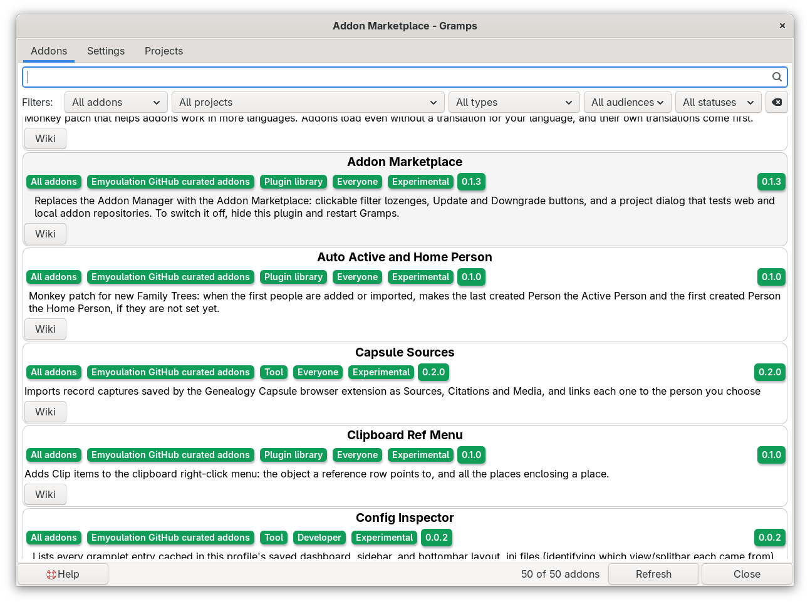

Experimental Addon plugins for Gramps open source Genealogy software
Install using the Addon Manager.

Most addons in this collection are filtered out when using the Addon Manager's default settings. Set the Status filter to "All statuses".

Addon Manager projects:
* `https://raw.githubusercontent.com/emyoulation/CuratedGrampsPlugins/master/gramps52`
* `https://raw.githubusercontent.com/emyoulation/CuratedGrampsPlugins/master/gramps60`
* `https://raw.githubusercontent.com/emyoulation/CuratedGrampsPlugins/master/gramps61`

### Gramplets
* **Data Entry Gramplet** - Key in a relative of the Active Person, with their birth, death and other events and sources, on one form instead of working through a dozen editing dialogs
* **Environment Inspector** - Developer reference gramplet showing the current locale, the related locale settings and where each is set, a searchable, sortable table of all Gramps string constants, and a preview of other Gramps translations
* **Flat Filter** - Search for people by their name parts and by relative names, with a choice of Fuzzy (phonetic) matching systems
  * Rule: `Flat Filter rule` - Used by custom filters saved with the Define filter button of the Flat Filter gramplet
* **Fuzzy Matching** - Find people in the Family Tree whose surname phonetically matches a given surname, using a cached per-tree index so it stays fast on large Family Trees
  * **Fuzzy Match API** - Library letting other addons do phonetic surname matching and open a quick "does someone like this already exist" lookup window
* **Localized Gramps Glossary Terminology** - Localized index to Gramps Glossary terminology
* **Metadata Inspector** - View the metadata of a Media object: embedded in the file (Exif, IPTC, XMP, PDF, audio/video tags), in its XMP sidecar, and recorded in the current tree
* **Note Styling Editor** - View and strip StyledText markup (bold, color, links, etc.) from a selected Note, or the first Note attached to the active record in any other note-holding category (Citation, Person, Family, Event, Place, Source, Repository, Media)
* **PDF Field Mapper** - Map the form fields of a PDF Media object to GEDCOM-style names, reorder the tab sequence, and embed the mapping in the PDF
* **Photo Tagging** - Tag people in photos (features Metadata import and use)
* **Virtual Keyboard** - Touch-friendly on-screen keyboard for clipboarding characters
* **What's Next** - Gramplet suggesting items to research

### Views, Reports and Quick Views
* **Fuzzy Grouping** - Person view grouping everyone in the Family Tree by phonetically similar family names
* **Complete Individual Report (Sorted)** - A complete report on the selected people, sorted by surname, given name and birth date
* **Biography - Complete** : Display a more extensive biography, combining the events, families, and other details of the Complete Individual Report with the narrative style of the Biography quick view

### Tools
* **Addon Pack and Ship** - Packaging and distribution of **Addon&nbsp;Manager-ready** Gramps addon plugin packages and listings for GitHub publishing
* **Capsule Sources** - Imports record captures saved by the Genealogy Capsule browser extension as Sources, Citations and Media, and links each one to the person you choose
* **Config Inspector** - Lists every gramplet entry cached in this profile's saved dashboard, sidebar, and bottombar layout .ini files (identifying which view/splitbar each came from), and can flush all of them at once so every view rebuilds its gramplet layout fresh from the currently registered plugin data
* **Pruned Branch** - Limit views, filters, tools and reports to one branch of the Family Tree for an editing session (prototype; Gramps 6.0 and newer)
* **Translation Updater** - Downloads newer Gramps and addon translations for chosen languages, without changing addon versions
  * **Tip of the Day Fix** - Shows the paragraph breaks in Tip of the Day correctly and stops the GTK markup warnings caused by unexpected tip formatting

### Interface improvements (monkey patches)
* **Addon Locale Fix** - Helps addons work in more languages: addons load even without a translation for your language, and their own translations come first
* **Addon Marketplace** - Replaces the Addon Manager with clickable filter lozenges, Update and Downgrade buttons, and a project dialog that tests web and local addon repositories
* **Auto Active and Home Person** - For new Family Trees: when the first people are added or imported, makes the last created Person the Active Person and the first created Person the Home Person, if they are not set yet
* **Clipboard Ref Menu** - Adds Clip items to the Clipboard right-click menu: the object a reference row points to, and all the places enclosing a place
* **Edit Attributes Plus** - Resizable Attribute Editor with a multi-line Value field, plus multi-column type popups and "Add a gramplet" menus for the sidebar, bottombar and Dashboard
* **Edit Date Calculator** - Adds a slide-out Date Calculator panel (with preview calendar sheets) to the Edit Date dialog; open it with the triangle tab on the right edge of the dialog
* **Idle Hidden Bars** - A hidden sidebar or bottombar does no work: its gramplets stop updating while the bar is hidden and catch up when it is shown again; undocked gramplets keep updating
* **Import with No Tree Loaded** - Makes Family Trees > Import... work when no Family Tree is loaded, by creating a new Family Tree named after the imported file
* **PR2296 Live Preferences** - Applies the Date format, Age display precision, Display ages for events after death, and Navigator text label Preferences without restarting Gramps, with date format examples in Preferences (Gramps PR 2296)
* **PR2388 Example Tree Prompt** - On startup, offers to import a practice Family Tree from the sample data included with Gramps, then shows the Dashboard with a To Do note to get started (field-test port of Gramps PR 2388)
* **PR2485 Edit Person Tweaks** - New/Edit Person dialogs remember Multiple Surnames column widths (Gramps PR 2485), add a ready-to-type row when switching to Multiple Surnames, and offer a Fuzzy Match Lookup button beside the Surname field when Fuzzy Matching is installed
* **Strict PyGObject Compatibility** - On systems with PyGObject 3.56 or newer, prevents crashes such as the Place Details gramplet "Must be string" error (Gramps 5.2 and 6.0)
* **Theme preferences (Themes2)** - An addition to Preferences for simple Theme and Font adjustment, especially useful for Windows users, with a layered CSS theming system of CSS Themes, CSS Patches, and a personal user override
* **Undocked Gramplets** - Gives gramplets undocked from a sidebar, bottombar or the Dashboard a Dock button, makes the title bar close button really close the gramplet, and uses the smart Help button of Markdown Utils

### Markdown viewing utilities
* **Markdown Utils** - Shared library for smart Help buttons that view locally stored README.md files in GitHub Flavored Markdown format; installs these companions:
  * **Markdown Dash** - Dashboard gramplet to view formatted Markdown (.md) files
  * **Plugin Manager plus** - Plugin Manager with fault-tolerant addon listing import and a locally cached wiki addon catalog (with thumbnails)
  * **Icon Browser** - Browse the icons available in the current GTK/Gramps theme, with every available size and the Markdown Dash syntax for embedding each icon

### Custom filter rules
* **Fuzzy (phonetic) name rules** - Match people with a name field having the same phonetic encoding as a test name:
  * Rule: `Soundex match of People with the <names>`
  * Rule: `Metaphone match of People with the <names>`
  * Rule: `Double Metaphone match of People with the <names>`
  * Rule: `NYSIIS match of People with the <names>`
  * Rule: `MRA match of People with the <names>` (Match Rating Approach)
  * Rule: `D-M match of People with the <names>` (Daitch-Mokotoff)
  * Rule: `Phonex match of People with the <names>`
  * Rule: `Phonex (French) match of People with the <names>`
  * Rule: `Soundex Custom match of People with the <names>`
* **Date Modifiers rules** - Valid dates by Type and Quality, or invalid (Text only) dates by text:
  * Rules: `Event Date Modifiers`, `Citation Date Modifiers`, `Media Date Modifiers`
* Rule: **`Events with participants in the <role>`** - Matches events in which a person or family takes part in the selected role
* **Immediate Family rules**:
  * Rule: `People in the immediate families of <anchor>` - Parents, siblings, spouses, children, in-laws and associations of a person or family
  * Rule: `Families in the immediate families of <anchor>` - The families of a person or family, as child or as parent, and the families of the people in those families
* **Role Reversal rules** - Reverse lookup of shared events where others hold a specified role (for example, Godparent):
  * Rules: `Person Role Reversal`, `Family Role Reversal`

### Importers, Exporters and Thumbnailers
* **Importer and Exporter: vCard (Enhanced — v1/2.1/3.0/4.0)** - Contacts in vCard (.vcf) files; embedded photos become Media objects, relationships become Associations, and unhandled properties are kept as Person attributes
* **Importer and Exporter: Comma Separated Values Spreadsheet (CSV) — Enhanced** - CSV import and export that includes events, citations, and media (Gramps 6.0 and newer)
* **WebP Thumbnailer** - Dedicated thumbnailer for WebP format images
