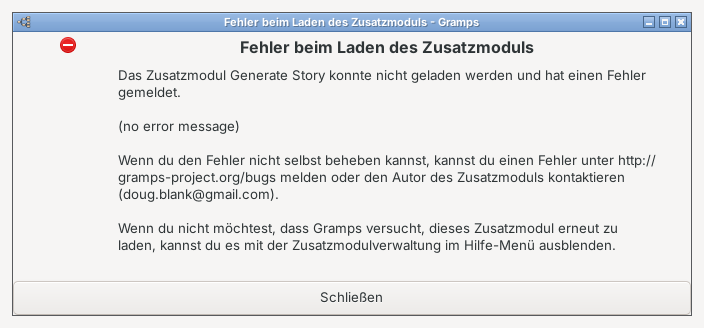
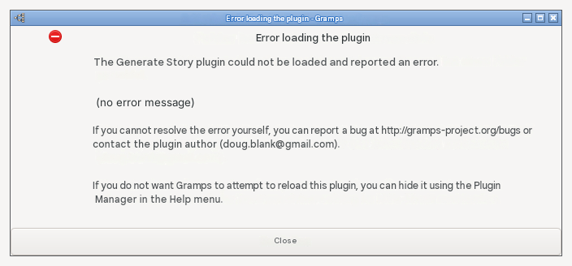

# Addon Locale Fix
## Screen captures to take (remove this list before release)

Gramps can show its menus and windows in many languages. But some addons do not start when Gramps uses a language other than English. Other addons start, but show some words that are not the words their translators chose. Addon Locale Fix is a small **monkey patch** that fixes both problems. After you install it, more addons work in more languages.



If it were possible for the dialog to appear when Gramps was running in English, the above would read: 


## Do I need it?
You probably need it if all of these are true:

- You use Gramps in a language that is not English.
- An addon you had installed (along with any required prerequisites) does not appear in the menus after restarting Gramps, or does not work.
- When you start that addon, you see a window called **Failed Loading Plugin**. Or, if you start Gramps from a terminal, you see a line like this one:

```
Plugin error (from 'ChatWithTree'): No usable translations in de for addon
```

The two letters after "in" are your language. For example, `de` is German, `fr` is French and `nl` is Dutch.

You may also want it if an addon shows the wrong word for something, and the translators of that addon chose a better word.

To see a list of the addons that have these problems in your language, use Environment Inspector. See [Find the addons that have language problems](#find-the-addons-that-have-language-problems) below.

If you use Gramps in English, you do not need this fix. It does no harm, but it also changes nothing for you.

## A message that is not a problem
In the terminal, you may also see a line like this one:

```
WARNING: Plugin EnvironmentInspector has no translation for any of your configured languages, using US English instead
```

This is not an error. The addon works. It shows its words in English, because nobody has translated it into your language yet. Addon Locale Fix cannot hide this line, because Gramps writes it before any addon starts.

## What it does
Each addon can bring its own translations. Gramps looks for them when the addon starts.

Without the fix, two things can go wrong:

1. **The addon does not start.** If the addon has no translation for your language, Gramps stops the addon with an error. It does not use English instead.
2. **The addon uses the wrong words.** If Gramps and the addon both translate the same word, Gramps always uses its own translation. The translation from the addon is ignored.

With the fix:

1. If the addon has no translation for your language, the addon still starts. It shows its words in English.
2. If the addon has a translation for a word, that translation is used first. Gramps translates the other words.

The fix does not change any files. It only changes how Gramps behaves while it is running. If you remove the fix, Gramps works as it did before.

## How to install
Addon Locale Fix is part of the Emyoulation collection of addons. The first time, you add this collection to the Addon Manager. If you already use addons from this collection, start at step 4.

1. Open Gramps. Choose **Edit > Addon Manager**.
2. Open the **Projects** tab. Click the **+** button.
3. For **Project name**, type `Emyoulation curated addons`. For **URL**, copy the line for your Gramps version:
   - Gramps 6.1: `https://raw.githubusercontent.com/emyoulation/CuratedGrampsPlugins/main/gramps61`
   - Gramps 6.0: `https://raw.githubusercontent.com/emyoulation/CuratedGrampsPlugins/main/gramps60`
   - Gramps 5.2: `https://raw.githubusercontent.com/emyoulation/CuratedGrampsPlugins/main/gramps52`
4. Open the **Addons** tab. Set the filters to **All audiences** and **All statuses**.
5. Find **Addon Locale Fix** in the list. Click **Install**.
6. Close Gramps and start it again.

That is all. The fix starts by itself every time Gramps starts. It has no window and no settings.

## Find the addons that have language problems
The [Environment Inspector](https://github.com/emyoulation/CuratedGrampsPlugins/blob/main/gramps61/source/EnvironmentInspector/README.md) addon can show you which of your addons have problems in your language. It is in the same collection as Addon Locale Fix.

1. Install **Environment Inspector** with the steps in [How to install](#how-to-install). In step 5, choose **Environment Inspector**.
2. In the Navigator on the left, click **Dashboard**.
3. Right-click an empty part of the Dashboard. Choose **Add a gramplet**, then **Environment Inspector**.
4. Open the **Language** tab. Look at the **Addons** line at the bottom of the **Current Locale** panel.

The **Addons** line counts your addons in three groups. Click **addon check** to see the names. A list opens in your text editor. The list is in English. It has these parts:

- **ADDONS THAT DO NOT LOAD IN THIS LANGUAGE.** Gramps skipped these addons. Addon Locale Fix makes them load, in English.
- **No translation, shown in English.** These addons work, but they need a translation for your language. Many addons are translated on [Weblate](https://hosted.weblate.org/projects/gramps-project/addons/). If you know your language well, you can help there.
- **Translated.** These addons work in your language.

After you install Addon Locale Fix and start Gramps again, the first part is gone. Click **Refresh** on the **Addons** line to check again at any time.

If you do not see the **Addons** line, update Environment Inspector with the Addon Manager. If you use Gramps in English, the line is not shown, because every addon works in English.

## How to check that it works
Open the addon that did not work before. If it opens now, the fix works.

In Environment Inspector, the **Addons** line no longer shows a warning sign.

You can also choose **Help > Plugin Manager** and look for **Addon Locale Fix** in the list.

## How to remove it
1. Choose **Help > Plugin Manager**.
2. Find **Addon Locale Fix** and hide it, or remove its folder from your Gramps plugins folder.
3. Close Gramps and start it again.

## Works well with Translation Updater
Translation Updater is another addon. It downloads new translations for Gramps and for your addons. The two addons work together, and you can install them in any order.

## Which Gramps versions
Addon Locale Fix is made for every Gramps version that has addons, from Gramps 4.0 to Gramps 6.1. It was tested with Gramps 4.2, 5.1 and 6.0.

## For addon developers
Many addons call `glocale.get_addon_translator(__file__)` inside `try` and `except ValueError`. That protects the addon from problem 1. Please keep that code. Not every user has this fix.

This fix also makes the `languages` argument of `get_addon_translator()` work for the Gramps part of the translation in Gramps versions before 5.2. Reports that you write in another language can use it.

If your addon also changes `get_addon_translator()`, please set `__wrapped__` on your function and call the original through it. Then Addon Locale Fix can work under your change. If you do not, the fix still prevents the crash, but your change keeps the old order of translations.

The addon check of Environment Inspector finds the modules that call `get_addon_translator()` without `try` and `except ValueError`, with the file name and line number.

## Assumptions I made
- The name is Addon Locale Fix (folder, files and plugin id `AddonLocaleFix`).
- The fix is always on. There are no settings, so there is no `.ini` file.
- The translation that comes with an addon should come before the Gramps translation. When the two are in different languages, the old order is kept, so one sentence never mixes two languages.
- Two pictures are enough: the problem, and where to find the Addons line. The fix has no window of its own.
- Addon Locale Fix is published in the Emyoulation collection, next to Environment Inspector and Translation Updater.
- Users install it with the Addon Manager in Gramps 5.2 and newer. Users of older Gramps versions install addons by hand and need no steps here.
