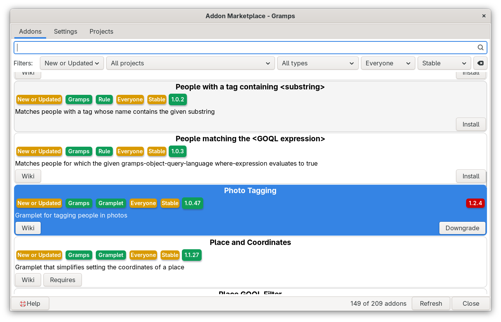
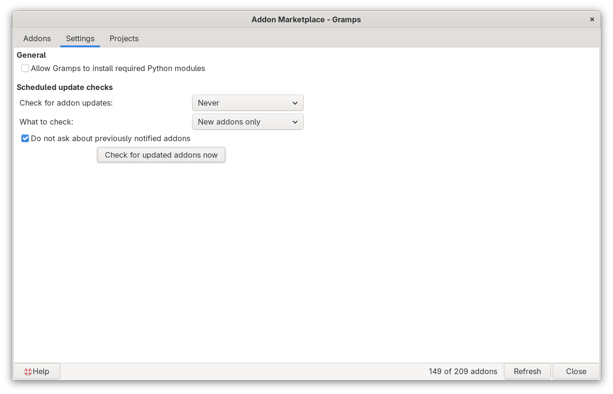
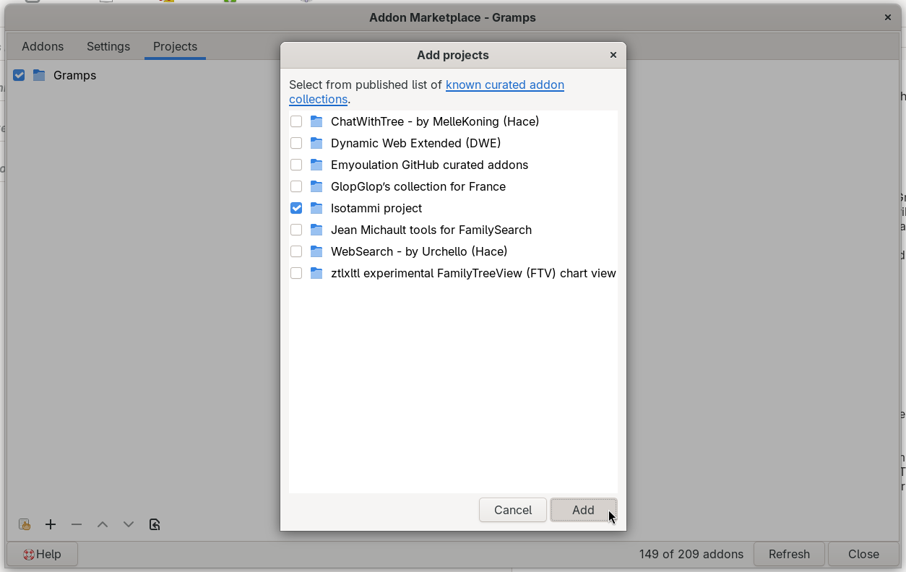
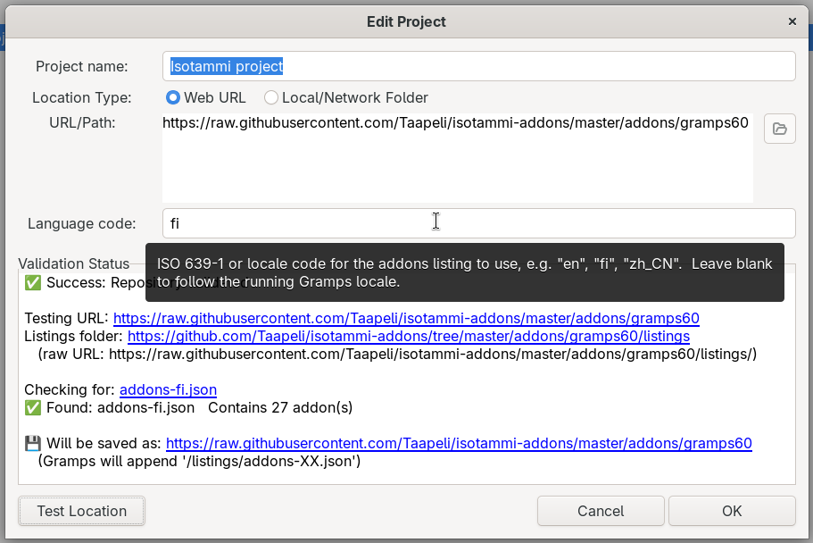

# Addon Marketplace
<!-- edit=False status=True browse=False undocked=True -->
[README.md](README.md) ● [CHANGELOG.md](CHANGELOG.md)

Addon Marketplace is a friendlier way to find, install and update Gramps addons. It takes the place of the Addon Manager window, so you open it from the same menu item. Everything you know from the Addon Manager is still there, with some helpful extras:
- **clickable labels** on every addon, so one click shows only addons of the same project, type, audience or status,
- a list that starts with the addons that are **new or have an update**, and a count of how many addons are shown,
- clear **Update** and **Downgrade** buttons that tell you whether the version offered is newer or older than the one you have,
- a **warning bar** that names any addon project that could not be loaded, and says why,
- messages that **tell you what to do** when the list is empty, with a button that clears all the filters,
- a **list of known addon collections** that you can add to your projects with a few clicks,
- a **project dialog** that tests an addon project address before you save it, fixes common address mistakes for you, and can read a project in another language.



The addon makes these changes when Gramps starts, without changing any Gramps files, so you can switch it off at any time. It is for field testing, so please report problems and ideas.

## Contents
- [Install](#install)
- [Open the Addon Marketplace](#open-the-addon-marketplace)
- [The Addons tab](#the-addons-tab)
- [The Settings tab](#the-settings-tab)
- [The Projects tab](#the-projects-tab)
- [The Help button](#the-help-button)
- [Where the settings are kept](#where-the-settings-are-kept)
- [If something does not work](#if-something-does-not-work)
- [Limits](#limits)
- [Turn the addon off](#turn-the-addon-off)
- [Credits](#credits)
- [AI disclosure](#ai-disclosure)
- [Assumptions I made (draft review)](#assumptions-i-made-draft-review)

## Install
Install the addon with the Gramps Addon Manager, from the [Emyoulation curated Gramps plug-ins](https://github.com/emyoulation/CuratedGrampsPlugins/) project. If that addons project is not in your Addon Manager yet, add it as the project page describes. Restart Gramps after you install the addon.

Addon Manager projects URLs:
* `https://raw.githubusercontent.com/emyoulation/CuratedGrampsPlugins/master/gramps52`
* `https://raw.githubusercontent.com/emyoulation/CuratedGrampsPlugins/master/gramps60`
* `https://raw.githubusercontent.com/emyoulation/CuratedGrampsPlugins/master/gramps61`

## Open the Addon Marketplace
Choose **Edit > Addon Marketplace...** from the menu. Before the addon is active, this menu item is named "Addon Manager...". Only one Addon Marketplace window opens at a time: if it is already open, the menu item brings it to the front.

The window has three tabs: Addons, Settings and Projects. At the bottom are the **Help** button (at the left), a count such as "149 of 209 addons" (how many addons the filters show, of all the addons listed), and the **Refresh** and **Close** buttons.

The addon catalogs of your projects are downloaded when the window opens, and kept until you close it. **Refresh** downloads them all again, for example after a project has published new versions.

## The Addons tab
The Addons tab lists the addons of every project that is turned on in the Projects tab. Each addon shows its name, a row of labels (called lozenges), its description and its buttons. The list is sorted by addon ID.

### Search and filters
Type in the search box to show only the addons that contain that text in their name, description, ID or help address, or in the names and e-mail addresses of their authors and maintainers, when the catalog lists them.

The filter menus below the search box narrow the list by installed state, project, type, audience and status. The installed state filter offers All addons, Not installed, Installed, Updates, and **New or Updated**, which shows the addons that you do not have yet and the addons with a different version available. New or Updated is the filter when the window opens.

The broom button at the end of the filter row resets the filters to their defaults. The defaults show all addons for **Everyone** with the status **Stable**, so addons for experts or developers, and Beta or Experimental addons, are hidden until you change those filters.

When you change a filter, the selected addon stays selected and the list scrolls to keep it in view.

### The lozenges
The first lozenge of every addon shows the installed state filter, for example "New or Updated". It is gold while that filter is set. Click it to show all addons again.

The next four lozenges show the project, type, audience and status of the addon. They are buttons:
- Click a green lozenge to filter the list by that value. For example, click "Gramplet" to see only gramplets. The lozenge turns gold to show that it is the active filter.
- Click a gold lozenge to clear that filter again.

The next lozenge shows the **repository version**, the version that the project offers. If the addon is installed, an **installed version** lozenge appears at the right end of the row:
- **Green**: the installed version is the same as the version offered.
- **Dark gold**: the version offered is newer. An **Update** button is shown.
- **Red**: the version offered is older than the installed version, for example after you installed a test version yourself. A **Downgrade** button is shown, which installs the older version offered.

A dark gold or red installed version lozenge is a button too: click it to show only addons that have a different version available.

### The addon buttons
- **Install** installs the addon, and any Python modules it needs if you allowed that on the Settings tab. Addons that the addon depends on are installed first, when their project lists that information.
- **Update** and **Downgrade** replace the installed addon with the version offered. If the download fails, a message shows the address that was tried.
- **Wiki** opens the help page of the addon.
- **Requires** lists what the addon needs that is missing, such as a Python module or a program.

Sometimes Gramps cannot use an addon after it is downloaded, almost always because the addon was made for another Gramps version. A message then asks whether to **keep the files**, so that you can adapt the `.gpr.py` registration file of the addon yourself, or to **remove the files**.

### When something is wrong
If an enabled project gave no addons, a yellow warning bar appears above the list. It names each such project, its address and the reason, for example "catalog not found (404)" or "a GitHub page, not a catalog". You can select and copy the text of the bar. The bar has these buttons:
- The **light bulb** at the left opens the Gramps Warnings dialog, with the details that Gramps wrote down about the problem.
- **Certificate help** appears when the security certificate of a project could not be checked. Its tooltip explains the problem, and the button opens a web page about fixing it.
- **Open Projects tab** takes you to the project, so you can fix the address.

When no addons show in the list, a message tells you why and what to do:
- **No projects are turned on**: turn on a project on the Projects tab.
- **No addon catalogs could be loaded**: check the project addresses, then click Refresh.
- **None of the addons listed match the filters**: click **Clear all filters**. This sets every filter to "All" and empties the search box, so every addon shows. (The broom button instead goes back to the default filters, which can still hide everything, for example when a project offers only Experimental addons.)

## The Settings tab
The Settings tab is the same as in the Addon Manager, and changes here also apply to the Addon Manager:



- **Allow Gramps to install required Python modules**: lets the Install button install the Python modules an addon needs.
- **Check for addon updates** and **What to check**: how often Gramps checks for new and updated addons when it starts, and which kind.
- **Do not ask about previously notified addons**: skips addons that Gramps already told you about.
- **Check for updated addons now**: checks at once, using the language codes of your projects.

## The Projects tab
The Projects tab lists the addon projects (the places addons come from). Each project shows a check box, a folder icon and the project name:
- The **check box** turns the project on or off. The Addons tab shows the change a moment later. A project that was already loaded shows again at once, without a new download.
- **Double-click the folder icon** to open the home of the project: the GitHub repository for a project on GitHub, or else the folder one level above the project folder, in your web browser or file manager. The tooltip of the icon shows where it goes.
- **Double-click the name**, or the empty part of the row, to edit the project.

The buttons below the list are, from the left:
- **Add projects from the list** (the index card icon): opens the list of known addon collections, described below.
- **Insert a project** (**+**): opens an empty project dialog.
- **Remove**, **move up** and **move down** the selected project. The first project, Gramps, cannot be removed or moved.
- **Revert to the project defaults**: goes back to the Gramps project only.

### Include English
The **Include English** check box at the top appears when Gramps uses another language than English, or when a project has another language code. Turn it on to also load the English catalog of each project that is read in another language, so that you can search the English names and descriptions too. Those addons show the project name followed by "+ en", and the Project filter has an entry for each of them.

### The list of known addon collections
The index card button opens the **Add projects** dialog. It lists the known curated addon collections that are not in your project list yet. The link at the top opens the published list of known curated addon collections on the Gramps Discourse forum.



Check the projects you want, then click **Add**. The projects you add are turned on. Each project has a folder icon too: double-click it to look at the project on GitHub before you add it. The list comes from the `gramps.ini` file in the `media` folder of the Addon Marketplace. It is read again each time you open the Projects tab and each time you click the button, so a changed list shows at once. When every project in the list is already in your project list, the button is dimmed.

### The project dialog
Double-click a project, or click the **+** button, to open the project dialog:



- **Project name**: any name you like. It is shown on the Project lozenge of each addon.
- **Location Type**: **Web URL** for an address on the internet, or **Local/Network Folder** for a folder on your computer or network. For a folder, the **Browse** button next to the address box lets you pick it.
- **URL/Path**: the address of the project. It is the folder that holds the `listings` folder, not the `listings` folder or a catalog file itself.
- **Language code**: the language of the catalog to use for this project, such as `fi` or `zh_CN`. Leave it empty to use the language of Gramps. If the project has no catalog in that language, the English catalog is used.

Click **Test Location** to check the address. The Validation Status box shows what was found, such as how many addons the catalog lists, and the address that will be saved. The blue addresses, folders and file names in that box are links: click one to open it in your web browser or file manager. Testing is optional: **OK** saves the project even without a test, so you can add a project while you are offline.

If the security certificate of the address cannot be checked, the test shows a warning with advice about fixing it, but you can still save the project.

### Addresses that are fixed for you
When you test or save a project, the dialog changes some common mistakes into the address that Gramps needs, and shows you the result:
- A **GitHub web page** address, for example `https://github.com/name/repository/blob/main/gramps60/listings/addons-en.json`, becomes the address of the files themselves: `https://raw.githubusercontent.com/name/repository/main/gramps60`. This works for file pages, folder pages and download links. The front page of a repository becomes an address for its default branch, but you still need to add the folder for your Gramps version, such as `gramps60`.
- A **catalog file or listings folder** at the end of the address, such as `listings/addons-en.json`, is removed, because Gramps adds it itself.
- A **folder path** typed or pasted from your file manager, such as `C:\Users\Name\addons\` or `/home/name/addons`, becomes a `file:///` address.
- A **slash at the end** of the address is removed.

## The Help button
The Help button at the lower left opens this document in Markdown Dash, when Markdown Dash is installed and active. Otherwise it opens the web page of this addon.

## Where the settings are kept
The project names, addresses and check boxes are kept in the `gramps.ini` file of Gramps, as for the Addon Manager. The language code of each project and the Include English setting are kept in the `AddonMarketplace.ini` file, next to the addon in your Gramps plugins folder.

## If something does not work
- **The menu item still says "Addon Manager..."**: the new name appears the next time Gramps rebuilds its menus, for example when you change to another view or restart Gramps. The window that opens is already the Addon Marketplace.
- **A Python module will not install**: Gramps installs modules into the `lib` folder of your Gramps plugins folder. If the installation fails, the error message shows what went wrong. You can also install the module into that folder yourself.
- **A project shows in the warning bar**: test its address in the project dialog. The Validation Status box gives more detail than the warning bar, and the light bulb on the bar shows what Gramps wrote down.
- **A new addon version does not show**: click Refresh, because the catalogs are kept until the window closes.
- When you report a problem, please include the messages that Gramps shows in the terminal window, and one line about what you did just before.

## Limits
- The window size and the settings on the Settings tab are shared with the Addon Manager.
- To find the reason a project failed, the addon reads the English catalog of that project a second time, because Gramps itself only writes the error to the terminal. A project that offers only a catalog in another language can show "catalog could not be read in this language".
- The catalogs published today do not list authors or maintainers, so searching for a person finds nothing yet.
- Installing Python modules without pip (in the all-in-one Windows installer or a Flatpak) is possible only on Gramps 6.1 and newer, as in the Addon Manager.
- The texts of the addon are not translated yet. Texts it shares with the Addon Manager show in your language.

## Turn the addon off
To switch the addon off without removing it, open the Plugin Manager, hide "Addon Marketplace", and restart Gramps. The menu item then opens the Addon Manager again. To remove the addon, use the Addon Manager.

## Credits
- The Addon Marketplace is built on the Addon Manager of Gramps, by the Gramps developers.
- Addon by Brian McCullough.

## AI disclosure
This addon was substantially written with an AI tool, as the Gramps [AI generated code policy](https://www.gramps-project.org/wiki/index.php/Howto:_Contribute_to_Gramps#AI_generated_code) asks contributors to disclose.
```
Generated-by: Claude Sonnet 4.6 (claude-sonnet-4-6), Claude Sonnet 5 (claude-sonnet-5) and Claude Opus 5.5 (claude-opus-5-5), Anthropic, via the claude.ai chat interface, 2026
Prompted by: Brian McCullough
```
- **Prompts (summary):** first an enhanced project dialog and Update/Downgrade handling inside a changed copy of the Addon Manager file of Gramps 6.0, and in a later copy the Validation Status links, the language code, Include English, the certificate handling, the addon count and the New or Updated filter; then the first copy turned into a monkey-patch addon named Addon Marketplace for Gramps 5.2 to 6.1, with its own lozenge style sheet; then a Help button that opens this README, messages that tell the user what to do when the Addons tab is empty, a warning bar for projects that could not be loaded, conversion of GitHub web page addresses, the list of known addon collections, the folder icons of the projects, the features of the later copy, one window at a time, and catalogs that are kept instead of downloaded again after each change.
- **Guidelines:** written in "draft mode", so the Gramps [AGENTS.md](https://github.com/gramps-project/gramps/blob/master/AGENTS.md) style rules (type hints, Black, pylint and others) were not fully applied.
- **Testing:** the AI checked the addon with the source code of Gramps 5.2 and 6.1 in a simulated display, with live addon projects on GitHub. Brian McCullough tested the user interface on Gramps 6.0.

## Assumptions I made (draft review)
This section is for review while the addon is in draft. Remove it before release.
- The menu item is renamed "Addon Marketplace..." as well as the window. If the name should stay "Addon Manager..." in the menu, that is a small change.
- The README describes the Edit menu, which is where the menu item is in Gramps 5.2 to 6.1.
- The Settings tab and the window size stay shared with the Addon Manager, so switching the addon off loses nothing.
- The lozenge colors are described by name (green, gold, dark gold, red), as they look in the default theme. A dark theme can change the red, because it comes from the theme.
- I called the button with the index card icon "Add projects from the list", after its purpose. Its tooltip says "Add projects from the gramps.ini file of the Addon Marketplace".
- The Help button falls back to the GitHub folder of the addon, which only works after the addon is committed to the repository.
- "Report problems" has no link yet: I assumed you will start a Gramps Discourse thread, as for other field-test addons.
