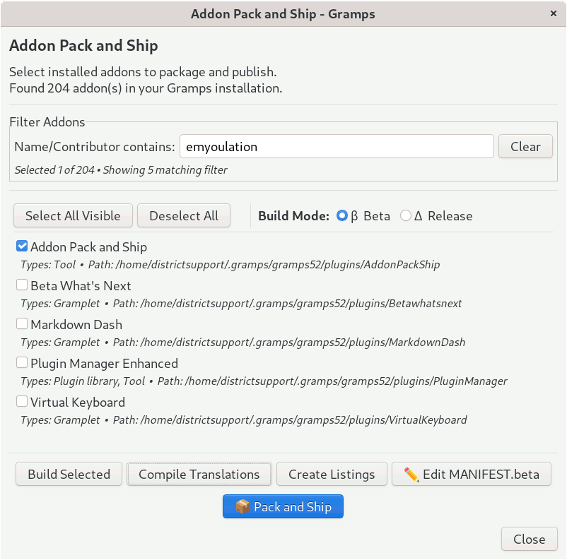
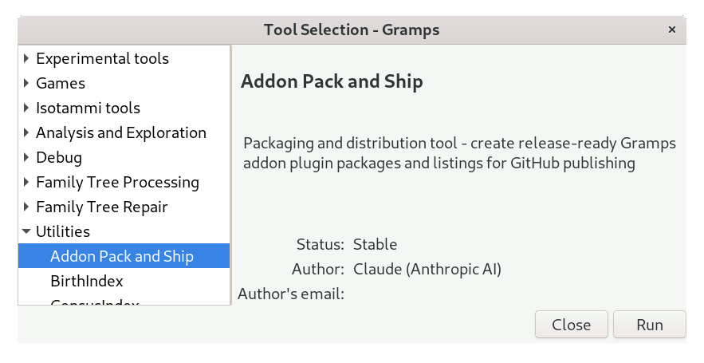
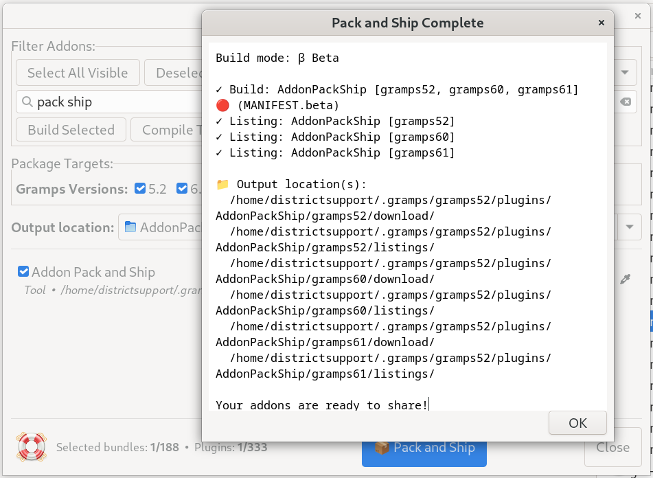
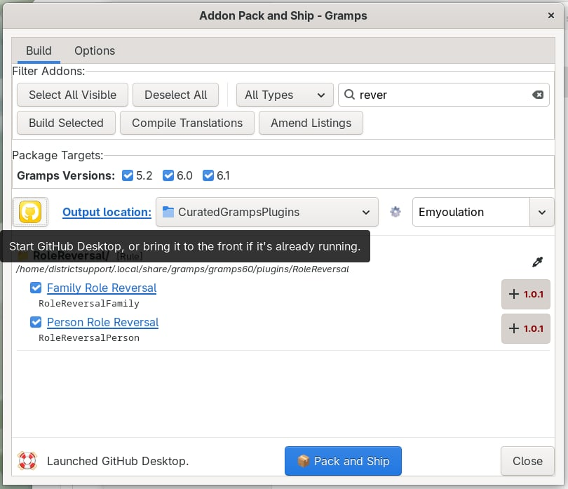

# AddonPackShip — Gramps Addon Packaging Tool
[**QuickStart.md**](QuickStart.md) ● [**README.md**](README.md) ● [**Change Log**](CHANGELOG.md)

**For Gramps 5.2+** desktop genealogy software — packages for one or several installed Gramps versions at once

Package your Gramps addons for distribution with a simple checkbox interface. Create release-ready `.addon.tgz` files and JSON listings for GitHub publishing in seconds.


---

## What This Tool Does
**AddonPackShip** packages finished Gramps addons for sharing:

✅ **Build** — Creates `.addon.tgz` packages from installed addons, for one or more Gramps versions at once
✅ **Compile** — Compiles translation files (`.po` → `.mo`), generates `template.pot` if missing
✅ **Amend Listings** — Adds/updates JSON metadata for the Addon Manager
✅ **Pack and Ship** — One-click build + listing for GitHub upload
✅ **Per-Addon MANIFEST Editor** — Folder icon button on each addon row/bundle opens a file chooser/editor
✅ **Per-Addon Version Bump** — Click the version tag of an addon to flag a patch-version bump on its next build
✅ **Named Configurations** — Save and reload your build mode, target versions, output folder, filters, and selections by name
✅ **Built-in Documentation** — Help icon opens this README directly, no browser required (when Markdown Dash is installed)
✅ **Progress window** — long operations show each step as it runs, so Gramps stays responsive
✅ **Session Logs** — a button on the **Options** tab opens the `logs/` folder: a plain-text record of the exact command each action ran, for learning how the `make.py` build scripts work (see [Learning from the Session Logs](#learning-from-the-session-logs))
✅ **GitHub Desktop button** — when GitHub Desktop is installed, an icon next to **Output location** starts it or brings it to the front, ready to publish what you just packaged (see [Publishing with GitHub Desktop](#publishing-with-github-desktop))

**a tool to help with sharing, not for developing code** — use this when your addon is ready to share. For active development, use your preferred text editor.

---

## Installation
**Via Addon Manager** (Recommended):

1. Open Gramps → **Edit** → **Addon Manager**
2. Go to the **Projects** tab
3. Add (if not already present) and select the **Emyoulation GitHub curated addons** URL from the **Project** tab:
   `https://raw.githubusercontent.com/emyoulation/CuratedGrampsPlugins/main/gramps60`
   (For english GUIs, opens: [/listings/addons-en.json](https://raw.githubusercontent.com/emyoulation/CuratedGrampsPlugins/main/gramps60/listings/addons-en.json) ) 
4. Select the **Emyoulation GitHub curated addons** checkbox
5. Click **Refresh**
6. Find **Addon Pack and Ship** under the **Expert** Tools category type
7. Click **Install**
8. Restart Gramps (not strictly necessary)

The tool then appears under **Tools** → **Utilities** → **Addon Pack and Ship**


### Translation tools (gettext)
**Compile Translations** needs two programs from the GNU gettext package: `xgettext` (makes `po/template.pot`) and `msgfmt` (compiles each `po/<lang>-local.po` into a `.mo` file). When either one is missing, the button is dimmed and reads **xgettext missing** (or **msgfmt missing**). Building and listing still work without them, but no translations are compiled.
- **Fedora**: `sudo dnf install gettext`
- **Debian / Ubuntu / Linux Mint**: `sudo apt install gettext`
- **macOS** (Homebrew): `brew install gettext`
- **Windows**: download and run the installer from https://mlocati.github.io/articles/gettext-iconv-windows.html, and allow it to add gettext to the `PATH`.

To check, open a terminal and run `xgettext --version`. After installing on Linux or macOS, close and reopen Addon Pack and Ship so it finds the tools. On Windows, restart Gramps instead, because a running program does not see the changed `PATH`.

---

## Quick Start
### First Use
1. **Tools** → **Utilities** → **Addon Pack and Ship**

2. Select addon(s) with checkboxes
3. Check that the build mode is **β Beta** (the default, on the **Options** tab), which includes translation source files
4. Check which **Gramps Versions** to package for under **Package Targets:** — the version you are currently running is pre-checked for you
5. Click **📦 Pack and Ship**
6. Upload the generated `gramps52/` (and/or `gramps60/`, etc.) folder(s) to GitHub

Your addon is ready to share! The settings you used are saved automatically the first time you run this tool, under a configuration named **default**, so they are ready to reuse next time — see [Named Configurations](#named-configurations) below.

---

## Interface Overview
### Filter Addons Frame (always visible)
The **Filter Addons** frame at the top contains all controls that stay visible while the addon list scrolls:

- **Select All Visible** / **Deselect All** — checkbox selection helpers (apply to whatever the current filters show)
- **Type filter** dropdown — narrow the list to one plugin type (VIEW, GRAMPLET, TOOL, REPORT, GENERAL, etc.), or choose **Selected** (just below **All Types**) to show only the plugins that are checked. A plugin you uncheck while **Selected** is shown stays in the list until the filter is applied again.
- **Search bundles and plugins…** — a live search box (with a built-in ✕ clear button), on the same row as the selection buttons and the type filter, that matches across every plugin field: name, type, id, path, authors, version, category, and more
- **Build Selected**, **Compile Translations**, **Amend Listings** — individual operation buttons

### Package Targets Frame
Directly below the addon filters, the **Package Targets** frame controls which installed Gramps releases to build and list packages for:

- **Gramps Versions** — one checkbox per bundled packaging script (e.g. `5.2`, `6.0`). Check as many as you want to target in one pass; the same `.addon.tgz` is reused across every checked version, so nothing is rebuilt twice. By default, only the Gramps version you are currently running is checked — tick additional boxes to also package for other installed versions.

> ⚠ **Check more than one Gramps Version only for addons with an adaptive `.gpr.py`.** Packing an addon whose `.gpr.py` has no version check for several Gramps versions lists it in every one of them as compatible, although it was written for one version. Users of the other versions can then install an addon that fails to load or does not work. Addon Pack and Ship warns and asks before it does this. See [Packing for Several Gramps Versions](#packing-for-several-gramps-versions).


### Options Tab
Settings that change rarely are on the **Options** tab, in three frames:
- **Build Mode:** — **β Beta** (default) or **Δ Release** (see [Build Modes](#build-modes)).
- **Listings:** — see [Listings Options](#listings-options) below.
- **Maintenance:** — **Update Scripts…** fetches the latest packaging scripts from `gramps-project/addons-source` on GitHub, refreshing your bundled copies (with a timestamped backup kept) and offering to add a script for any newly released Gramps version not yet bundled here. It needs an internet connection; existing bundled scripts keep working offline. **Session Logs** opens the `logs/` folder (see [Learning from the Session Logs](#learning-from-the-session-logs)).

### Listings Options
The **Listings:** frame (on the **Options** tab) holds:
- **Multilingual** — decides whether new language listings may be created. Whether it is on or off, every `addons-<lang>.json` that already exists in the listings folder is updated with the addons you select, using the translated name and description where a translation exists, and English otherwise. This keeps each published language catalog at the current version of every addon, even for addons that have no translation for that language.
  - **Off** (default): no new language listing is created. Only `addons-en.json` is created, when it does not exist yet.
  - **On**: a new `addons-<lang>.json` is created only when the name or description in the `.gpr.py` of the addon is actually translated into that language. A translation file (`po/<lang>-local.po` or a compiled `.mo`) alone is not enough, because it may not translate those two strings yet. The results dialog says which language files were created, and why any were not.
- **Translation:** language picker and **Edit translation…** button — opens the translation file of each selected addon in the chosen language (see [Translating an Addon](#translating-an-addon)). When Gramps runs in a language other than English, that language is chosen for you.
- **Duplicate into unverified/incompatible versions anyway** — off by default. It applies to addons with an adaptive `.gpr.py`: when off, such an addon is not packed or listed for a checked Gramps Version that its own version check rejects; when on, it is packed and listed for every checked version. Addons that are not adaptive are never packed for several versions silently, whatever this setting is: Pack and Ship always warns and asks first (see [Packing for Several Gramps Versions](#packing-for-several-gramps-versions)).
- **Remove untranslated listings…** — a button that, for every checked Gramps Version, finds each `addons-<lang>.json` in which every name and description is identical to `addons-en.json`. Such a file only repeats the English catalog: the Addon Manager already uses `addons-en.json` for any language without its own file. The files found are listed, and deleted only after you confirm. Files with any translated name or description are kept, and no `po/` or `locale/` translation files are touched. This is a separate action, not part of Pack and Ship, so nothing is deleted unless you ask.

- **Remove all language listings…** — a button next to **Remove untranslated listings…** that, for every checked Gramps Version, lists every `addons-<lang>.json` except `addons-en.json`, including files with translated names and descriptions, and deletes them only after you confirm. Files that contain translations are marked ⚠ in the list. Use it to return a listings folder to English only: listing runs never delete a language listing that already exists. No `po/` or `locale/` translation files are touched, and a later listing run with **Multilingual** on can create the language files again.

The first time you open AddonPackShip (before `APS.ini` exists), the window opens on the **Options** tab, so you can review these settings before your first build.

### Output Location & Named Configurations
Below Package Targets, one row combines where packages are written with saving/loading your settings:

- **GitHub Desktop icon** (shown only when GitHub Desktop is installed) — starts GitHub Desktop, or brings it to the front (see [The GitHub Desktop button](#the-github-desktop-button)).
- **Output location** — a link: click it to open the folder in your file browser. It is the parent folder under which the `download/` and `listings/` subfolders for each checked version are created. Defaults to the installation folder of this tool; pick something else (e.g. a local clone of the GitHub repository for your addon) if you want the generated files to land somewhere you can commit and push directly.
- **Suggested folder** dropdown (shown only if any are found) — local Git repository clones detected under common developer folders (e.g. `~/Documents/GitHub`); picking one fills in the Output location for you.
- **Configuration** name box and save icon — see [Named Configurations](#named-configurations) below.

### Named Configurations
AddonPackShip can remember a complete snapshot of your settings — build mode, checked Gramps Versions, output location, filters, and which addons are selected — under a name you choose, so you do not have to rebuild the same setup by hand each time:

- Type a name and press **Enter** (or click the save icon) to save the current settings under that name, overwriting it if it already exists.
- Pick an existing name from the dropdown to load it.
- Whichever configuration was active when you last closed this tool is restored automatically the next time you open it.
- On a fresh install, before you have saved anything, AddonPackShip automatically saves the settings from your very first session as a configuration named **default** — including the running-version-only Gramps Versions selection above — so there is always at least one ready to reload.

Configurations are stored in `APS.ini`, alongside the files of this tool — not in `gramps.ini`.

### Addon List (scrollable)
Each addon row (or, for addons that register several plugins in one folder, each bundle header) shows:
- A **checkbox** with the display name of the addon (bundles with multiple plugins list one checkbox per plugin beneath a shared header). The name is a link: click it to open the folder of the installed addon in your file browser, for example to reach its `po/` subfolder
- Small text showing type(s) and folder path
- A **version tag** (e.g. `1.2.3`) — click it to flag that addon for a patch-version bump (e.g. `1.2.3` → `1.2.4`) in its `.gpr.py` the next time it is built; click again to cancel
- A **📂 folder icon button** — click to create or open the MANIFEST/MANIFEST.beta for that addon in your text editor. For a bundle, this button is on the bundle header row, because one MANIFEST controls the whole folder, which becomes one `.addon.tgz`. The version tags are on the rows of the addons inside the bundle.

**Right-click menu.** Right-click anywhere in the addon list for two actions on the listing (`addons-en.json`) of one Gramps Version in the Output location (the menu names that version, for example Gramps 6.0):
- **Filter list to addons in Gramps 6.0's listing** — shows only the addons that this listing already contains. Then click **Select All Visible** to select exactly those addons, for example to rebuild everything you have published. Right-click again and choose **Show all addons (clear listing filter)** to see the full list.
- **Open Gramps 6.0's addons-en.json for editing** — opens the listing file in your text editor.

Both actions need exactly one Gramps Version checked under **Package Targets**, and that listing file must already exist; otherwise they are dimmed.

### Bottom Bar
- **❓ Help icon** — leftmost. Opens the documentation for this tool, preferring to show `README.md` directly if the Markdown Dash gramplet is installed, otherwise opening the online help page in your browser
- **Found N bundles (M registered plugins)…** — shown when nothing is selected; switches to a live **Selected bundles: X/Y • Plugins: V/T** readout as soon as you check something
- **📦 Pack and Ship** — center, highlighted action button
- **Close** — right side

---

## Build Modes
### β Beta Build (Default)
**For**: Translators, beta testers, developers

**Includes everything**:
- All core files (`.py`, `.gpr.py`, `.glade`, `.xml`)
- All documentation (`README.md`, `CHANGELOG.md`, `*.md`)
- Translation source files (`po/*.po`, `po/template.pot`)
- Compiled translations (`locale/*.mo`)
- Development files (`MANIFEST`, `MANIFEST.beta`)
- All subdirectory contents (`data/`, `layouts/`, etc.)

**When to use**: Sharing work-in-progress, requesting translations, beta testing

### Δ Release Build
**For**: End users

**Includes only**:
- All core files (`.py`, `.gpr.py`, `.glade`, `.xml`)
- `README.md` only
- Compiled translations (`locale/*.mo`)
- MANIFEST extras (if `MANIFEST` file exists)

**Intentionally excludes**: Translation source files, developer documentation, build metadata

⚠ **Warning**: Release mode is *intentionally lossy*. Use β Beta for development sharing.

**When to use**: Final public release for end users

---

## Features
### Checkbox Selection Interface
- Filter addons by type, or search by name, author, email, id, path, version, or category
- **Select All Visible** / **Deselect All** — fixed in the Filter frame, never scrolls away, and respects whatever the current filters show
- Selection count shown in the bottom bar, next to the Help icon
- Shows addon type and path beneath each checkbox

### Multi-Version Package Targets
- Check as many **Gramps Versions** as you want to package for in one pass — each checked version gets its own `gramps<NN>/download/` and `gramps<NN>/listings/` output
- The version you are currently running is pre-checked by default; add others as needed, but only for addons with an adaptive `.gpr.py` (see [Packing for Several Gramps Versions](#packing-for-several-gramps-versions))
- **Update Scripts…** refreshes the bundled packaging engines from `gramps-project/addons-source` on GitHub, and can add scripts for newly released Gramps versions not yet bundled

### Output Location and Named Configurations
- Choose where the generated `gramps<NN>/` folders are created — defaults to the folder of this tool, or point it at a local Git clone
- Detected local Git repository clones are offered as one-click suggestions
- Save and reload complete settings snapshots by name, backed by `APS.ini`
- Your most recently used configuration is restored automatically next time you open the tool
- A **default** configuration is created for you automatically the first time you use this tool

### Build Operations
**Build Selected** — Creates `.addon.tgz` packages
- Compiles translations automatically
- Generates `template.pot` if missing
- Uses `MANIFEST.beta` or `MANIFEST` if present
- Auto-includes appropriate files per mode
- Bumps the `.gpr.py` patch version first for any addon flagged with its version tag
- Builds once per checked Gramps Version — output: `gramps<NN>/download/AddonName.addon.tgz`

**Compile Translations** — Standalone translation compilation
- Needs the gettext tools (see [Translation tools (gettext)](#translation-tools-gettext)); the button is dimmed when they are missing
- Brings `template.pot` up to date from the source files every time: it is created when missing, and replaced when the strings changed (a new creation date alone does not count, so an unchanged addon leaves nothing new for Git)
- Fills the `template.pot` header from the `.gpr.py`: the title line reads, for example, "Translation template for the 1.2.4 Photo Tagging gramplet addon for Gramps.", plus the copyright holder (the maintainers), the year, the package name and version, and the bug-report address (the first maintainer email). The title follows each new version. The translator lines (`FIRST AUTHOR`, `Last-Translator`, `Language-Team`) stay as placeholders for each translator to fill in.
- Compiles each `po/<lang>-local.po` (for example `po/fr-local.po`) to `locale/<lang>/LC_MESSAGES/addon.mo`
- **Restart Gramps afterward to see the new translations** (see [Translating an Addon](#translating-an-addon))



**Amend Listings** — Generates/updates JSON metadata
> ℹ️ **"Amend" not "Create"**: This operation *adds or updates* entries in `addons-en.json` — it does **not** remove entries for addons you have not selected. Existing entries for other addons are preserved. For each addon you *do* select, every old or duplicate entry is replaced with what its `.gpr.py` registers now.
> **To shrink the listing** (e.g., to remove a retired addon): delete the `gramps<NN>/listings/` folder first, then run Amend Listings for only the addons you want listed.

- Creates `addons-LANG.json` for each locale, for each checked Gramps Version
- Uses actual plugin registration data
- Includes status and audience fields
- Checks each listing file afterward against the `.gpr.py` of the addon, and repairs any missing, outdated or duplicated entries for it (the results dialog says when it did)
- Keeps each listing file sorted by addon name, the same order the Addon Manager shows
- Output: `gramps<NN>/listings/addons-en.json`

**Pack and Ship** — Combined build + listing (recommended!)
- One button for complete packaging across every checked Gramps Version
- Validates the `.gpr.py` of every selected addon first and reports any that are malformed
- Confirms before a Release build, since it is intentionally lossy
- Shows a progress window naming each build and listing step as it runs
- Creates both `download/` and `listings/` folders
- Ready to upload to GitHub

### Per-Addon MANIFEST Editor (📂 button)
Each addon row (or bundle header, for addons with multiple plugins) has a **folder icon button**. Clicking it:

1. Opens (or creates) `MANIFEST.beta` (β mode) or `MANIFEST` (Δ mode) for that specific addon
2. Seeds from existing `MANIFEST` when creating a new `MANIFEST.beta`
3. Appends a helpful header with file inclusion rules
4. Appends an annotated directory listing showing which files are auto-included vs. need manual entry
5. Opens the file in your OS default text editor

The tooltip of the button tells you whether the file already exists, its full path, and which mode it applies to — so it doubles as a quick sanity check.

> The button is always enabled — you do not need to select an addon first. Just click the folder icon next to whichever addon you want to manage.

### Per-Addon Version Bump
Each addon shows its current version as a small clickable tag at the end of its row:

1. Click the tag to flag that addon for a **patch-version bump** (e.g. `1.2.3` → `1.2.4`) — the tag turns red and previews the new version
2. Click it again to cancel the flag
3. Flagged addons have their version actually incremented in the `.gpr.py` the next time their bundle is built (via **Build Selected** or **Pack and Ship**)

A bundle has no version of its own, so the bundle header row has no version tag. Each addon inside a bundle has its own tag, and a bump changes only the `version=` of that one registration, even when several addons are registered in the same `.gpr.py` (for example an importer and an exporter). Formatting, comments (including a `# build` comment) and quote style are kept. A `version=` that is not a plain text value (for example a variable) is not changed, and the results say so.

---

## Packing for Several Gramps Versions
⚠ **Packing an addon for more than one Gramps version is safe only when its `.gpr.py` is adaptive.** Doing it with any other addon is a very bad idea.

### Why it matters
Addon Pack and Ship builds one `.addon.tgz` and copies it into the `download/` folder of every checked Gramps Version, and adds the addon to the listing of each of those versions. The Addon Manager of each version then offers the addon as compatible. Nothing in that process tests the code of the addon in the other versions. Gramps changes between versions (for example, classes, settings and plugin rules), so an addon written for one version can fail to load, raise errors, or behave wrongly in another.

### What an adaptive .gpr.py is
An adaptive `.gpr.py` checks the running Gramps version before it registers the addon, and reports that version as its target:

```python
from gramps.version import major_version, VERSION_TUPLE

if VERSION_TUPLE >= (5, 2, 0):
    register(
        TOOL,
        id="myaddon",
        name=_("My Addon"),
        version="1.0.0",
        gramps_target_version=major_version,
        status=STABLE,
        fname="myaddon.py",
        # ...
    )
```

The version check is the promise of the author: "this addon works in these Gramps versions". When a version is known to break the addon, add an upper limit, for example `if (5, 2, 0) <= VERSION_TUPLE < (6, 1, 0):`. An adaptive `.gpr.py` is necessary but not enough: the code itself must also work in each version, so test it in every version you pack it for.

A `.gpr.py` is **not adaptive** when it calls `register()` without a version check, or when it names one version in `gramps_target_version`, for example `gramps_target_version="5.2"`. Such an addon belongs in one Gramps version only.

### What Addon Pack and Ship does
- **When one addon is selected**, the **Gramps Versions** checkboxes show what is safe. A version that the `.gpr.py` rejects is red, dimmed and unchecked. When the `.gpr.py` has no version check at all, every version except the one you are running is marked with an orange ⚠, and its tooltip explains why.
- **When you click Build Selected, Amend Listings or Pack and Ship** with more than one Gramps Version checked, every selected addon is tested first. If any of them is not adaptive, a warning lists those addons, why each one is not adaptive, and which version is safe for it: the version named in `gramps_target_version`, or else the Gramps version you are running, because that is where the installed copy is known to load. You then choose:
  - **Only the safe versions** (recommended, the default): each of those addons is packed and listed only for its safe version. An addon whose safe version is not checked is skipped. Adaptive addons in the same run are packed for every checked version as usual.
  - **All checked versions anyway**: the objection is overridden for this run. Choose this only when you have tested the addon in every checked version. The results window marks each such addon with ⚠.
  - **Cancel**: nothing is built or listed.
- **Adaptive addons** are packed and listed for every checked version that their version check accepts. A version it rejects is left out of both the package and the listing, unless **Duplicate into unverified/incompatible versions anyway** is on (see [Listings Options](#listings-options)).
- The `.gpr.py` itself is never changed.

---

## Translating an Addon
Addon Pack and Ship can be used by translators, not only by addon authors. It works on the *installed copy* of each addon, in the Gramps user plugins folder, which is also the copy that Gramps runs.

### The three translation files
A translation is one file per language. Gramps does not read that file directly, so two other files take part:

| File | Made by | Used for |
|---|---|---|
| `po/template.pot` | **Compile Translations** or **Edit translation…**, from the source files of the addon | The list of all text to translate. It is never translated itself. |
| `po/<code>-local.po` | **Edit translation…** the first time, then the translator | The translation, for example `po/pl-local.po` for Polish. This is the file to send back. |
| `locale/<code>/LC_MESSAGES/addon.mo` | **Compile Translations** | The compiled file that Gramps reads. It does not need to be sent. |

### Before you start
- Install the gettext tools (see [Translation tools (gettext)](#translation-tools-gettext)). Without them, the **Compile Translations** button is dimmed and reads **xgettext missing**.
- Install the addon you want to translate, from the Addon Manager or from a **β Beta** package.
- Choose how to translate: with a `.po` editor (Route A) or with an AI assistant (Route B). A `.po` editor such as [Poedit](https://poedit.net/) makes translating easier, but any text editor works.

### Route A: translate with a .po editor
1. On the **Options** tab, in the **Translation:** row of the **Listings:** frame, choose your language. When Gramps already runs in a language other than English, that language is chosen for you.
2. On the **Build** tab, select the addon(s) to translate.
3. Click **Edit translation…**. For each selected addon:
   - `po/template.pot` is brought up to date from the source files of the addon.
   - When `po/<code>-local.po` does not exist yet (for example `po/de-local.po`), it is created from the template, with the language and plural rules already filled in.
   - When it exists, new and changed strings from the template are merged into it. Existing translations are kept.
   - The file opens in your `.po` editor. A results window lists the full path of each file and what was done.
4. Translate, then save the file.
5. Click **Compile Translations**. This turns each `.po` file into the `.mo` file that Gramps reads.
6. **Restart Gramps** in your language (see [Why Gramps must restart](#why-gramps-must-restart)), then check each translated text where it appears.
7. Fix any mistakes, then repeat steps 4 to 6.
8. Send the `.po` file back (see [What to send back](#what-to-send-back)).

### Route B: translate with an AI assistant
This route was first used for the Polish translation of the Role Reversal rule addon, and it is described in the forum topic [A translation workflow for an Addon](https://gramps.discourse.group/t/a-translation-workflow-for-an-addon/10171). These are the steps as they were done:
1. Select the addon to translate in **Tools → Utilities → Addon Pack and Ship**.
2. Click **Compile Translations**. This also rebuilds `po/template.pot`, the list of translatable text, in the installed copy of the addon.
3. Click the name of the addon in the list. The name is a link that opens the folder of the addon.
4. Open the `po` subfolder.
5. Give `template.pot` to an AI assistant, for example by uploading it to Claude in a web browser.
6. Ask for a translation into the target language, for example `Please make a Polish translation file.`
7. Save the answer as `<code>-local.po` (for example `pl-local.po` for Polish) in the `po` subfolder of the addon.
8. Open the `.po` file and fix any mistranslations. An AI can produce sentences that look correct but say something odd, like the famous phrase-book sentence [My hovercraft is full of eels](https://www.omniglot.com/language/phrases/hovercraft.htm).
9. Click **Compile Translations** again. This makes the `.mo` file that Gramps reads, for example `RoleReversal/locale/pl/LC_MESSAGES/addon.mo`.
10. Restart Gramps in the target language, and check that the translation works and is correct.
11. Fix any mistranslations by going back to step 8.
12. Send the `<code>-local.po` file to the developer. A pull request against the GitHub repository of the addon is preferred.

**Shorter version.** Steps 2 to 4 and step 7 can be replaced by one click on **Edit translation…** (see Route A, steps 1 to 3). It refreshes `template.pot`, creates `po/<code>-local.po` with the language and plural rules already filled in, and shows its full path. Give that file to the AI instead of `template.pot`, ask it to fill in the empty translations, and save the answer over the same file. For a later version of the addon, **Edit translation…** merges the new text into the existing file. Give the merged file to the AI and ask it to translate only the empty and "fuzzy" entries, so that translations that were already checked stay as they are.

**Before you trust an AI translation:**
- Ask the AI to list the words it was unsure of, and the words that must match Gramps itself.
- Compare words that Gramps already translates (filter rule categories such as "Event filters", event types, event roles such as "Primary") with the translation of Gramps in that language. A filter rule category that does not match the Gramps translation exactly shows as a separate category in the filter editor.
- Ask a native speaker to review the file before it is published.
- Name the AI in the `Last-Translator` line of the file header, so that nobody mistakes a machine translation for a reviewed one.

### Why Gramps must restart
Gramps reads the translation file of an addon only once in a session and then keeps that copy in memory. After **Compile Translations** writes a new `.mo` file, the running Gramps still uses the old copy. Reloading the plugin, for example with **Load** in the Plugin Manager, is **not** enough: the reloaded plugin receives the same old copy. This also applies to the name and description of the addon in the Plugin Manager and Addon Manager. Only a restart of Gramps reads the new file.

To see an addon in your language, Gramps itself must run in that language. Choose the language in the Gramps Preferences (this also needs a restart), or start Gramps from a terminal with the language set, for example `LANGUAGE=pl gramps` on Linux.

### Names that stay in English
Some text in this tool contains `{fields}` such as `{listing}`, `{gpr}` or `{manifest}`. Copy each field into the translation exactly as it is, including the braces. The tool fills in the real name, for example `addons-en.json`, `.gpr.py` or `MANIFEST`. These names must stay in English, because the code and the Addon Manager look for exactly those files and folders. A field that is misspelled in a translation is shown as written, for example `{listin}`, and does not stop the tool from working.

### What to send back
Send only the `po/<code>-local.po` file. The `.mo` file does not need to be sent, because it is made from the `.po` file. A pull request against the GitHub repository of the addon is preferred. When that is not possible, attach the file to a message on the [Gramps forum](https://gramps.discourse.group/) or send it to the maintainer listed for the addon.

The `.po` file is in the installed copy of the addon. Keep a copy of it somewhere else until the developer has it: a newer package of the addon can contain a file with the same name and replace yours.

**For developers receiving a translation:** copy the file into the `po/` folder of the addon source, and into the installed copy. Run **Compile Translations**, check the result, then publish. When the language does not have an `addons-<code>.json` yet, turn **Multilingual** on so that one is created with the translated name and description.

### Name and description in the Addon Manager
The Addon Manager shows the name and description of each addon from the listing files (`addons-<code>.json`). These two strings are translated only when the `.po` file translates the `name` and `description` from the `.gpr.py` of the addon, and when the listing for that language exists or is created (see [Listings Options](#listings-options)). An existing `addons-<code>.json` is always updated; a new one needs **Multilingual** turned on.

### Weaknesses of this workflow
These notes are here so that translators know what to expect, and so that developers know what to improve. Several of them come from the forum topic [A translation workflow for an Addon](https://gramps.discourse.group/t/a-translation-workflow-for-an-addon/10171).
- **Too many steps.** A translation passes through Addon Pack and Ship, a file browser, a `.po` editor or an AI chat in a web browser, the file browser again, and Gramps itself. Each change of program is a chance to save a file in the wrong folder or under the wrong name.
- **Button names hide what happens.** **Compile Translations** also rebuilds `template.pot`, but the button name does not say so. **Edit translation…** does the preparation work that Route B does by hand, but only its tooltip says so.
- **The checking loop is slow.** Each correction needs **Compile Translations** and a restart of Gramps, and Gramps must run in the target language. A translator who does not normally use Gramps in that language must switch back and forth.
- **No link to the translation of Gramps itself.** Words that Gramps already translates must be looked up by hand. Nothing warns when a filter rule category, event type or role name does not match.
- **The work happens in the installed copy.** The `.po` file lives in the Gramps user plugins folder, not in the source of the addon. An update can replace it, and it must be returned by hand.
- **The return path is manual.** A pull request needs a GitHub account and some Git knowledge that many translators do not have. A file sent by email or forum must be copied into the source by the developer.
- **Little context for translators.** Short text such as "Primary" or "any role" is hard to translate without seeing where it appears. The tool copies developer comments that start with `# Translators:` into `template.pot`, but few addons have such comments.
- **AI translations read well even when they are wrong.** Fluent wording makes mistakes harder to see, not easier. Only a native speaker can catch them reliably.
- **Separate from Weblate.** The translation teams of Gramps work in [Weblate](https://gramps.discourse.group/t/getting-started-with-translating-gramps-interface-using-weblate/3492). Addon translations made this way are not visible to those teams, and the teams cannot share their word lists with addon translators. See the forum topic ["Weblate translation for Addons" experiment needs testers](https://gramps.discourse.group/t/weblate-translation-for-addons-experiment-needs-testers/6964).

Ideas for improvement (not features yet): a dedicated Addon Translator tool with one button that prepares, opens, compiles and checks a translation; an automatic comparison of shared words with the Gramps translation of the same language; and a Weblate step before any AI translation.

---

## MANIFEST Files
Control exactly what goes into your addon package with optional `MANIFEST` and `MANIFEST.beta` files.

### MANIFEST.beta (β Beta mode)
**Optional** — if absent, β Beta auto-includes everything.

**When to create**:
- You want to *exclude* specific files from auto-inclusion
- You need precise control over beta packages

**Example**:
```
# MANIFEST.beta for VirtualKeyboard
VirtualKeyboard/README.md
VirtualKeyboard/layouts/*
VirtualKeyboard/data/config.json
```

**If `MANIFEST.beta` exists** → it controls inclusion (additive on top of core files)
**If `MANIFEST.beta` absent** → auto-includes everything

### MANIFEST (Δ Release mode)
**Optional** — defines extras beyond release defaults.

**Example**:
```
# MANIFEST for VirtualKeyboard
VirtualKeyboard/layouts/*
VirtualKeyboard/data/*
```

**Release always includes**: `.py`, `.gpr.py`, `.glade`, `.xml`, `locale/*.mo`, `README.md`

### Wildcard Patterns
```
AddonName/data/*              # All files in data/
AddonName/layouts/*.csv       # Specific extension
AddonName/README.md           # Individual file
```

---

## Publishing with GitHub Desktop
Addon Pack and Ship writes the package and listing files. [GitHub Desktop](https://desktop.github.com/) is a free program that sends (pushes) the changed files from a folder on your computer to your repository on GitHub, without typing Git commands. The two programs work well together: Addon Pack and Ship writes into a local copy (clone) of your repository, and GitHub Desktop shows exactly what changed before anything is published.

### Prepare your addon
- Finish coding and testing.
- Mark translatable strings with `_()`, and add `# Translators:` comments above any short or unclear text, so that translators see them in `template.pot`.
- Run **Compile Translations** to bring `template.pot` up to date.
- To publish for more than one Gramps version, make the `.gpr.py` adaptive first (see [Packing for Several Gramps Versions](#packing-for-several-gramps-versions)).
- Add any `po/<code>-local.po` files that translators have sent.

### The GitHub Desktop button
When GitHub Desktop is installed, a GitHub Desktop icon appears on the **Build** tab, to the left of **Output location**. Click it to start GitHub Desktop, or to bring it to the front when it is already running. The status line at the bottom of the window then reads **Launched GitHub Desktop.**



When clones of repositories are found in the usual folders (`Documents/GitHub`, `GitHub`, `Projects`, `repos` and similar folders in your home folder), the tooltip also lists them. A clone somewhere else still works as the **Output location**, but it is not listed in the tooltip or in the **Suggested folder** list.

The button only starts GitHub Desktop. It does not choose a repository, look at changes, or commit anything: all of that stays in GitHub Desktop, where you can see it. GitHub Desktop offers no way for another program to ask which repository is open or which repositories it knows (see [desktop/desktop issue 22779](https://github.com/desktop/desktop/issues/22779)), so the list in the tooltip comes from looking for clones in the usual folders.

**When the icon is missing**, GitHub Desktop was not found:
- **Windows** and **macOS**: install it from [desktop.github.com](https://desktop.github.com/).
- **Linux**: GitHub does not make a Linux version. Addon Pack and Ship looks for the community version, either installed as the `github-desktop` program from [shiftkey/desktop](https://github.com/shiftkey/desktop), or as the Flatpak `io.github.shiftey.Desktop` from Flathub.

After installing, close and reopen Addon Pack and Ship.

### One-time setup
1. Create a repository on GitHub for your addons, if you do not have one yet.
2. In GitHub Desktop, choose **File → Clone repository** and clone it into the default folder, `Documents/GitHub`. Addon Pack and Ship looks for clones there.
3. In Addon Pack and Ship, choose the clone from the **Suggested folder** list, or set **Output location** to the clone folder.
4. Save these settings as a [named configuration](#named-configurations), so that they come back each time.

### Each release
1. Addon Pack and Ship packages the installed copy of the addon, not your source folder. If your repository also keeps the source of the addon (for example `gramps61/source/RoleReversal/` in the CuratedGrampsPlugins repository), copy the finished addon folder there yourself, leaving out any `__pycache__` folder.
2. In Addon Pack and Ship, select the addon(s), check the **Gramps Versions**, click the version tag of each addon that needs a new version number, and click **📦 Pack and Ship**.
3. Click the **GitHub Desktop** icon.
4. In GitHub Desktop, choose your repository from the **Current repository** list at the top left.
5. Look through the **Changes** list. Expect `gramps<NN>/download/<Addon>.addon.tgz` and `gramps<NN>/listings/addons-*.json` for each checked Gramps Version. Click a listing file to see the changed lines: the entry of the addon shows the old and new version. Clear the checkbox of any file that you do not want to publish yet.
6. When the **Changes** list is empty, the files were written somewhere else. Click **Output location** in Addon Pack and Ship to open the folder that was used.
7. Type a **Summary** (required) and a **Description**. If an AI assistant helped with the code or the documents, say so in the description, as the Gramps project asks in [AI generated code](https://www.gramps-project.org/wiki/index.php/Howto:_Contribute_to_Gramps#AI_generated_code).
8. Click **Commit to main**, then **Push origin**.

Users see the new version the next time they click **Refresh** in the Addon Manager. GitHub can take a few minutes before the new files are served.

Before the first release of an addon, test the package on your own computer first (see [Local Testing](#local-testing)).

### Repository layout
Your repository needs one `gramps<NN>/` folder for each Gramps Version you packaged for:

```
your-repo/
├── gramps52/
│   ├── download/
│   │   └── YourAddon.addon.tgz
│   └── listings/
│       ├── addons-en.json
│       ├── addons-fr.json
│       └── addons-de.json
├── gramps60/
│   ├── download/
│   └── listings/
└── README.md
```

**URL format**: `https://raw.githubusercontent.com/username/repo/main/gramps52/listings/addons-en.json`

### Share with users
**Users add your URL** in the Gramps Addon Manager:
1. **Edit** → **Addon Manager** → **Projects** tab
2. Add the URL of your repository, for example `https://raw.githubusercontent.com/username/repo/main/gramps60`
3. Refresh → Install your addon

---

## Local Testing
Test your addon package **before** uploading to GitHub using `file://` URLs:

1. **Build** your addon with AddonPackShip
2. Note the output path (shown in results dialog) — this depends on your chosen **Output location**
3. **Tools** → **Addon Manager** → **Projects** tab
4. Add: `file:///<output-location>/gramps52/listings/addons-en.json`
   - Windows: `file:///C:/<output-location>/gramps52/listings/addons-en.json`
5. Refresh and install from your local "repository"

**Test both modes**:
- β Beta — check that `.po` files and docs are included
- Δ Release — verify clean end-user package

---

## Learning from the Session Logs
Each action that Addon Pack and Ship runs is written to a plain-text session log, as the command you could type in a terminal to do the same thing yourself. The log is a teaching record: reading it is a gentle way to learn how the `make.py` build scripts of the Gramps [addons-source](https://github.com/gramps-project/addons-source) project work, without first reading their source code.

### Where the logs are
On the **Options** tab, in the **Maintenance:** frame, click **Session Logs**. The `logs/` folder opens in your file browser. It is inside the folder of Addon Pack and Ship, in the Gramps user plugins folder (for example `~/.local/share/gramps/gramps60/plugins/AddonPackShip/logs/` on Linux with Gramps 6.0). Each time the window is opened, a new log file starts, named after that date and time, for example `20261030_101500.log`. When nothing has run yet, a message says so.

### What an entry looks like
Each entry starts with a blank line. The line that starts with a time in brackets is the command that ran, followed by `# succeeded` or `# failed`. The lines above it that start with `#` are notes. For a build, the notes show the nearest command of the standard `make<NN>.py` script, and how it differs:

```
# FYI: the standard make.py tool's rough equivalent would be:
#   python3 make60.py gramps60 build RoleReversal
# but it is NOT a drop-in substitute:
#   - it also bumps the version in RoleReversal/*.gpr.py every time it runs
#   - it has no beta/release distinction (always builds the minimal, release-style file set: no po/*.po, template.pot, or MANIFEST.beta)
#   - requires RoleReversal/ as a subdirectory of the current directory, with ../addons/gramps60/ as the sibling output tree (see make.py's own conventions)
[2026-10-30 10:15:42] python3 make_addon.py build "/home/you/.local/share/gramps/gramps60/plugins/RoleReversal" "/home/you/Documents/GitHub/your-repo/gramps60"  # succeeded
```

Builds, compiles and cleans are done by `make_addon.py`, the engine bundled with Addon Pack and Ship, so the logged command is the one that really ran. Listings are made by the real `make<NN>.py` script of the Gramps project, so the logged listing command is the standard one. When it fails, the note keeps the full error text, and says when the bundled English-only listing maker was used instead.

### Why the logs are worth reading
- **Learn the shape of a make.py command** with your own addon as the example: `python3 make<NN>.py gramps<NN> <command> <AddonFolder>`, where `<command>` is for example `build`, `compile`, `listing` or `clean`.
- **Learn the differences that matter before you submit an addon** to the official addons-source repository: the standard `build` raises the version number every time, there is no Beta mode, the standard `clean` deletes the whole `locale/` folder, and the scripts expect a fixed folder layout.
- **Repeat an action without the window.** The logged `make_addon.py` commands use full paths, so they work from a terminal opened in the folder of Addon Pack and Ship. For a Release build, the note says how to set `BUILD_MODE=release` first.
- **Find out why an action failed.** The results window shortens long error messages; the log keeps all of the text.
- **Ask for help.** Attach the log when you report a problem on the [Gramps forum](https://gramps.discourse.group/): it shows exactly what ran. The log contains folder paths, which include your user name.

### A second log for missing addons
When an installed addon does not appear in the addon list, start Gramps from a terminal with `APS_DEBUG=1` set (on Linux: `APS_DEBUG=1 gramps`), then open Addon Pack and Ship. A trace of how each addon folder was found or skipped is written to `aps_debug.log` in your home folder. That file is replaced each time the window opens.

---

## Default File Inclusion Rules
### Always Auto-Included (Both Modes)
- `*.py` — All Python source files
- `*.gpr.py` — Plugin registration
- `*.glade` — GTK interface definitions
- `*.xml` — XML data files
- `locale/*.mo` — Compiled translations

### β Beta Auto-Includes (Additional)
- `*.md` — All markdown documentation
- `po/*.po` — Translation source files
- `po/template.pot` — Translation template
- `MANIFEST` and `MANIFEST.beta` — Packaging metadata
- All subdirectory contents (`data/`, `layouts/`, custom folders)

### Δ Release Auto-Includes (Additional)
- `README.md` only (no other `.md` files)

### Never Included (Filtered Out)
- `__pycache__/` — Python cache directories
- `*.pyc`, `*.pyo` — Compiled Python bytecode
- `*~` — Editor backup files
- Hidden directories (`.git`, `.`, `..`)

---

## Common Tasks
### Share a Beta for translators
1. Select the addon, and check that the build mode is **β Beta** (on the **Options** tab).
2. Click **Compile Translations** to bring `po/template.pot` up to date.
3. Click **📦 Pack and Ship**.
4. Publish the files (see [Publishing with GitHub Desktop](#publishing-with-github-desktop)), then share the URL of your repository with translators and point them to [Translating an Addon](#translating-an-addon).

### Publish a final release
1. Select the addon, and choose **Δ Release** on the **Options** tab.
2. Click **📦 Pack and Ship**, and confirm the warning: a Release package intentionally leaves out translation sources and developer files.
3. Publish the files (see [Publishing with GitHub Desktop](#publishing-with-github-desktop)), then announce the release on the [Gramps forum](https://gramps.discourse.group/).

### Update the translation template
1. Add or change translatable strings (`_()`) in the `.py` files of the addon.
2. Click **Compile Translations**. `po/template.pot` is updated only when the strings really changed.
3. Share the updated package or `template.pot` with translators. **Edit translation…** merges the new strings into each existing `po/<code>-local.po`.

### Rebuild everything already published
1. Under **Package Targets**, check exactly one Gramps Version.
2. Right-click the addon list and choose **Filter list to addons in Gramps 6.0's listing** (the menu names the checked version).
3. Click **Select All Visible**, check any other Gramps Versions you need, and click **📦 Pack and Ship**.
4. Right-click again and choose **Show all addons (clear listing filter)** to see the full list.

### Remove an addon from the listings
**Amend Listings** adds and updates entries but never removes them.
1. Delete the `gramps<NN>/listings/` folder in your **Output location**.
2. Select only the addons that should stay listed.
3. Click **Amend Listings** (or **📦 Pack and Ship**).

---

## Troubleshooting
### "No Addons Found"
**Cause**: No third-party addons installed.

**Solution**: Install at least one addon first using the Addon Manager, then use AddonPackShip to package it.

### "Malformed .gpr.py File"
**Cause**: Commas inside quoted strings in list fields.

**Example of error**:
```python
authors = ["Smith, John"]  # ❌ Wrong
```

**Fix**:
```python
authors = ["Smith", "John"]  # ✅ Correct
```

### Translation Files Not Compiling
**Cause**: The gettext tools (`xgettext` and `msgfmt`) are not installed. The **Compile Translations** button then reads **xgettext missing** and is dimmed.

**Solution**: Install gettext as described in [Translation tools (gettext)](#translation-tools-gettext), then close and reopen Addon Pack and Ship (on Windows, restart Gramps).

### My new translation does not appear
**Cause**: Gramps keeps the translations it has already loaded until it restarts. Reloading the plugin does not read the new `.mo` file.

**Solution**: Click **Compile Translations**, then restart Gramps. Also check that Gramps runs in that language (see [Why Gramps must restart](#why-gramps-must-restart)).

### Listing Entries Not Being Removed
**Cause**: "Amend Listings" adds/updates but never removes entries.

**Solution**: Delete the `gramps<NN>/listings/` folder entirely, then run Pack and Ship (or Amend Listings) for only the addons you want in the listing.

### An addon is listed at an older version
**Cause**: Older versions of AddonPackShip could leave an old entry in the Gramps 5.2 listing (`gramps52/listings/addons-en.json`) while the package itself was new.

**Solution**: Run **Amend Listings** (or **Pack and Ship**) for that addon again, with the affected Gramps Version checked. The listing is now checked against the `.gpr.py` of the addon and repaired; the results dialog shows a `Repaired addons-en.json` line when it fixes something.

### "No Versions Found" when clicking Update Scripts…
**Cause**: No bundled packaging scripts were found locally, and the GitHub branch list could not be reached.

**Solution**: Check your internet connection and try again. If you are offline, any already-bundled `make<NN>.py` scripts still work for packaging — this only affects fetching newer/additional ones.

### Help icon opens a browser instead of the README
**Cause**: The Markdown Dash gramplet is not installed (or could not be loaded), so AddonPackShip falls back to opening its online help page instead of showing `README.md` directly.

**Solution**: This is expected without Markdown Dash — the browser fallback still gets you to the documentation. Install Markdown Dash from the Addon Manager if you would like the README shown in-app instead.

---

## Tips and Best Practices
### For Addon Developers
✅ Start with **β Beta** mode for all development and testing
✅ Check more than one **Gramps Version** only for addons with an adaptive `.gpr.py`, and only after testing them in each version
✅ Use the **📂 folder button** on each addon row to check or create MANIFEST files
✅ Use the version tag to flag a patch bump instead of hand-editing `.gpr.py`
✅ Save a **named configuration** once your settings are right, so you do not have to redo them next time
✅ Test locally with `file://` URLs before publishing
✅ Point **Output location** at a clone of your repository, and publish with the **GitHub Desktop** button (see [Publishing with GitHub Desktop](#publishing-with-github-desktop))
✅ Read the **Session Logs** to learn the equivalent `make.py` commands (see [Learning from the Session Logs](#learning-from-the-session-logs))
✅ Add `# Translators:` comments above short or unclear translatable text
✅ Run **Compile Translations** to generate `template.pot`
✅ Commit MANIFEST files to version control for transparency
✅ To reduce the listing file, delete `gramps<NN>/listings/` first

### For Translators
✅ Follow [Translating an Addon](#translating-an-addon) — **Edit translation…** prepares and opens the right file, also when an AI assistant does the first draft
✅ Check words that Gramps already translates against the Gramps translation of your language
✅ After **Compile Translations**, **restart Gramps** — a reload is not enough
✅ Run Gramps in your language to check the result
✅ Keep a copy of your `.po` file, and send it to the author of the addon (a pull request is preferred)

### For Beta Testers
✅ Install from **β Beta** to get latest features
✅ Report bugs with version number and mode (β/Δ)
✅ Check `README.md` in β Beta packages for testing instructions

---

## Credits
**Author**: Brian McCullough
**Email**: emyoulation@yahoo.com
**Development**: AI-assisted using Claude (Anthropic)
**License**: GPL v2 or later
**Gramps**: https://gramps-project.org
**Repository**: https://github.com/emyoulation/CuratedGrampsPlugins

---

## Support and Feedback
**Issues**: Report via Gramps Discourse forums
**Feature Requests**: Discourse or email
**Contributions**: Welcome — discuss on Discourse first

---

## See Also
[**QuickStart.md**](QuickStart.md) — 5-minute guide to first use
[**COMPARE_make_APS.md**](COMPARE_make_APS.md) — How AddonPackShip compares to make52.py/make60.py
[**Change Log**](CHANGELOG.md) — What changed in each version
**Translating addons (forum)** — https://gramps.discourse.group/t/translating-addons/6106
**A translation workflow for an Addon (forum)** — https://gramps.discourse.group/t/a-translation-workflow-for-an-addon/10171
**Gramps Developer Docs** — https://gramps-project.org/wiki/index.php/Portal:Developers

---

**AddonPackShip** — Pack it, ship it, share it! 📦🚀
