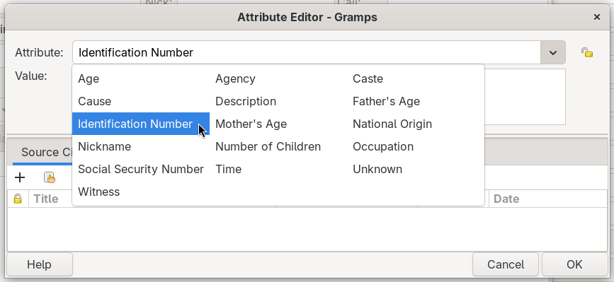
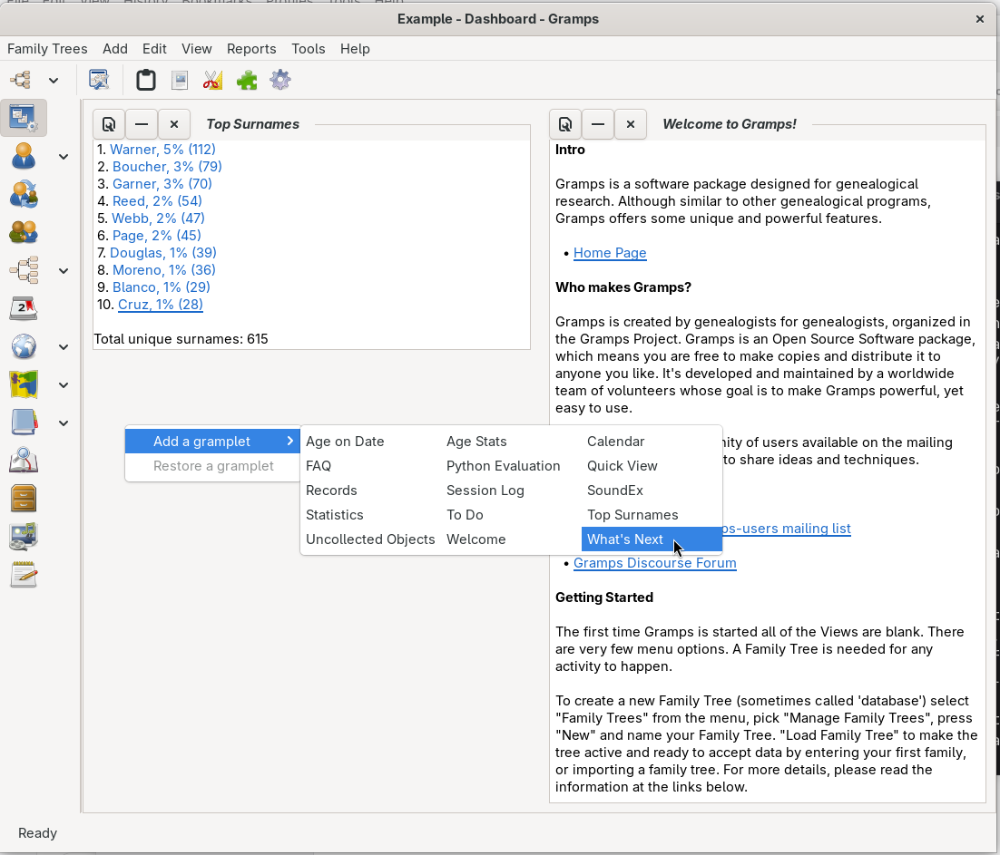

# Edit Attributes Plus
Edit Attributes Plus gives the Gramps Attribute Editor more room to work. The Value field can hold several lines of text, and you can drag the divider to make it taller. Long lists of choices open as tidy columns instead of one long list that you have to scroll.

## What changes
The addon changes how a few existing Gramps windows and menus look and behave. It does not add new menu items, and it does not change any of your family tree data.

### The Attribute Editor
- The **Value** field wraps long text onto more lines, and it can hold more than one line. A scroll bar appears only when the text needs one.
- A divider sits between the top of the window (Attribute and Value) and the bottom (Source Citations and Notes). Drag the divider to give more space to whichever part you are using.
- The same changes apply wherever Gramps edits an attribute, including attributes for people, families, events, media and sources.

### Lists of types in columns
When you open the **Attribute** list, the built-in types and the custom types you have added are sorted together in one alphabetical list. A list with more than 12 choices opens as three columns, so you can see every choice at once.

Other type lists in Gramps editors work the same way, for example lists of name types or event roles.

### Adding gramplets
The **Add a gramplet** menu also opens in three columns when it has more than 12 choices. This works in the Dashboard (right-click on an empty area) and in the sidebar and bottombar (the small arrow button at the end of the tabs).

In the Dashboard menu, **Restore a gramplet** is grayed out when there are no closed gramplets to bring back.

## Installing
Install Edit Attributes Plus from the Gramps Addon Manager, then restart Gramps. The changes take effect after the restart.

## Turning it off
Open **Help > Plugin Manager**, find Edit Attributes Plus, and hide or uninstall it. Restart Gramps to return to the standard windows and menus.

## Things to know
- Choices are listed across each row first, then down to the next row. Read from left to right to find a name in alphabetical order.
- On some systems, a type list that has a tooltip may print a harmless "Tried to map a popup with a non-top most parent" warning in the terminal. This is a known GTK issue, and the list still works.
- If something does not look right, the addon writes notes to the Gramps log. Report problems at the link in the Plugin Manager.

## Credits
Development and documentation by Claude AI, from ideas and testing by Brian McCullough. The Attribute Editor layout builds on the standard Gramps Attribute Editor by the Gramps developers.

## Assumptions I made
- Readers reach this page from the Plugin Manager or the Addon Manager, so the intro skips how to find the addon.
- The column behavior in other type lists (not only Attributes) should be mentioned, since users will notice it.
- The sidebar and bottombar arrow button is the way most users reach "Add a gramplet" there; no screenshot of it yet.
- The "Remove a gramplet" submenu in the sidebar and bottombar also uses columns; I did not call it out separately.
- A section for developers (which Gramps classes are patched) is left out for now; it can be added at the end if wanted.
