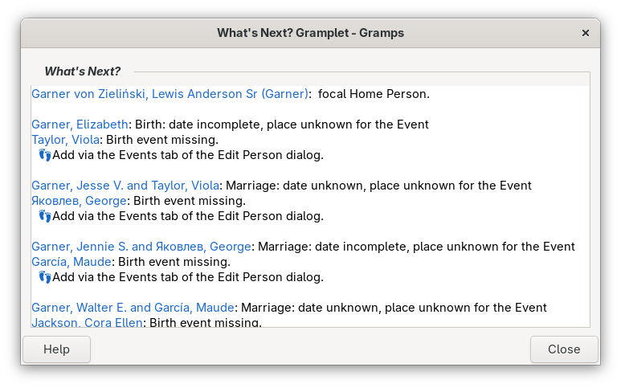
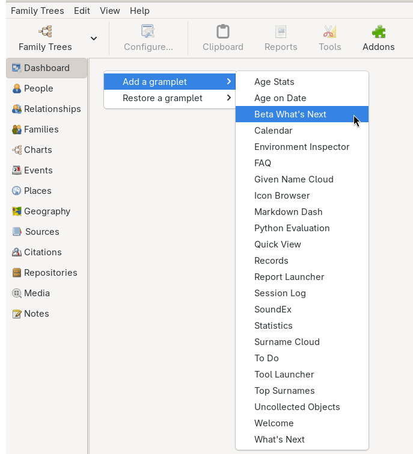
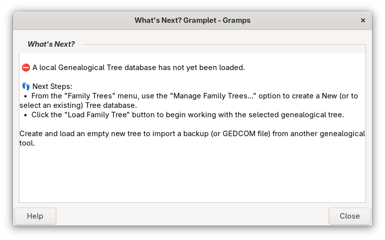
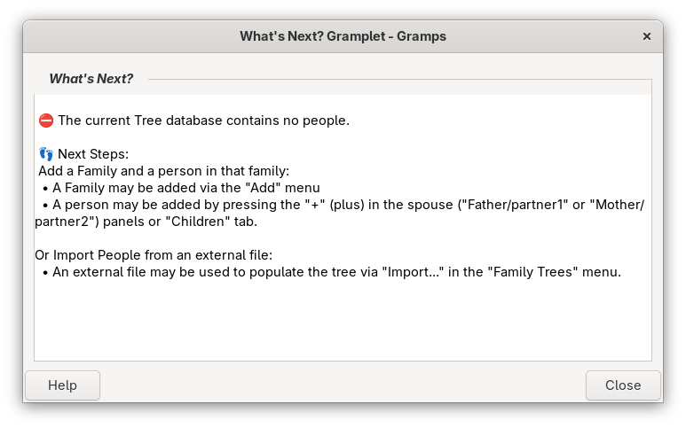
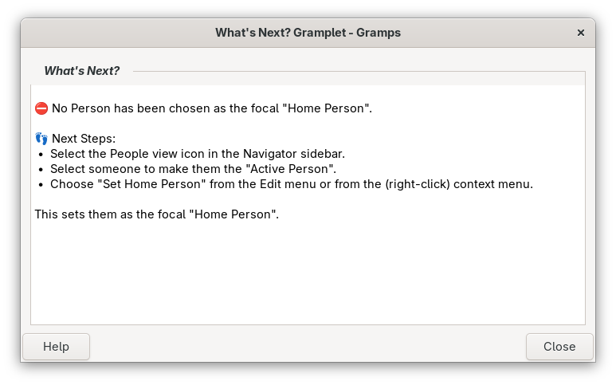

# What's Next?

[README.md](README.md) ● [CHANGELOG.md](CHANGELOG.md)

**Beta What's Next** suggests the next research or documentation tasks for a family tree. It starts at the Home Person, works outward through ancestors, descendants and their partners, and lists the people and families that have missing or incomplete information. It is a beta-test version of the "What's Next" gramplet that is built into Gramps.

The changes from the built-in gramplet are for new users: plain-language guidance when the tree cannot be checked yet, clearer descriptions of each problem, suggested next steps, and a list that refreshes when the tree changes. A new set of tags lets a reader clear finished or hopeless entries from the list with a single click. See CHANGELOG.md for a full comparison.

## Requirements

- A loaded Family Tree with a Home Person set.
- For the color Help button, the MarkdownUtils addon. When MarkdownUtils is not present, a plain Help button is shown instead.

## Installation

Beta What's Next is part of the Emyoulation addon collection. Open the Gramps Addon Manager, add the collection as a project if it is not already listed, and install "Beta What's Next" from the list. Restart Gramps, and the gramplet appears in the gramplet list as "Beta What's Next?".

The built-in "What's Next?" gramplet is not replaced. Both gramplets can be used at the same time, which makes a side-by-side comparison easy.

## Adding the gramplet

- Dashboard: right-click the Dashboard background and choose "Add a gramplet", then "Beta What's Next?".

- Sidebar or Bottombar: click the small down-arrow button in the gramplet bar and choose "Add a gramplet", then "Beta What's Next?".

## Getting started messages

When the gramplet cannot build a list yet, it explains why and what to do next. Each message starts with a ⛔ symbol, and the suggested next steps start with a 👣 symbol. The suggested steps can be turned off (see Options).

- No Family Tree loaded: explains how to create or load a tree from the "Family Trees" menu, and how to import a backup or GEDCOM file into a new empty tree.

- The tree has no people: explains how to add a Family and people, or how to import people from a file.

- No Home Person: explains how to choose a person in the People view and use "Set Home Person" from the Edit menu or the right-click menu.

## Reading the list

The first line names the Home Person, so it is clear where the search started. Each following line names a person or a family and then lists the problems found.

- Single-click a colored name to make that person or family the Active one.
- Double-click a colored name to open the Edit Person or Edit Family dialog.
- Right-click a colored name for a menu: "Review" opens the editor, three further items tag that one person or family (see Tags), and "Organize Tags" opens the tag organizer.
- Right-click anywhere else in the list for the usual Copy and Select All menu, with "Organize Tags" added at the bottom.
- A line that starts with 👣 suggests a next step to fix the problem.
- A blank line separates each round of the search. Each round moves one generation further away from the Home Person.

The list refreshes on its own when people, families or events are added, changed or deleted, and when the Home Person changes.

## Tags

Three tags shape the list. Each one is applied to a person or a family, and each one hides that object from the list. They differ in how they affect the search, and in how long they are meant to last.

- **Complete**: the object is finished, because its missing information will never be found (for example, a record that was destroyed). The object is hidden from the list, and the search still travels through it to reach relatives. This tag is meant to stay.
- **Ignore**: the gaps are set aside for now, to be returned to later. The object is hidden from the list, and the search still travels through it. Delete the Ignore tag to bring the object back into the list and try again.
- **Prune**: the object is a dead end. It is hidden from the list, and the search does not travel through it, so the people and families reached only through it are left out. This shapes the direction of the search. Delete the Prune tag to bring that branch back.

Each of the three tags must be a different tag. If two are set to the same tag, the later one in the order Complete, Ignore, Prune is treated as not chosen, so the Prune tag can never act as the Complete tag.

Because each tag can be deleted on its own, each one resets a different part of the work: delete Prune to restore a branch, delete Ignore to return to set-aside gaps, and keep Complete for the entries that are truly finished.

### Tagging one object, or every shown object

To tag one person or family, right-click its name and choose Tag as Complete, Ignore or Prune.

To tag every person and family currently shown, use the buttons along the bottom of the gramplet. The "Complete", "Ignore" and "Prune" buttons each apply their tag to the whole list at once. This both clears the list and saves the search from doing the same work again. The line for the Home Person is left out of batch tagging, and the list refreshes right after the tags are applied.

A tag can be chosen in the options (see below). When no tag is chosen, the first use creates one at the top of the tag list: "Completed" in grey, "Ignored" in pale grey and "Pruned" in dark amber. The created tag is then remembered as the chosen tag.

## The button row

A row of buttons sits along the bottom of the gramplet.

- A Help button on the far left opens this document.
- "Complete", "Ignore" and "Prune" tag every shown person and family, as described above.

## What the gramplet checks

### For each person

- First name or surname is unknown.
- The Birth event is missing.
- The Birth or Death event has no date, an incomplete date, or no place.

### For each family

- The relationship type is "Married" but there is no Marriage event.
- The relationship type is "Unknown".
- The Marriage or Divorce event has no date, an incomplete date, or no place.

### For links between people

- A partner relationship exists but the spouse is missing.
- The father or the mother is missing from the parent family.
- A person has no parent family (this report can be turned off in the options).

## Options

Open the gramplet options with "Configure..." in the View menu (Sidebar and Bottombar), or with the gramplet properties on the Dashboard.

| Option | Range | Default | What it does |
|---|---|---|---|
| Search Quota | 1 to 300 | 10 | The least number of lines to show. The search stops once this many problems are found. |
| Depth per loop | 1 to 15 | 1 | How many generations of descendants to check before going up one more generation of ancestors. |
| Pause search expansion | 1 to 10 | 5 | How many extra rounds to wait after checking an ancestor before checking the descendants of that ancestor. |
| Complete tag | any tag | (none) | The tag that marks a finished object. The object is hidden, and the search still travels through it. |
| Ignore tag | any tag | (none) | The tag that sets an object aside. The object is hidden, and the search still travels through it. |
| Prune tag | any tag | (none) | The tag that marks a dead end. The object is hidden, and the search does not travel through it. |
| Show suggested Next Steps | on or off | on | Shows or hides the guidance steps and the 👣 suggestions, for a shorter list. |
| Report a missing parent family | on or off | on | Lists, or does not list, a person who has no parent family. |

Hold the pointer over an option, or over its label, to see a short description.

The defaults for "Depth per loop" and "Pause search expansion" differ from the built-in gramplet, to keep the search closer to direct ancestors for longer.

## Tips

- Raise the Search Quota for a longer to-do list. Large values can make the list slow to build in a large tree.
- Use the Prune tag with care. Everyone reached only through a pruned person or family is also left out of the list.
- To reset the list after setting items aside, open "Organize Tags..." in the Edit menu and delete the Ignore tag.

## Feedback

This is a beta version. Please report problems and suggestions at https://github.com/emyoulation/_BetaDashboards

## Credits and license

- Original "What's Next" gramplet: Reinhard Mueller (2008), maintained by Jakim Friant (2010) and the Gramps project.
- Beta changes: Brian McCullough (2023 to 2024), with development and documentation by Claude (2026) from wish-coding by Brian McCullough.

Distributed under the GNU General Public License. See the license header in the source files.
