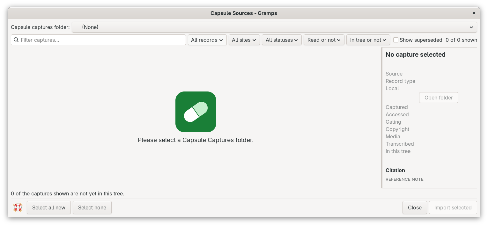
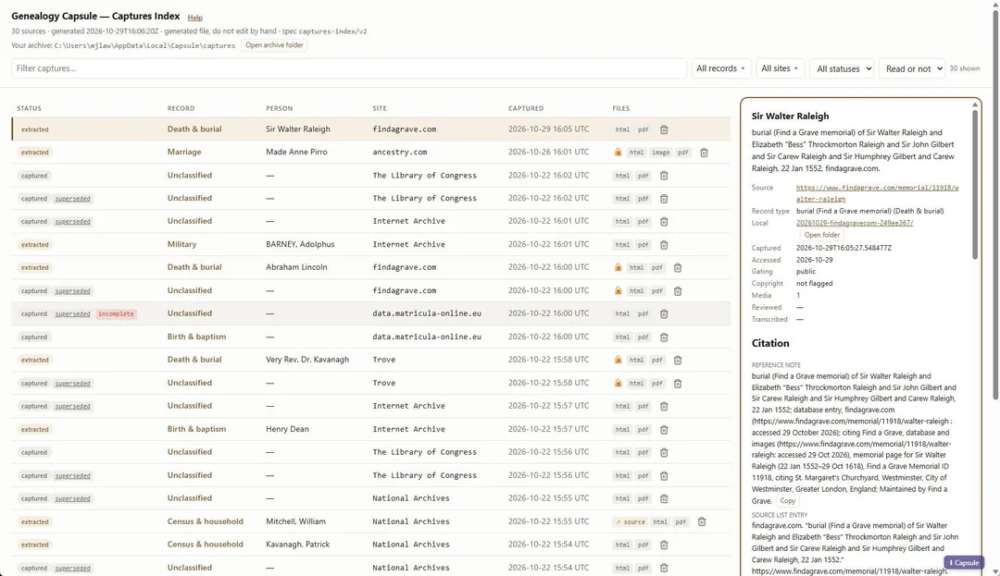

# Capsule Sources
<!--  -->
[README.md](README.md) ● [CHANGELOG.md](CHANGELOG.md) ● [PLAN.md](PLAN.md)

Capsule Sources brings the records you saved with Genealogy Capsule into your Gramps family tree. Each saved record arrives as a Citation, with the record image and a copy of the web page attached, ready for you to use as evidence. Nobody is created or merged behind your back: you choose the person each record belongs to, and you can do that before or after the import.

## What is Genealogy Capsule?
 
[Genealogy Capsule](https://github.com/mjlawless/capsule-genealogy) is a free, open source Chrome extension with a small helper program that runs on your own computer. When you look at a record page on a site such as Ancestry, FamilySearch, Find a Grave or a national archive, you click **Capture**. Capsule then saves the page, the record image, an Evidence Explained style citation and a fingerprint (SHA-256 hash) of every file, so you can show later that nothing changed. With an Anthropic API key, it can also read the record and list the people, dates and places it names.

Capsule Sources does not capture anything itself. It reads the folder of captures that Genealogy Capsule keeps on your computer, so Capsule does not need to be running when you import.

Learn more about **Genealogy Capsule**:
- [Genealogy Capsule on GitHub](https://github.com/mjlawless/capsule-genealogy) (install instructions, list of supported sites)
- [Genealogy Capsule on the Chrome Web Store](https://chromewebstore.google.com/detail/genealogy-capsule/dopmkpbopjegbdngekbdpgpkmpgkgeeo)
- [Announcement on r/GenealogySoftwareDevs](https://www.reddit.com/r/GenealogySoftwareDevs/comments/1xioiq6/new_chrome_extension_released_for_saving/)
- [Release notes](https://github.com/mjlawless/capsule-genealogy/releases)
- [Roadmap](https://github.com/mjlawless/capsule-genealogy/blob/main/ROADMAP.md) (a Gramps integration is planned there too)
- [Discussions](https://github.com/mjlawless/capsule-genealogy/discussions)

## How to use it
1. Install Genealogy Capsule and capture a few record pages.
2. In Gramps, open your family tree and choose **Tools > Family Tree Processing > Capsule Sources**.
3. Check the **Capsule captures folder** at the top. On Linux it is usually `~/.local/share/Capsule/captures`, on macOS `~/Library/Application Support/Capsule/captures`, and on Windows `%LOCALAPPDATA%\Capsule\captures`. The tool remembers your choice. Until a folder with captures is chosen, the window shows the Genealogy Capsule icon and asks you to select one.
4. The list shows every capture: its status, the kind of record, the person, the site, when it was captured and which files were saved.
5. Tick the captures you want, or click **Select all new**.
6. Click **Import selected**. A message tells you what was added.

You can run the tool again at any time. Captures that are already in the tree are skipped, so nothing is added twice. Captures you make in Chrome while the window is open appear when you click the Genealogy Capsule icon to the left of the folder name.

At the right end of the folder row, a short readout shows how many captures and sites the folder holds. Hold the mouse over it for the full breakdown: how many are in this tree, how many are new, superseded, not read yet, private or linked to a person, the capture dates and the size on disk.

Close the window with the **x** in its title bar or the Esc key. The Help icon at the lower left of the window opens this README. If the Markdown Dash gramplet is installed, the README opens inside Gramps; otherwise the Capsule Sources page on GitHub opens in your web browser.

## Finding captures
The row above the list narrows it down, much like the Captures Index page of Genealogy Capsule:
- Type in **Filter captures** to match the record type, person, site, status, citation, capture id, web address or your notes.
- **All records** and **All sites** let you tick one or more record types or sites.
- **All statuses**, **Read or not** and **In tree or not** each pick one value.
- **Show superseded** adds the captures you replaced with better ones.

Click a column heading to sort by it. Drag the edge of a column heading to make it wider or narrower; the tool remembers the widths, and the window size, for next time.

## The person on each record
The **Person** column works like the Name column of the Photo Tagging gramplet.
- A name shown in red is not linked to anybody in your tree yet. It is what Genealogy Capsule read from the record, or what you typed. Click the name of a selected row to change it. You can type it as "Surname, Given" or "Given Surname". Clearing it leaves it empty, so the old suggestion does not come back.
- A name shown as a link belongs to a person in your tree. Double-click it to open that person.

Right-click a row for these choices:
- **See the person details**, **See ancestor family details**, **See descendant family details** and **Make the person active**, once a person is linked.
- **Link** to choose a person already in your tree.
- **Add a new person**, with the name from the Person column filled in. The new person is linked when you click OK.
- **Clear Reference** to unlink the person.
- **Fuzzy Match Lookup…** to search your tree for similar sounding surnames. This needs the Fuzzy Matching addon.
- **Edit the Citation**, **Open the capture folder** and **Copy the reference note**.
- **Clipboard the Citation** to put the Citation on the Gramps Clipboard, so you can drag it onto a person, event or anything else that takes a citation. This works once the capture is in your tree.

When a capture is in your tree, linking a person also adds the Citation to that person, on the **Source Citations** tab of the Edit Person window. Clearing the link takes it off again. If you link a person before the import, the Citation is added to that person during the import.

The names you type and the people you link are kept in the file `CapsuleSources_captures.json` in the Capsule Sources addon folder, not in the Genealogy Capsule folder. Each family tree keeps its own links. Keep a copy of that file if you back up your Gramps addons.

## Looking at a capture
The panel on the right shows the selected capture: the primary person, the web address, the record type, when it was captured and accessed, whether it is private, and the Evidence Explained citation. The capture folder name next to **Local** is a link: click it to open that folder. Click the **Reference note**, **Short note** or **Source list entry** heading, marked with a copy icon, to copy that part, ready to paste anywhere.

Under **Files**, each saved file has two buttons:
- **Open** shows the file in the program your computer uses for that kind of file.
- **Open with…** lets you choose a program. A new Linux installation may have no program set for PDF or saved web pages; then Capsule Sources asks once. Chrome, which you already use for Genealogy Capsule, can show all of these files. The tool remembers your choice for each kind of file.

When a capture is in your tree, **In this tree** shows the Citation ID. Click it, or double-click the row in the list, to open the Citation.

## What you get in Gramps
- **One Repository named "Genealogy Capsule captures"**, of type Collection. It links to the Genealogy Capsule home page and to your captures folder.
- **A Source for each web site**, such as "findagrave.com", held in that Repository. You can rename the Source, for example to "Find a Grave"; later imports still find it.
- **A Citation for each capture**, such as one Find a Grave memorial. The Volume/Page field holds the title of the record page, and the Date is the day of the capture. The Citation also carries the page address, the date you accessed it and the capture id from Genealogy Capsule.
- **A Citation note** holding the complete layered Evidence Explained citation: reference note, short note and source list entry.
- **Research notes** for anything you wrote about the capture in Genealogy Capsule.
- **Media objects** for the record image, the page PDF, the full saved page and any downloaded document, each with its SHA-256 fingerprint. The files stay where Genealogy Capsule saved them; Gramps links to them instead of copying them. If you move the Capsule folder, use the Gramps Media Manager to fix the paths.

No events or facts are created yet. A later version will show them for review so you can attach each one to the right person yourself.

## Privacy
Records from subscription sites, and records marked as copyrighted, are marked private in Gramps: the Citation, its notes and its media. Gramps reports and exports leave private records out by default, which matches the rule in Genealogy Capsule that subscription content stays on your own computer.

## Status in the list
- **in tree**: the capture is already in this family tree. It comes first so that it stays visible in a narrow column.
- **captured**: the page, image and citation were saved.
- **extracted**: Genealogy Capsule also read the people and facts on the record.
- **not read yet**: the record text was not read because no API key was set. It still imports normally.
- **incomplete**: Genealogy Capsule found that the capture does not hold the whole record. Hold the mouse over the row to see why.
- **superseded**: you replaced this capture with a better one in Genealogy Capsule. These are hidden unless you tick **Show superseded**, and they cannot be imported.

## Credits
Genealogy Capsule is © 2026 the Genealogy Capsule authors (mjlawless), released under the [MIT License](https://github.com/mjlawless/capsule-genealogy/blob/main/LICENSE). The Genealogy Capsule icon in the `media` folder comes from that project and is used under the same license; a copy is in `media/GenealogyCapsule-LICENSE.txt`. Capsule Sources reads the capture folder format that Genealogy Capsule publishes; it is an independent addon and is not affiliated with or endorsed by the Genealogy Capsule project.

The Person column and its right-click choices follow the Photo Tagging gramplet, and the Fuzzy Match Lookup comes from the Fuzzy Matching gramplet, both part of the Emyoulation addons.

Capsule Sources was developed by Claude AI (Anthropic), from wish coding by Brian McCullough, who maintains it as part of the Emyoulation addons.
