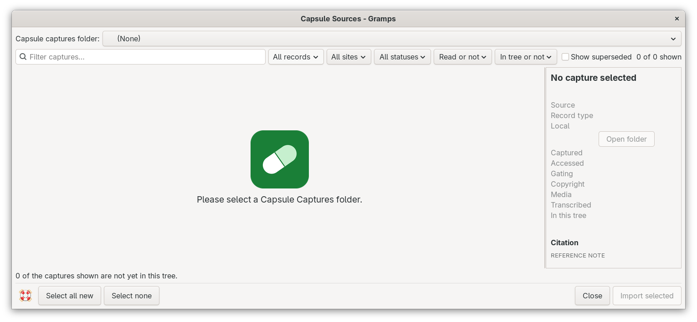
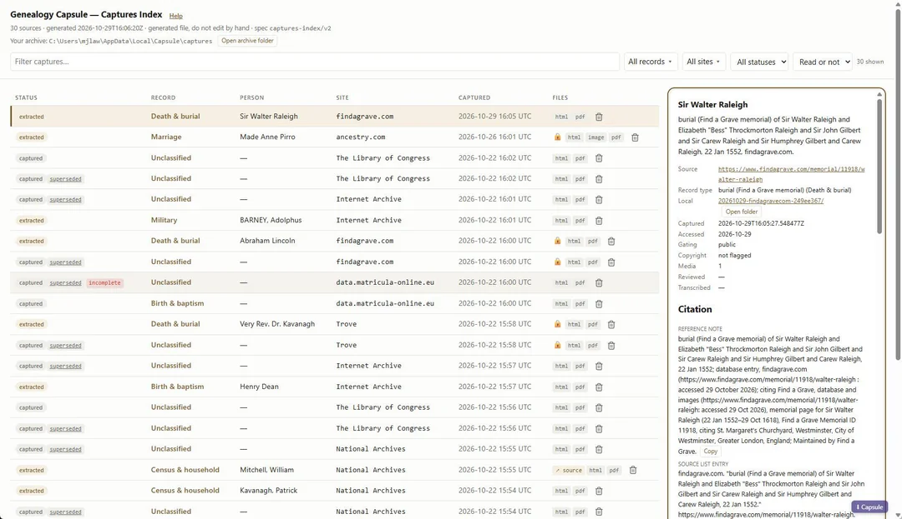

# Capsule Sources
<!--  -->
[README.md](README.md) ● [CHANGELOG.md](CHANGELOG.md) ● [PLAN.md](PLAN.md)

Capsule Sources brings the records you saved with Genealogy Capsule into your Gramps family tree. Each saved record arrives as a Source and a Citation, with the record image and a copy of the web page attached, ready for you to use as evidence. No people are created and nobody is merged; you decide later which people to whom the evidence belongs.

## What is Genealogy Capsule?
 
[Genealogy Capsule](https://github.com/mjlawless/capsule-genealogy) is a free, open source Chrome extension with a small helper program that runs on your own computer. When you look at a record page on a site such as Ancestry, FamilySearch, Find a Grave or a national archive, you click **Capture**. Capsule then saves the page, the record image, an Evidence Explained style citation and a fingerprint (SHA-256 hash) of every file, so you can show later that nothing changed. With an Anthropic API key, it can also read the record and list the people, dates and places it names.

Capsule Sources does not capture anything itself. It reads the folder of captures that Genealogy Capsule keeps on your computer, so Capsule does not need to be running when you import.

Learn more about **Genealogy Capsule**:
- [Genealogy Capsule on GitHub](https://github.com/mjlawless/capsule-genealogy) (install instructions, list of supported sites)
- [Genealogy Capsule on the Chrome Web Store](https://chromewebstore.google.com/detail/genealogy-capsule/dopmkpbopjegbdngekbdpgpkmpgkgeeo)
- [Announcement on r/GenealogySoftwareDevs](https://www.reddit.com/r/GenealogySoftwareDevs/comments/1xioiq6/new_chrome_extension_released_for_saving/)
- [Release notes](https://github.com/mjlawless/capsule-genealogy/releases)
- [Roadmap](https://github.com/mjlawless/capsule-genealogy/blob/main/ROADMAP.md) (a Gramps integration is planned there too)
- [Discussions](https://github.com/mjlawless/capsule-genealogy/discussions)

## How to use it
1. Install Genealogy Capsule and capture a few record pages.
2. In Gramps, open your family tree and choose **Tools > Family Tree Processing > Capsule Sources**.
3. Check the **Capsule captures folder** at the top. On Linux it is usually `~/.local/share/Capsule/captures`, on macOS `~/Library/Application Support/Capsule/captures`, and on Windows `%LOCALAPPDATA%\Capsule\captures`. The tool remembers your choice. Until a folder with captures is chosen, the window shows the Genealogy Capsule icon and asks you to select one.
4. The list shows every capture: when it was captured, the site, the title, its status, whether it is private, and a check mark if it is already in this tree.
5. Tick the captures you want, or click **Select all new**.
6. Click **Import selected**. A message tells you what was added.

You can run the tool again at any time. Captures that are already in the tree are skipped, so nothing is added twice.

The Help icon at the lower left of the window opens this README. If the Markdown Dash gramplet is installed, the README opens inside Gramps; otherwise the Capsule Sources page on GitHub opens in your web browser.

## What you get in Gramps
- **A Repository for each web site**, such as "Ancestry", with a link to the site home page.
- **A Source for each record collection**, titled with the Evidence Explained source list entry. Records from the same collection share one Source.
- **A Citation for each capture.** The Volume/Page field holds the full Evidence Explained reference note. The Citation also carries the page address, the date you accessed it and the capture id from Genealogy Capsule.
- **A Citation note** holding the complete layered citation: reference note, short note and source list entry.
- **Research notes** for anything you wrote about the capture in Genealogy Capsule.
- **Media objects** for the record image, the page PDF, the full saved page and any downloaded document, each with its SHA-256 fingerprint. The files stay where Genealogy Capsule saved them; Gramps links to them instead of copying them.

## Privacy
Records from subscription sites are marked private in Gramps: the Citation, its notes and its media. Gramps reports and exports leave private records out by default, which matches the rule in Genealogy Capsule that subscription content stays on your own computer.

## Status in the list
- **current**: a normal capture, ready to import.
- **not read yet**: the page, image and citation were saved, but the record text was not read because no API key was set. It still imports normally.
- **superseded**: you replaced this capture with a better one in Genealogy Capsule. These are hidden unless you tick **Show superseded**, and they cannot be imported.

## Assumptions made
These are early design choices for you to review and redirect:
- Records from the same collection share one Source, matched by identical source list entry text. If Genealogy Capsule puts record details in that text, each record gets its own Source instead.
- The Citation Date is left empty, because in Gramps it normally means the date of the record entry. The access date is stored as an attribute named "Accessed".
- Media files are linked where Genealogy Capsule keeps them. If you move the Capsule archive, use the Gramps Media Manager to fix the paths.
- The page text copy (`snapshot.html`) is not attached, because the full saved page and the page PDF are the copies meant for people to read.
- The tool is under Family Tree Processing because it changes your tree.
- People, events and facts from the record are not imported yet. A later version will show them for review so you can attach each one to the right person yourself.

## Credits
Genealogy Capsule is © 2026 the Genealogy Capsule authors (mjlawless), released under the [MIT License](https://github.com/mjlawless/capsule-genealogy/blob/main/LICENSE). The Genealogy Capsule icon in the `media` folder comes from that project and is used under the same license; a copy is in `media/GenealogyCapsule-LICENSE.txt`. Capsule Sources reads the capture folder format that Genealogy Capsule publishes; it is an independent addon and is not affiliated with or endorsed by the Genealogy Capsule project.

Capsule Sources was developed by Claude AI (Anthropic), from wish coding by Brian McCullough, who maintains it as part of the Emyoulation addons.
