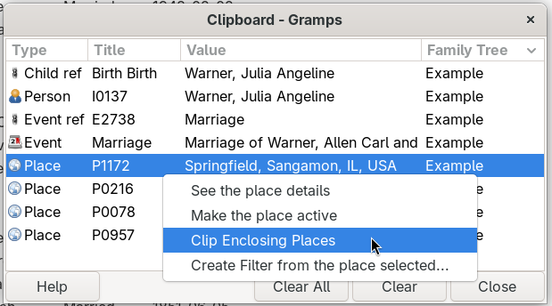
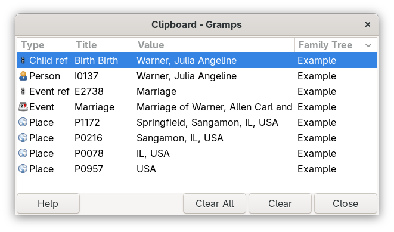
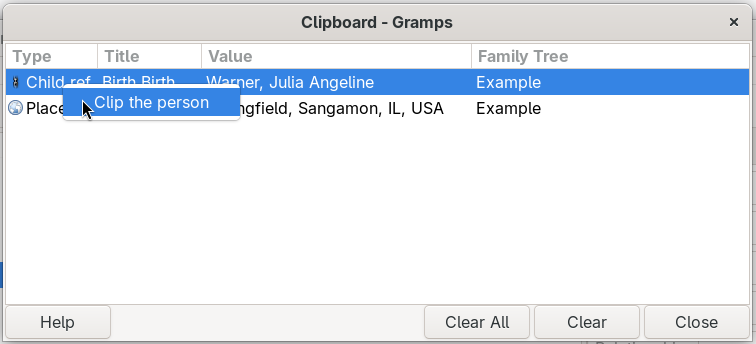
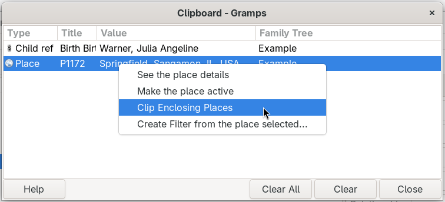

# Clipboard Ref Menu
<!-- undocked=false -->

The Gramps clipboard is a handy holding area for people, places, events, and other object records while you work. Some clipboard rows are not an object at all, instead, they are "Ref" links to one, containing metadata about how the object relates to its enclosing object.  Such as a child relates to the parents inside a family; or, a repository inside a source; or, the Role and shared information of an Event 

Right-clicking those rows with the original Clipboard has no context menu. This Clipboard Ref Menu gives them a useful right-click context menu.

## What you get

**Clip the record behind a link.** Right-click a link row on the clipboard and choose **Clip** followed by the type of record, for example **Clip Person** or **Clip Repository**. The real record is added to the clipboard as if you had dragged it there from a view. These link rows are supported:
- Child
- Person reference
- Event reference
- Place reference
- Media reference
- Repository reference

If several link rows are selected, all of the records they point to are clipped at once. A record already on the clipboard is not added a second time.

**Clip Enclosing Places.** Right-click a Place on the clipboard and choose **Clip Enclosing Places** to add every place above it in the hierarchy. For example, from a town this adds the county, the state, and the country in one step. The item appears only when the place has an enclosing place.

The usual items on a clipboard row menu, such as **See details**, **Make active**, and **Create Filter**, are still there.

## Where it works

The change applies to every clipboard in Gramps that uses the standard clipboard list:
- The Clipboard window (Edit menu)
- The [Collections Clipboard](https://gramps-project.org/wiki/index.php?title=Addon:Collections_Clipboard_Gramplet) gramplets

## Installing

1. Install the addon with the Gramps Addon Manager, or copy the **ClipboardRefMenu** folder into your Gramps user plugins folder.
2. Close Gramps completely and start it again. The addon takes effect at startup, so opening a new view is not enough.

Nothing in Gramps is overwritten. The addon adds its menu items while Gramps starts.

## Removing

Delete the **ClipboardRefMenu** folder, or hide the addon in the Plugin Manager, then restart Gramps. Gramps is back to its normal behavior.

## Good to know

- Your family tree data is never changed. The addon only adds records to the clipboard.
- Other kinds of secondary rows, such as an address or an attribute, are not links to a record, so they still have no menu.
- A link to a record that has since been deleted from the tree has no menu.
- Works with Gramps 5.2 and newer.
- Runs alongside the Undocked Gramplets addon. The two are independent and each works without the other.

## Troubleshooting

- **No new menu items:** restart Gramps completely, then check that the addon is listed and not hidden in the Plugin Manager.
- **Menu items appear twice or behave oddly:** an older copy of this addon under a previous name may still be installed. Remove the old folder and restart.
