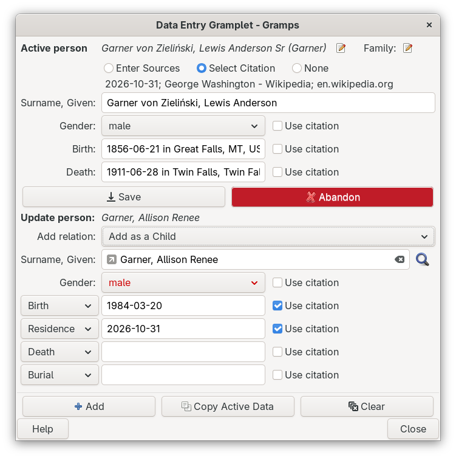

# Data Entry Gramplet
[README.md](README.md) ● [CHANGELOG.md](CHANGELOG.md)

Add people to your family tree quickly, without opening the full editors and without long chains of selection dialogs and windows.

Look at the active person, change a few fields, and add a new person as a parent, spouse, sibling or child, together with up to four events and their sources or a citation. If the person is already in your tree, the gramplet can find them and update them instead of adding a second copy.



The gramplet works in any Gramps view that shows Person gramplets, such as the Relationships, People or Pedigree views.

## Getting started
1. Install the addon with the Gramps Addon Manager and restart Gramps.
2. Open a People view. In the sidebar or bottombar, open the Gramplet Bar menu and choose **Add a gramplet → Data Entry**. The gramplet can also be detached into its own window.
3. Select a person in the view. Their data appears in the **Active person** area at the top.

## The form
The form has two areas, one above the other.

The **Active person** area shows whoever is selected in the view: name, gender, birth, death and a source for each. The edit buttons next to the name and next to *Family:* open the Gramps editors for that person or their family. You can change the fields here and press <kbd>Save</kbd>. Save updates the name, gender, birth and death and their sources only.

The **New person** area is what you fill in to add a person to the tree:

| Field | What it does |
|---|---|
| **Add relation** | How the new person relates to the active person: *No relation*, *Parent*, *Mother*, *Father*, *Spouse*, *Wife*, *Husband*, *Sibling* or *Child*. Two more choices, *Update self* and *Add an Association*, are described below. |
| **Surname, Given** | Type the surname, a comma, then the given names. The magnifying glass at the right looks for people who are already in the tree (see *Finding people who are already in the tree*). The small eraser at the right end of the field empties it. |
| **Gender** | Needed for some relations (see *If something is refused*). |
| Four **event rows** | A type menu, a *date in place* field and a Source field. |

Buttons under each area always stay in view:

* <kbd>Save</kbd> keeps your changes to the Active person area, and <kbd>Abandon</kbd> discards them.
* <kbd>Add</kbd> adds the new person to the tree.
* <kbd>Copy Active Data</kbd> copies the data of the active person into the New person area, so you can add a similar person (a sibling, or a child with the same surname) by changing a few fields.
* <kbd>Clear</kbd> empties the New person area. It keeps your event types.

## Dates and places
Type a date, then the word *in*, then a place: `1855-06-21 in Great Falls, MT`. Type the date the way you normally enter dates in Gramps. The word *in* is translated in other languages. A place that does not exist yet is created; otherwise the existing place is used.

## The four event rows
Each row has a pop-up menu for the event type. They start as **Birth, Residence, Death, Burial**. Pick any other standard type, for example Baptism, Census or Marriage. Your choices are remembered (see *Your settings*).

* Leave a row empty and no event is created for it.
* The first row set to *Birth* becomes the birth event of the person, and the first row set to *Death* becomes the death event. Any other row is added as an ordinary event.

## Sources or a citation
Under the Active person title you choose how new records are sourced. **Enter Sources**, **Select Citation** and **None** are a pick-one-of-three: choosing one always deselects the others.

* **Enter Sources:** each Source field is a text entry. Type a title in the ones you want sourced and leave the rest empty. Each source is found by its exact title, or created if there is none, and cited on that person or event.
* **Select Citation:** the Gramps citation selector opens. Choose one **citation** (expand a source to see its citations; picking a source itself does not count). It is shown under the radio buttons as *Date; Volume/Page; Source title*. Every Source field is replaced by a **Use citation** check box. Tick the ones you want the citation attached to and leave the rest unticked. The citation is not attached anywhere by default.
* **None:** every Source field is hidden. Nothing is sourced and no citation is attached.

If you close the selector without choosing a citation, the selection goes back to Enter Sources. Selecting Enter Sources or None forgets the citation and unticks every **Use citation** box. A ticked **Use citation** box is a one-time choice: it unticks itself once you press <kbd>Add</kbd> or <kbd>Save</kbd>, so the next entry starts unticked.

When a citation is chosen, <kbd>Copy Active Data</kbd> also puts the date of the citation into the *Residence* row. That is handy for census records: choose the census citation and the residence date is filled in for you.

Right-click the line with the three radio buttons, or the citation line below it, for a Citation menu:

* **Add...** opens the Edit Citation dialog for a new citation. When you click OK, the new citation becomes the chosen citation.
* **Edit...** opens the chosen citation in the Edit Citation dialog.
* **Quick View** runs a Citation quick view on the chosen citation.

Edit and Quick View need a chosen citation.

## Finding people who are already in the tree
If the **Fuzzy Matching** addon is installed and enabled, a magnifying glass appears to the right of the **Surname, Given** field of the New person area. Click it before you add someone, to check whether that person is already in your tree.

The Fuzzy Match Lookup window opens with:

* the surname from the field, matched by how it sounds, so spelling differences still find the family (if the field is empty, the surname of the active person is used),
* that surname selected, with everyone who carries it listed on the right,
* the given name from the field in the **Given name contains** filter, and the closest match selected.

The bottom bar of that window reminds you that a double-click there updates the Data Entry New Person. Double-click a person to link them, as described next. You can also drag a person from that window onto the gramplet.

## Updating a person who is already in the tree
Instead of adding a second copy of someone, you can **link** the New person area to a person who is already in the tree. There are three ways:

* double-click the person in the Fuzzy Match Lookup window,
* drag the person from any Gramps view, the Fuzzy Matching gramplet or the lookup window, and drop them on the New person area,
* right-click a person who is already linked and use the menu (see *Right-click menus*).

While the area is linked:

* The title changes from *New person* to **Update person:** followed by the name of the linked person, and a link symbol appears at the left end of the name field. Hover over the symbol to see who is linked.
* **Gender** is filled in from the linked person, and **Add relation** shows the relationship that the tree already records between the linked person and the active person, if there is one.
* If you then choose a different gender or relation, that menu turns the error color of your theme. Its list gets an extra first line, such as *Recorded as: Father* or *Recorded as: male*. Pick that line to go back to what the tree records.
* <kbd>Add</kbd> adds the events, sources, citation and relationship to the linked person. No new person is created.

Add never links the same person twice. If the linked person already belongs to the family that Add would change (for example they are already a child of the active person and you chose *Add as a Child*), Add skips the family link, still adds the events, sources and citation, and says so in the status bar. The same rule stops a second role in one family, such as a sibling being added as a parent.

A birth or death that the linked person already has is kept. A new Birth or Death row is then added as an ordinary event.

The link ends when you edit or clear the name, press <kbd>Clear</kbd> or <kbd>Copy Active Data</kbd>, choose **Unlink the existing person** from the right-click menu, or after a successful Add. The title, colors and menus then go back to normal.

### Update self
When both areas show the same person (the New person area is linked to the active person), **Add relation** switches to **Update self**. Add then adds the events, sources and citation to that person and changes nothing in their families. *Update self* is only allowed when both areas show the same person; at any other time its menu turns the error color and Add refuses.

## Associations
Choose **Add an Association** in **Add relation** to record an association instead of a family relationship, for example a godparent, a witness or a neighbor.

Choosing it opens the Gramps **Person Reference Editor**. Choosing it again, even when it is already selected, opens the editor again so you can change the association.

* The associated person starts as the active person. Use the select button of the editor to choose someone else.
* Type the association, such as *Godfather*, and add citations or notes if you like.
* Hover over **Add relation** to see the association you entered.

When you press <kbd>Add</kbd>, the association is added to the new (or linked) person, with no family link. An association that is already recorded, with the same person and the same description, is not added a second time.

The gramplet remembers the last association for each family tree, so the next one starts with the same description, privacy, citations and notes. If you chose a person other than the active person, that person is remembered too; otherwise the next association starts with whoever is active then. Citations, notes or people that are no longer in the tree are left out.

## Drag and drop
You can drop a person (dragged from a Gramps view, the Fuzzy Matching gramplet or the Fuzzy Match Lookup window) on either area of the gramplet:

* Drop on the **Active person** area to make that person the active person. If the area has unsaved edits, you are asked whether to abandon them first.
* Drop on the **New person** area to link that person, as described in *Updating a person who is already in the tree*.

The text fields still accept ordinary text drops.

## Right-click menus
Right-click a label or an empty space in either area for its menu. The text fields keep their usual Cut, Copy and Paste menu.

When an area shows a person (the active person, or a linked person in the New person area), the menu starts with the same commands as the right-click menu of a person in the People view:

* **Back**, **Forward**, **Home** and **Set Home Person**
* **Add...**, **Edit...**, **Delete** (after you confirm) and **Merge...**, which merges the people of the two areas when they are different people
* **Quick View** and **Web Connection** submenus

Below those come the commands of the area:

* Active person area: **Save** and **Abandon**, when there are unsaved edits.
* New person area: **Fuzzy Match Lookup...**, **Unlink the existing person** when linked, **Add**, **Copy Active Data** and **Clear**.

The source radio button line has its own Citation menu (see *Sources or a citation*).

## Examples
### Add a child
1. Select the parent in the view.
2. Set *Add relation* to *Add as a Child*, then type the name and choose the gender.
3. Fill in the events you know and press <kbd>Add</kbd>.

If the parent has no family yet, one is created for you.

### Record a census for a new person
1. Select <kbd>Select Citation</kbd> and choose the census citation.
2. Type the name, then press <kbd>Copy Active Data</kbd> if the person is similar to the active one.
3. Check the Residence date, add other details, tick **Use citation** next to the Residence row (and anywhere else the citation applies), and press <kbd>Add</kbd>.

### Add a census entry for someone who may already be in the tree
1. Type *Surname, Given* in the New person area and click the magnifying glass.
2. If the person is listed, double-click them. The title changes to **Update person:**.
3. Fill in the Residence row, tick **Use citation** if you chose a census citation, and press <kbd>Add</kbd>. The residence is added to that person, and no duplicate is created.

### Record a godparent
1. Select the godchild in the view, and type the name of the godparent in the New person area (or link them if they are already in the tree).
2. Choose **Add an Association**. In the editor, choose the godchild as the associated person if needed, type *Godfather*, and click OK.
3. Press <kbd>Add</kbd>.

## Unsaved edits
If you type in the Active person area, the <kbd>Abandon</kbd> button turns red. Hover over it to see which fields have unsaved changes and whose they are.

While it is red, the area does not follow the active person, and <kbd>Add</kbd> relates the new person to the person being edited, not to whoever is selected now. Press <kbd>Save</kbd> to keep the changes or <kbd>Abandon</kbd> to discard them and reload the area.

## If something is refused
If Add cannot be completed, you get a message and **nothing is saved**. Fix the problem and press Add again; no partial person is left behind.

| Message | What to do |
|---|---|
| Please set an active person | Select someone in the view first. |
| Please provide a name | Fill in the surname and/or given name. |
| Please set gender on Active person | To add a child to someone with no family yet, the gender of the parent must be known. |
| Please set the new person's gender | Set *Gender* when adding a Parent, or a Spouse to someone whose gender is not known. |
| Same genders on Active and new person | The gramplet does not add a spouse of the same gender. Use the Gramps Edit Family dialog for that family. |
| The linked person is the active person | Both areas show the same person. Choose *Update self* (or an association). |
| The New person is not linked to the active person | *Update self* needs both areas to show the same person. |
| The linked person is no longer in the tree | The linked person was deleted. Link someone else or clear the name. |
| Please choose the associated person | Open the association editor again and choose a person. |
| A person can't be associated with themselves | Choose a different associated person. |
| No Family Tree is open | Open a family tree first. |

Each Add or Save is one step in the Gramps **Edit → Undo** history.

## Your settings
Your settings are saved in `DataEntryGramplet.ini`, in the folder of the addon inside the Gramps plugins folder:

```ini
[association]
by_tree={'a1b2c3d4e5': {'tree': 'Example Gramps', 'relation': 'Godfather', 'private': False, 'person': '', 'citations': [], 'notes': []}}

[gramplet]
event_type_row2='21:Census'

[meta]
plugin_id='Data Entry Gramplet'
schema_version='2'
```

* Each event type value is the number of the type and its English name. If they do not match the current list of event types in Gramps, that row goes back to its default.
* The association line holds one remembered association for each family tree, under the database ID of that tree. An empty `person` means "use the active person".

To reset everything, delete the file; it is recreated. If you update or reinstall the addon, pick your event types again if they were reset.

## Points of interest
* The form fits down to about 315 pixels wide; below that it scrolls sideways. The buttons always stay at the bottom.
* Only standard event types are offered, not custom ones.
* One citation goes on everything a single Add creates. To cite different records differently, add them separately.
* Sources and places are matched by their exact title.
* The magnifying glass and the Fuzzy Match Lookup menu item appear only while the Fuzzy Matching addon is installed and enabled. The given-name filter and the bottom-bar reminder need a recent version of Fuzzy Matching; with an older one, the window scrolls to the closest given name instead.

## More information
The Gramps wiki page for this addon:

* [Addon:DataEntryGramplet](https://gramps-project.org/wiki/index.php/Addon:DataEntryGramplet)

## Credits and license
Copyright 2007-2011 Douglas S. Blank and Gary Burton; 2026 Brian McCullough. Released under the GNU General Public License, version 2 or (at your option) any later version.

Development and documentation by Claude AI (Anthropic), from wish-coding by Brian McCullough: the earlier rework with Claude Sonnet 5 (claude-sonnet-5), and the lookup, linking, association, drag-and-drop and menu features with Claude Opus 5.5 (claude-opus-5-5). Guidelines: the gramps-project/gramps AGENTS.md and the Gramps "AI generated code" policy.
