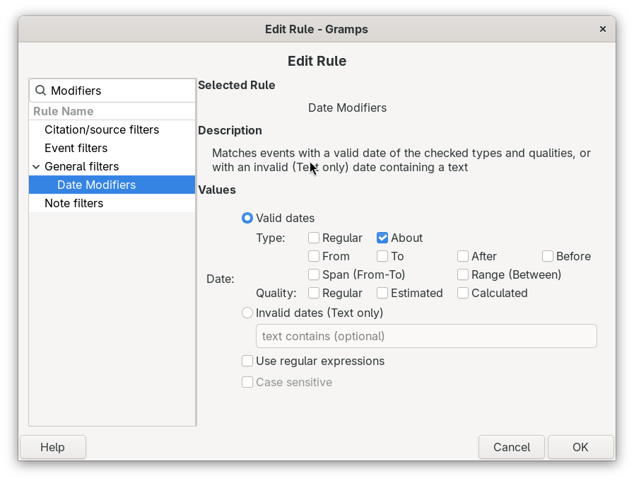

# Date Modifiers Rule
<!-- edit=True status=True browse=True undocked=True -->
[README.md](README.md) ● [CHANGELOG.md](CHANGELOG.md)

Date Modifiers Rule is a Gramps addon that adds one custom filter rule for finding dates by their modifiers. It is a companion to the Edit Date Calculator addon, and it works without it. The rule can find:
- **valid dates** with any combination of the Type modifiers (Regular, Before, After, About, Range, From, To, Span) and the Quality modifiers (Regular, Estimated, Calculated),
- **invalid dates**, which Gramps keeps as Text only, with an optional search for text in the date.


Date filters are used only now and then, so the addon gives you one rule with check boxes instead of a long list of separate rules. The rule is available for Events, Citations and Media, because each of these objects has one date.

## Contents
- [Install](#install)
- [Add the rule to a custom filter](#add-the-rule-to-a-custom-filter)
- [Valid dates](#valid-dates)
- [Invalid dates](#invalid-dates)
- [Examples](#examples)
- [Limits](#limits)
- [Assumptions made in this draft](#assumptions-made-in-this-draft)
- [Credits](#credits)
- [AI disclosure](#ai-disclosure)

## Install
Install the addon with the Gramps Addon Manager, from the [Emyoulation curated Gramps plug-ins](https://github.com/emyoulation/CuratedGrampsPlugins/) project. If that addons project is not in your Addon Manager yet, add it as the project page describes. Restart Gramps after you install the addon.

Addon Manager projects URLs:
* `https://raw.githubusercontent.com/emyoulation/CuratedGrampsPlugins/master/gramps52`
* `https://raw.githubusercontent.com/emyoulation/CuratedGrampsPlugins/master/gramps60`
* `https://raw.githubusercontent.com/emyoulation/CuratedGrampsPlugins/master/gramps61`

The addon works with Gramps 5.2, 6.0 and 6.1.

## Add the rule to a custom filter
1. Go to the Events view (or the Citations view or the Media view).
2. Open the filter editor with **Edit > Event Filter Editor** (Citation Filter Editor or Media Filter Editor in the other views), and click **+** to define a new filter.
3. In the Define filter dialog, click **+** to add a rule.
4. In the rule list, open **General filters** and select **Dates by modifiers or invalid text**.
5. Choose **Valid dates** or **Invalid dates (Text only)**, and set the choices of that section. The other section is grayed out, because one rule matches only one of the two sections.
6. Click **OK**, give the filter a name, and save it.

To find dates that match more than one setting, for example Before dates or invalid dates, add the rule two times and set **Options** in the Define filter dialog to **At least one rule must apply**.

## Valid dates
A valid date is a date that Gramps can use for sorting and for calculations. The Valid dates section has two rows of check boxes. They have the same names as the Type and Quality lists of the Date selection dialog.
- **Type:** Regular, Before, After, About, Range, From, To, Span.
- **Quality:** Regular, Estimated, Calculated.

A date matches a row when it has any of the checked choices in that row. A row with no checked choices matches all dates. So, with nothing checked at all, the rule finds every valid date.

Text only is not in the Type row. Gramps counts every Text only date as invalid, so those dates are in the Invalid dates section.

## Invalid dates
An invalid date is a date that Gramps could not understand, so it keeps the date as text (Type Text only). Gramps cannot sort these dates or use them in calculations. With the Edit Date Calculator addon, the Date selection dialog shows these dates in red, and the Parse button can try to read them again.

Type text in the box to find only the invalid dates that contain that text. Leave the box empty to find all invalid dates. The search ignores uppercase and lowercase unless you check **Case sensitive** in the Define filter dialog. Check **Use regular expressions** to search with a regular expression. These two options are used only by the Invalid dates section.

Empty dates are never found by either section.

## Examples
| To find | Set |
|---|---|
| All dates that are not exact | Valid dates, Type: Before, After, About, Range, From, To, Span |
| Estimated birth years | Valid dates, Quality: Estimated (and add an event type rule for Birth) |
| Calculated dates that are also About dates | Valid dates, Type: About, Quality: Calculated |
| All dates that need repair | Invalid dates, empty text box |
| Invalid dates with a question mark | Invalid dates, text `?` |
| Invalid dates that start with a 4-digit year | Invalid dates, text `^\d{4}`, Use regular expressions checked |

## Limits
- The rule looks only at the one date of an Event, Citation or Media object. It does not look at dates in names, attributes, addresses or LDS ordinances.
- The rule does not look at the calendar or at the New year setting of a date.

## Assumptions made in this draft
- The Quality modifiers (Estimated, Calculated) are in the same rule as the Type modifiers, so all searches for date modifiers are in one rule.
- Text only is part of the Invalid dates section, not a check box in the Type row.
- The rule is registered for Events, Citations and Media.
- The rule is in the General filters category of the rule list.
- The rule name is the same in all three views: "Dates by modifiers or invalid text".
- The addon is separate from the Edit Date Calculator addon, so it can be installed alone.
- A filter saves the settings of the rule as text that does not depend on the language of Gramps, so a filter keeps working when you change the language.

## Credits
- The valid date and invalid date sample rules by Kari Kujansuu (Isotammi group) were the starting point for the rule logic.
- Addon by Brian McCullough.

## AI disclosure
This addon was substantially written with an AI tool, as the Gramps [AI generated code policy](https://www.gramps-project.org/wiki/index.php/Howto:_Contribute_to_Gramps#AI_generated_code) asks contributors to disclose.
```
Generated-by: Claude Opus 5.5 (claude-opus-5-5), Anthropic, via the claude.ai chat interface, 2026
Prompted by: Brian McCullough
```
- **Prompts (summary):** one custom filter rule to complement the Edit Date Calculator, with check boxes for each date modifier in a Valid section and a text search in a separate Invalid section that cannot be used at the same time, based on the Isotammi valid date and invalid date sample rules; then the "Date Modifiers" naming of the addon and its files.
- **Guidelines:** written in "draft mode", so the Gramps [AGENTS.md](https://github.com/gramps-project/gramps/blob/master/AGENTS.md) style rules (type hints, Black, pylint and others) were not applied.
- **Testing:** the rule logic was checked by the AI with the date code of Gramps 6.0, and the editor widget was checked with GTK 3 on a virtual display. The addon has not yet been tested in a running Gramps.
