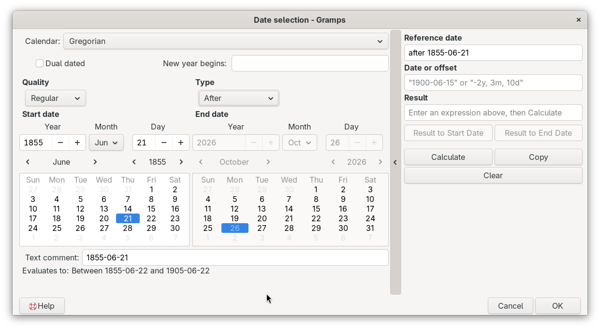
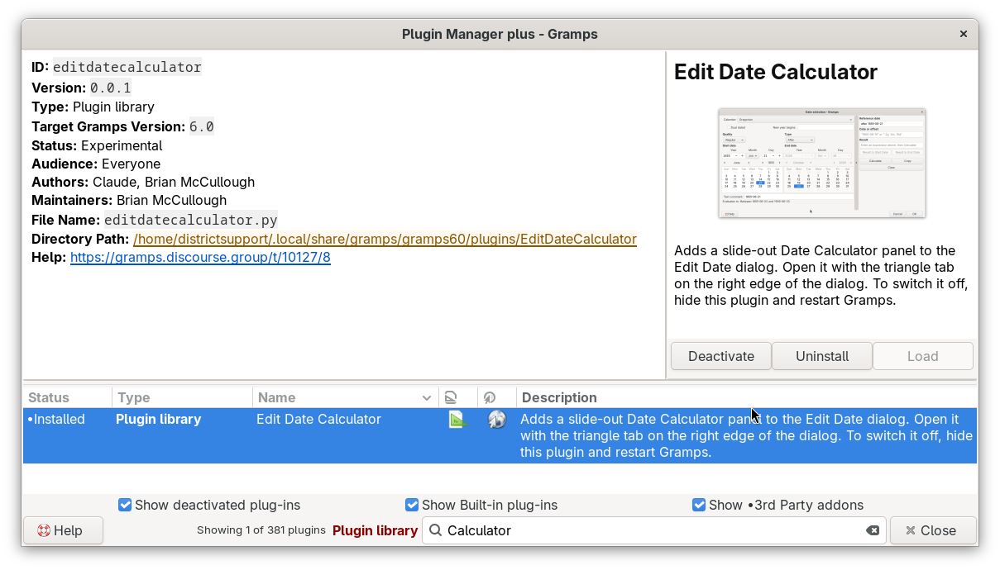
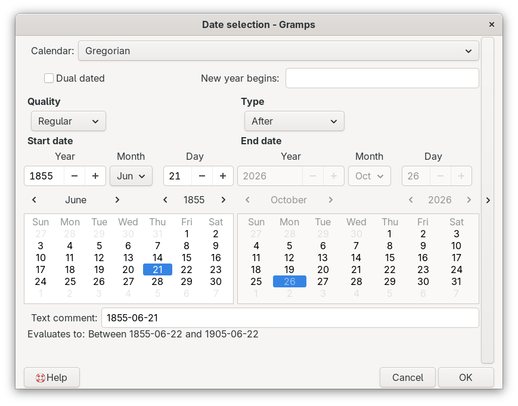

# Select Edit and Calculate Dates
[README.md](README.md) ● [CHANGELOG.md](CHANGELOG.md)

Edit Date Calculator is a Gramps addon that makes the Date selection dialog (the Date Editor) of Gramps 5.2, 6.0 and 6.1 much easier to use. It adds:
- a **date calculator** that slides out from the side of the dialog, to add or subtract ages and offsets and to find the time between two dates,
- **month calendars** that you can click, browse and drag dates from (on Gramps 6.1, the calendars of Gramps itself get the same new behavior),
- **drag and drop** of days, months and years between the Start date, the End date, the calculator and other text boxes,
- **smarter Date Type handling**, so that Before, To, Range and Span dates always show their dates in the section where they belong,
- a **Parse button** that reads the Text comment as a date, and **red text** that shows when a date is Text only,
- an **"Evaluates to" line** that shows how Gramps reads the date when it compares dates, and copies it with a double-click.



The addon makes these changes when Gramps starts, without changing any Gramps core files, so you can switch it off at any time. It is for field testing: please report problems and ideas in the [Gramps Discourse thread](https://gramps.discourse.group/t/10127/8).

## Contents
- [Install](#install)
- [A quick tour of the dialog](#a-quick-tour-of-the-dialog)
- [The slide-out date calculator](#the-slide-out-date-calculator)
- [The month calendars](#the-month-calendars)
- [Drag and drop](#drag-and-drop)
- [Types: which section holds the date](#types-which-section-holds-the-date)
- [The Text comment and the Parse button](#the-text-comment-and-the-parse-button)
- [The Evaluates to line](#the-evaluates-to-line)
- [Worked examples](#worked-examples)
- [If something does not work](#if-something-does-not-work)
- [Limits](#limits)
- [Turn the addon off](#turn-the-addon-off)
- [Credits](#credits)
- [AI disclosure](#ai-disclosure)

## Install
Install the addon with the Gramps Addon Manager, from the [Emyoulation curated Gramps plug-ins](https://github.com/emyoulation/CuratedGrampsPlugins/) project. If that addons project is not in your Addon Manager yet, add it as the project page describes. Restart Gramps after you install the addon.

Addon Manager projects URLs:
* `https://raw.githubusercontent.com/emyoulation/CuratedGrampsPlugins/master/gramps52`
* `https://raw.githubusercontent.com/emyoulation/CuratedGrampsPlugins/master/gramps60`
* `https://raw.githubusercontent.com/emyoulation/CuratedGrampsPlugins/master/gramps61`

To check that the addon works, open any Date selection dialog, for example with the button beside a Date field in the Edit Event dialog. A small triangle is at the right edge of the dialog. It is the tab of the calculator, and it shows as a button when the mouse pointer is over it.




## A quick tour of the dialog
From top to bottom, the Date selection dialog with this addon has:
- **Calendar, Dual dated and New year begins**, unchanged from Gramps.
- **Quality and Type.** In the Type menu, Range is named **Range (Between)** and Span is named **Span (From-To)**, so you can see what each one means.
- **Start date and End date.** These are the "Date" and "Second date" sections of Gramps, renamed for what they hold. Each section has Year, Month and Day fields and, below them, a month calendar. The two sections have the same width, with a wide space between them.
- **Text comment**, with the **Parse button** at the end of the row (see [The Text comment and the Parse button](#the-text-comment-and-the-parse-button)). While the Type is Text only, the text here is red.
- **Evaluates to**, a new line that shows how Gramps reads the date. It starts below the "Text comment:" label.
- **The triangle tab** at the right edge, which opens the date calculator.
- **Help** at the lower left, which opens this document.

You can move the Date selection dialog separately from the editor that opened it, for example to see the Edit Event dialog behind it. The editor does not accept input until you close the Date selection dialog with OK or Cancel.

## The slide-out date calculator

### Opening and closing
Click the narrow tab at the right edge of the dialog. The tab shows the background of the dialog, so at first you see only its triangle; it shows as a button while the mouse pointer is over it, and as a pressed button while the calculator is open. The triangle on the tab points to the right (▶) while the calculator is closed and to the left (◀) while it is open, and the tooltip of the tab says what it does. When the calculator opens, the dialog grows wider by the width of the calculator, and taller only if the calculator needs more room. When it closes, the dialog returns to exactly the size it had before. While the calculator is open, making the dialog wider or narrower changes only the width of the calculator, not the date fields and calendars. Gramps remembers the size of the dialog without the calculator.


### The three boxes
- **Reference date** is the starting date. When the calculator opens, it is filled with the date from the dialog, unless you already typed something there yourself; each time you open the calculator again, an unchanged Reference date is refreshed. You can type any date that Gramps understands, including a range such as "between 1850 and 1860".
- **Date or offset** is what to add, subtract or compare (see the table below).
- **Result** shows the answer. You cannot type in it. While it is empty, it shows a short hint.

### What you can type in Date or offset
| You type | Meaning | Example result, with Reference date 16 Mar 1923 |
|---|---|---|
| `5` | add 5 years | 16 Mar 1928 |
| `-5` | subtract 5 years | 16 Mar 1918 |
| `2, 3, 10` | add 2 years, 3 months and 10 days | 26 Jun 1925 |
| `2y, 3m, 10d` | the same, with units | 26 Jun 1925 |
| `10d` or `6 months` | one unit only; the others count as zero | 26 Mar 1923 / 16 Sep 1923 |
| `-2y, 3m, 10d` | a leading minus subtracts the whole offset | 6 Dec 1920 |
| `Aged 45y 3m 10d` | "Age" or "Aged" also subtracts the whole offset | 6 Dec 1877 |
| `13 Jan 1854` | a second date: the time between the two dates | 69 years, 2 months, 3 days |

Units may be written as `y`, `yr`, `yrs`, `year` or `years`; `m`, `mo`, `mos`, `month` or `months`; and `d`, `day` or `days`. Each unit may appear once, in any order, with or without commas. The hint in the empty box shows an example in your own date format. At least one of the two boxes must hold a date; you may also put the offset in Reference date and the date in Date or offset. An offset keeps the kind of date: "about 1900" plus 5 gives "about 1905", and "between 1854 and 1923" plus 10 gives "between 1864 and 1933".

### The buttons
- **Calculate** shows the result. Pressing Enter in any of the boxes does the same. A date result has the quality Calculated.
- **Result to Start Date** puts the result in the Start date fields of the dialog. The Quality and the Type come from the result (a calculated date is Calculated, and usually Regular). For a Range or Span, only the Start date changes and the End date stays. For a Before or To date, the Start date is dimmed, so the Type changes so that both sides are active: Before becomes Range (Between) and To becomes Span (From-To).
- **Result to End Date** puts the result in the End date fields, converted to the calendar of the dialog. If the End date is dimmed, the Type changes so that both sides are active: From becomes Span (From-To), After becomes Range (Between), and any other Type becomes Range (Between). For a Range, Span, Before or To date, the Type stays.
- **Copy** puts the text of the result on the clipboard of your computer.
- **Clear** empties all three boxes, and the hint returns to the Result box.

The two "Result to" buttons work only when the result is a date. A time span, such as "69 years, 2 months, 3 days", can only be copied.

### Error messages
| Message | What to do |
|---|---|
| Error: invalid Reference date | Type a date that Gramps understands in Reference date. |
| Error: invalid Date or offset | Check the box against the table above. "Aged" must be followed by an offset, not a date. |
| Error: Reference date must be a date | At least one of the two boxes must hold a date. |
| Error: could not calculate a result | The calculation is outside what Gramps can do, for example with a date that has no year. |

## The month calendars
Each section has a month calendar below its date fields. Gramps 6.1 has these calendars; on Gramps 5.2 and 6.0, this addon adds them. On all three versions, the addon changes how they work.

### Choosing a date with a click
- **Click a day** to put that whole date (day, month and year) in the date fields of its section. Clicking a gray day from the month before or after works too, and shows that month.
- **Click the month name** in the heading of the calendar to put that month and year in the date fields, with no day, for example "Mar 1923".
- **Click the year** in the heading to put only that year in the date fields, with no month or day, for example "1923".
- A day is chosen when you **release** the mouse button. If you move the mouse while holding the button down, you start a drag instead, and nothing in the dialog changes.
- When the calendar has the keyboard focus, the arrow keys move between days and the space bar chooses a day.

### Browsing without changing the date
- The **arrows** in the heading show the month or the year before or after. They change only the calendar, never the date fields.
- The **Page Up and Page Down** keys do the same, when the calendar has the keyboard focus.
- The month name always takes the same width, so the arrows stay in the same place for "May" and for "November", and you can click an arrow many times without moving the mouse.
- The date of the section is marked only on the month that holds it, so a marked day always means the date in the fields.
- When you type in the date fields, the calendar follows and shows that month. A date with only a year shows January of that year, and the Month field stays empty.

### When the calendars are dimmed
The calendars work only with the Gregorian calendar, so they are dimmed for other calendars. They are also dimmed for Text only dates, and each calendar is dimmed whenever its section is dimmed (see [Types](#types-which-section-holds-the-date)).

## Drag and drop
| Drag this | Drop it here | What happens |
|---|---|---|
| A day, month name or year from a calendar | anywhere on the **other** section: its label, its date fields or its calendar | The same as clicking that item on the other calendar. If the other section is dimmed, the Type changes first (see below). |
| A day, month name or year from a calendar | a text box, such as Reference date or Date or offset of the calculator | The date is typed into the box as text, in your date format. |
| Any text | the calculator, outside its text boxes | The text replaces the Reference date. |
| Any text | a text box of the calculator | The text is inserted, as in any text box. |

When a drop fills a dimmed section, the Type changes so that both sides are active: From and To become Span (From-To), Before and After become Range (Between), and Regular and About dates become Span (From-To). For example, with a Start date of 13 Jan 1554 and the End date dimmed, dragging "January" from the Start date calendar onto the End date section makes the date a Span from 13 Jan 1554 to January 1554.

A drop on the section the drag came from does nothing, and drops are refused while the calendar is not Gregorian or the Type is Text only. To make the whole section a drop target, the Day and Year fields of the two sections do not accept dropped text themselves.

## Types: which section holds the date
### Which sections are active
| Type | Start date | End date |
|---|---|---|
| Regular, About, After, From | active, holds the date | dimmed |
| Before, To | dimmed, shows the date of today | active, holds the date |
| Range (Between), Span (From-To) | active, holds the first date | active, holds the second date |
| Text only | dimmed | dimmed |

A Before or To date marks the end of a period, so this addon shows it in the End date section. (Gramps itself shows it in the first section; the date that Gramps saves is the same either way.)

### What happens when you change the Type
| From | To | The date |
|---|---|---|
| Regular, About, After, From or Text only | Before or To | moves to the End date; the Start date shows today and is dimmed |
| Before or To | Regular, About, After or From | moves back to the Start date |
| Range or Span | Before or To | the End date stays; the Start date is dimmed and shows today |
| Before or To | Range or Span | the End date stays; the Start date (today) becomes active, ready for you to change |
| Regular, About, After or From | Range or Span | the Start date stays; the End date becomes active |

Changing the Calendar keeps a Before or To date in the End date section.

### How the Type changes by itself
| What you do | Current Type | New Type |
|---|---|---|
| Result to End Date (End date dimmed) | From | Span (From-To) |
| | After | Range (Between) |
| | Regular, About, Text only | Range (Between) |
| Result to Start Date (Start date dimmed) | Before | Range (Between) |
| | To | Span (From-To) |
| Drop on the dimmed End date | From | Span (From-To) |
| | After | Range (Between) |
| | Regular, About | Span (From-To) |
| Drop on the dimmed Start date | Before | Range (Between) |
| | To | Span (From-To) |
| Type in Text comment, with parsing off | any | Text only |
| Type in Text comment, with parsing on | any | the Type of the date that Gramps reads, or Text only |

Gramps keeps the Text comment only for Text only dates, so typing a comment for any other Type would lose it when you press OK. That is why typing in Text comment changes the Type to Text only while parsing is off. Clearing the Text comment does not change the Type.

## The Text comment and the Parse button
### Red for Text only
While the Type is Text only, the text in Text comment and the Text only item of the Type menu are red, in the error color of your theme. A Text only date is not a date for Gramps: it is not sorted, compared or evaluated as a date, so the red is a warning. Only the color changes, never the weight of the letters, so the text does not move under the mouse pointer while you edit it. The red appears and disappears with a short fade.

### The Parse button
The Parse button is at the end of the Text comment row: at the right for languages that read from left to right, and at the left for languages that read from right to left.
- **Parsing off.** The button is faint. Typing in Text comment changes the Type to Text only, as described above. This is how the dialog starts.
- **Click the button** to read the Text comment as a date at once. The button fades to full color, and parsing is on.
- **Parsing on.** Each time you pause while typing in Text comment, Gramps reads the text as a date, the same way it reads a date typed in the Date field of an editor. A date that Gramps understands, such as "abt 1850" or "between 1850 and 1860", fills the Type, Quality, Calendar and date fields; a Before or To date goes to the End date section. Text that Gramps cannot read makes the Type Text only, so it turns red.
- **Click the button again** to stop parsing. The button fades back to faint.

Parsing works in one direction only: changing the date fields does not change the Text comment. An empty Text comment is not read. Parsing is off again each time the dialog opens.

## The Evaluates to line
The line below Text comment shows the date the way Gramps reads it when it compares dates, for example in filters. It changes as you edit, and you can select and copy its text.

**Double-click the line** to copy the evaluated date, without the words "Evaluates to:", to two places:
- the clipboard of your computer, to paste into other programs, and
- the Gramps Clipboard (Edit > Clipboard), as a Text item, to drag into Gramps later. This works the same way as Ctrl+C on a selected person in the People view: if the Clipboard window is open, the date is added there; if it is not, a new Clipboard window opens. A date that is already on the Gramps Clipboard is not added again.

For a moment, the line then ends with "(Copied to the clipboard)". The text before it does not move. A Text only date cannot be copied this way. It uses the About, Before and After date ranges set in the Gramps Preferences; these examples use the default of 50 years:

| Date | Evaluates to |
|---|---|
| 16 Mar 1923 | 16 Mar 1923 |
| 1923 | Between 1 Jan 1923 and 31 Dec 1923 |
| About 16 Mar 1923 | Between 16 Mar 1873 and 16 Mar 1973 |
| Estimated Feb 1923 | Between 1 Feb 1873 and 28 Feb 1973 |
| Before 16 Mar 1923 | Between 15 Mar 1873 and 15 Mar 1923 |
| After 1923 | Between 1 Jan 1924 and 1 Jan 1974 |
| To 13 Jan 1554 | Between 13 Jan 1504 and 13 Jan 1554 |
| From Feb 1900 to 1910 | Between 1 Feb 1900 and 31 Dec 1910 |

A date with only a year or a month covers the whole year or month. An Estimated date counts as About. Before does not include the day itself, and After starts after the whole stated period. For a date in another calendar, the evaluated range is shown in the Gregorian calendar, because that is how Gramps compares dates. While the date is not valid, the line is empty, and a Text only date shows "Text only: not evaluated as a date".

## Worked examples
The dates in these examples are shown as "16 Mar 1923"; the dialog shows them in the date format set in your Preferences.

### A birth date from an age at death
A death record of 16 Mar 1923 says the person was aged 45 years, 3 months and 10 days.
1. Open the Date selection dialog of the birth event, and open the calculator.
2. Type `16 Mar 1923` in Reference date (or drag it there from another date dialog), and type `Aged 45y 3m 10d` in Date or offset.
3. Press Enter. The result is 6 Dec 1877.
4. Click **Result to Start Date**. The birth date is now 6 Dec 1877, with the quality Calculated.

### A birth range from a census age
A census taken on 1 Jun 1880 gives the age 34, so the person was born between 2 Jun 1845 and 1 Jun 1846.
1. Open the Date selection dialog of the birth event, and open the calculator.
2. Type `1 Jun 1880` in Reference date and `Aged 35` in Date or offset, press Enter (1 Jun 1845), and click **Result to Start Date**.
3. Change Date or offset to `Aged 34`, press Enter (1 Jun 1846), and click **Result to End Date**. The End date was dimmed, so the Type changes to Range (Between).
4. The Evaluates to line now shows "Between 1 Jun 1845 and 1 Jun 1846". If you want the exact first day, change the Start day to 2.

### "Last Thursday" in a newspaper
A newspaper of 12 Mar 1901 reports a death "last Thursday".
1. Type `1901` in the Start Year field and choose March in the Month field. The calendar shows March 1901, and 12 Mar 1901 is a Tuesday.
2. Click Thursday 7 in the calendar. The Start date is now 7 Mar 1901.

### Making a Before date into a Range
A record says only "before 1923", and another record gives the year 1890 as the earliest possibility.
1. With the Type Before, the date 1923 is in the End date section, and the Start date is dimmed.
2. Open the calculator. Reference date already holds "before 1923". Type `-33` in Date or offset and press Enter: the result is "before 1890".
3. Click **Result to Start Date**. The Start date was dimmed, so the Type changes to Range (Between), and the date is now "between 1890 and 1923", with the quality Calculated.
4. Or choose Range (Between) in the Type menu yourself: the End date stays 1923, and the Start date becomes active for you to type 1890.

### The time between two dates
Type the first date in Reference date and the second date in Date or offset, then press Enter: 13 Jan 1854 and 16 Mar 1923 give "69 years, 2 months, 3 days". Click **Copy** to paste the result into a note.

## If something does not work
| Problem | Likely cause |
|---|---|
| There is no triangle tab on the dialog. | The addon is hidden in the Plugin Manager, or Gramps was not restarted after installing it. |
| The calendars are dimmed. | The Calendar is not Gregorian, the Type is Text only, or that section is dimmed for the current Type. |
| The "Result to" buttons are dimmed. | There is no result yet, or the result is a time span, not a date. |
| A drop does nothing. | It was dropped on the section the drag came from, the Calendar is not Gregorian, or the Type is Text only. |
| Help opens a web browser, not this document. | Markdown Dash is not installed, or is hidden in the Plugin Manager. |
| The Start date shows the date of today. | The Type is Before or To; the date is in the End date section. |
| The Text comment is red. | The Type is Text only. Gramps does not read the date as a date. Turn parsing on, or choose another Type. |
| Typing in Text comment changes the date fields. | Parsing is on (the Parse button is in full color). Click the button to turn parsing off. |
| I cannot see the triangle tab. | Move the mouse pointer over the right edge of the dialog; the tab shows as a button there. |
| The Gramps Clipboard window opened, but I cannot click it. | The Date selection dialog keeps the input until it closes. Close it with OK or Cancel. |

## Limits
- The month calendars work only with the Gregorian calendar and only for positive years.
- When you drag a day, the day you pressed is marked for a moment, until the drag starts and the earlier mark returns.
- The Day and Year fields of the Start date and the End date do not accept dropped text, so that a drop anywhere on a section works.
- The Evaluates to line always shows a Gregorian range.
- The Gramps Clipboard has no Date item, so a copied date is a Text item there.
- A Clipboard window that the double-click opens does not accept input until the Date selection dialog closes.
- On macOS, the double-click probably copies only to the clipboard of the computer, not to the Gramps Clipboard.

## Turn the addon off
To switch the addon off without removing it, open the Plugin Manager, hide "Edit Date Calculator", and restart Gramps. To remove it, use the Addon Manager.

## Credits
- The month calendars come from the work of Serge Noiraud for Gramps 6.1: pull request [#2001](https://github.com/gramps-project/gramps/pull/2001) ("New calendar") and pull request [#2209](https://github.com/gramps-project/gramps/pull/2209) ("Calendar enhancements"), which replaced #2001.
- The calculation logic comes from the Date Calculator gramplet addon, by Douglas S. Blank, Jan Sparreboom, Steve Youngs and others.
- Addon by Brian McCullough.

## AI disclosure
This addon was substantially written with an AI tool, as the Gramps [AI generated code policy](https://www.gramps-project.org/wiki/index.php/Howto:_Contribute_to_Gramps#AI_generated_code) asks contributors to disclose.
```
Generated-by: Claude Sonnet 5 (claude-sonnet-5) and Claude Opus 5.5 (claude-opus-5-5), Anthropic, via the claude.ai chat interface, 2026
Prompted by: Brian McCullough
```
- **Prompts (summary):** first a slide-out date calculator for the Edit Date dialog as patched Gramps files, then the same feature as a monkey-patch addon for field testing, with the Gramps 6.1 month calendars, calendar clicks and drag and drop, Before and To dates in the End date section, Type changes for the "Result to" buttons and for drops, the evaluated date line, and a Markdown-aware Help button; then, for version 0.1.0, the red Text only warning, the Parse button and its icons, copying the evaluated date to both clipboards, and layout changes to the sections, the Evaluates to line and the calculator tab.
- **Guidelines:** written in "draft mode", so the Gramps [AGENTS.md](https://github.com/gramps-project/gramps/blob/master/AGENTS.md) style rules (type hints, Black, pylint and others) were not applied.
- **Testing:** the addon logic was checked by the AI with simulated widgets and with the date code of Gramps 5.2.4 and 6.0.8, which also produced the results in the worked examples. The changes for version 0.1.0 were checked by the AI for Python syntax only. The user interface was tested by Brian McCullough on Gramps 6.0.8.
