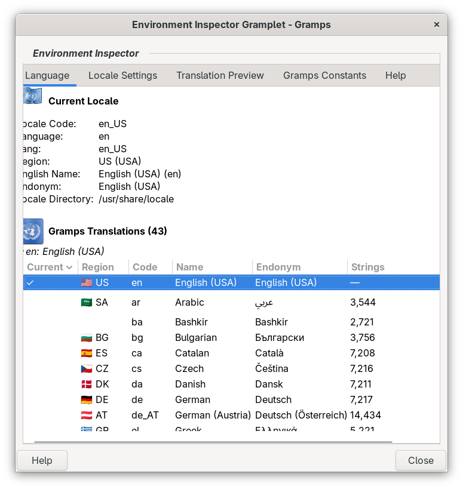
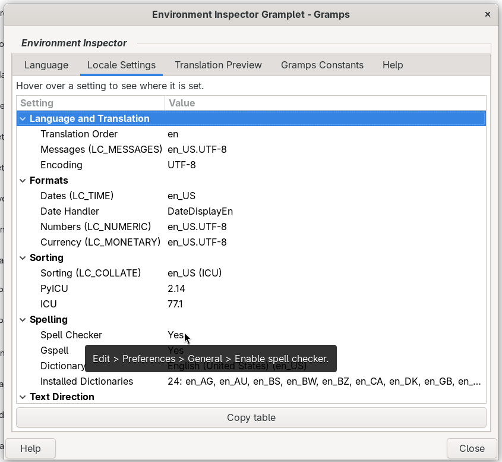
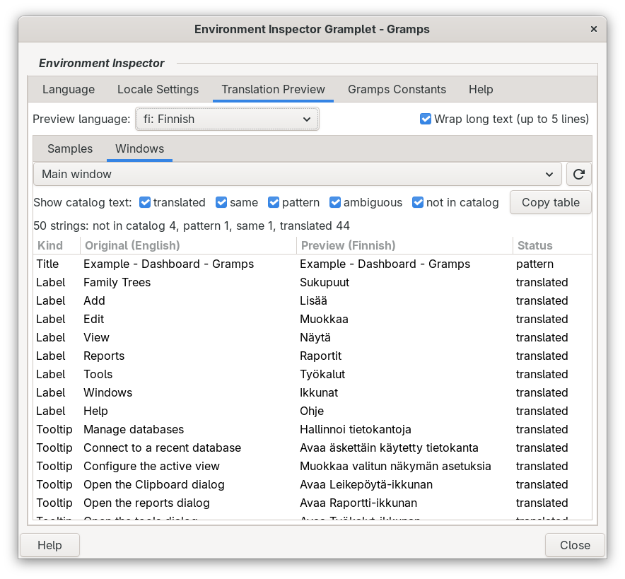
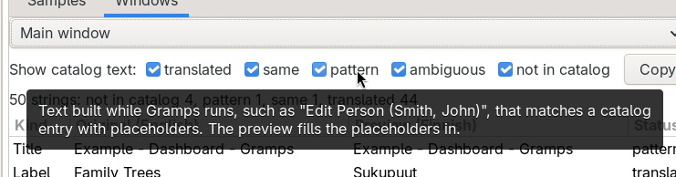
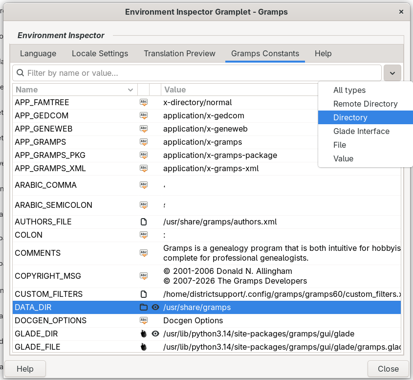
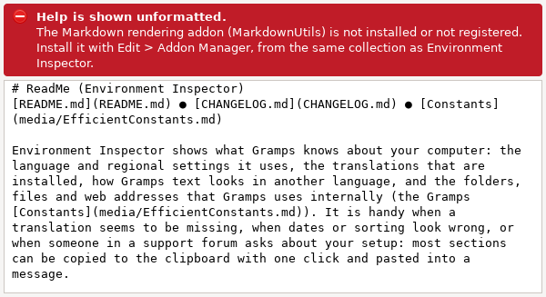

# ReadMe (Environment Inspector)
[README.md](README.md) ● [CHANGELOG.md](CHANGELOG.md) ● [Constants](media/EfficientConstants.md)

Environment Inspector shows what Gramps knows about your computer: the language and regional settings it uses, the translations that are installed, how Gramps text looks in another language, and the folders, files and web addresses that Gramps uses internally (the Gramps [Constants](media/EfficientConstants.md)). It is handy when a translation seems to be missing, when dates or sorting look wrong, or when someone in a support forum asks about your setup: most sections can be copied to the clipboard with one click and pasted into a message.

---

## The five tabs
### Language
The **Current Locale** panel lists the locale code, the language, the region, the English name and the endonym (the name of the language in that language) of the current session, and the folder where Gramps looks for translations. Click the globe icon to copy these lines.

The **Gramps Translations** table lists every installed Gramps translation, with a region flag, the language code, the English name, the endonym and the number of translated strings. Double-click anywhere on the heading row to open or close the table. Click its icon to copy the summary line, or the whole table when it is open. Click a column heading to sort the table.

Double-click a language in the table to use it the next time Gramps starts. Gramps offers to restart right away. Before it closes, every open editor with unsaved changes asks whether to save them, and after the restart Gramps opens the same family tree again. If you choose **Later**, the row shows **Restart** until Gramps starts again; double-click it again to cancel. The choice is used for one start only. Selecting a language in this table also selects it on the Translation Preview tab.

### Locale Settings
The language is only one part of the locale that Gramps uses. This tab lists the other parts, in groups: the translation order and encoding, the locales for dates, numbers and currency, sorting (with the PyICU and ICU versions), spell checking (with the dictionary that Gramps picks and the installed dictionaries), text direction, the Gramps preferences that depend on the locale, and the environment variables that Gramps reads when it starts.

Hold the mouse pointer over a setting to see where it is normally set: a tab of the Gramps Preferences, a right-click menu, a report dialog, the desktop settings or an environment variable. A warning sign on the **Dictionary** row means that notes are checked against a dictionary in a different language from the interface. Right-click the table for **Expand all Nodes** and **Collapse all Nodes**, and click **Copy table** to copy everything. The values are read again each time you open the tab.

### Translation Preview
Choose a **Preview language** to see how Gramps text looks in that language, without changing the running session. The column headings name their languages, for example "Current (Danish)". A column that would only repeat the language of a column to its left is hidden.
* **Samples** shows common Gramps words, a date in every date format, the date modifiers (about, before, between), a sample name and a short sorted list, side by side in the original (English), the current language and the preview language.

* **Windows** shows the interface text of the main window, of any window in the Windows menu, of the visible sidebar or bottombar gramplet, or of an open Dashboard gramplet, looked up in the translation of the preview language. Each row has a status. Use the **Show catalog text** check boxes to choose which statuses are listed; hold the mouse pointer over a check box to see what its status means. The choice is remembered.

* **Wrap long text** lets long text wrap to as many as five lines. **Copy table** copies the visible columns.

The preview only reads interface text. It never reads or changes text that you typed, such as genealogy data.

### Gramps Constants
This tab lists the folders, files, web addresses and text values that Gramps defines internally.
* Type in the search box to filter the list by name or value.
* Use the button beside the search box to show only one type: Remote Directory, Directory, Glade Interface, File or Value.
* The icons show the type of each entry, and whether a folder is hidden.

Double-click a row to copy its value and open it:

| Type | Double-click opens |
| :--- | :--- |
| **Directory** | The folder in your file manager. |
| **File** | The file in its default program. |
| **Glade Interface** | A Glade interface file in the program set for Glade files, or else in your text editor. A Glade folder opens in your file manager. |
| **Remote Directory** | The web address in your web browser. |
| **Value** | Nothing; the value is only copied. |

A blank row always stays at the bottom of the list. Double-click it to copy every row that is listed, one "name: value" line per row.

### Help
This tab shows this document. With the MarkdownUtils addon installed and enabled, it is formatted, with pictures and working links; click the links at the top of a page to move between the help pages. Without MarkdownUtils, a red alert at the top of the tab says that the help is shown unformatted, and whether MarkdownUtils needs to be installed (with the Addon Manager) or activated (in the Plugin Manager).

---

## Installation
Environment Inspector is part of the [Emyoulation curated addons collection](https://gramps.discourse.group/t/curated-third-party-addon-collections/7170/17), and you install it with the Addon Manager of Gramps. The first time, add the collection to the Addon Manager as a project; after that, Gramps can also tell you when an update is available.
1. In Gramps, open the **Edit** menu and choose **Addon Manager...**.
2. Open the **Projects** tab and click the **+** button (Insert a project).
3. For **Project name**, type `Emyoulation curated addons`. For **URL**, copy the line for your version of Gramps:
   * Gramps 6.1: `https://raw.githubusercontent.com/emyoulation/CuratedGrampsPlugins/main/gramps61`
   * Gramps 6.0: `https://raw.githubusercontent.com/emyoulation/CuratedGrampsPlugins/main/gramps60`
   * Gramps 5.2: `https://raw.githubusercontent.com/emyoulation/CuratedGrampsPlugins/main/gramps52`
4. Open the **Addons** tab. Set the audience filter to **All audiences** and the status filter to **All statuses**, so that every addon of the collection is listed.
5. Find **Environment Inspector** in the list and click **Install**, then close the Addon Manager.
6. In the Navigator on the left, click the **Dashboard** category.
7. Right-click an empty part of the Dashboard, choose **Add a gramplet**, and then choose **Environment Inspector**.

To deactivate or uninstall Environment Inspector, open the **Help** menu and choose **Plugin Manager**. Select **Environment Inspector** in the list. Click **Hide/Unhide** to deactivate it (Gramps then no longer loads it, and clicking **Hide/Unhide** again brings it back), or uninstall it there.

---

## More information
* [CHANGELOG.md](CHANGELOG.md) lists the changes in each version and ends with the outstanding issues: planned features, ideas that need discussion, and limits of Gramps itself.
* [Constants](media/EfficientConstants.md) is a short developer reference for using the Gramps constants in an addon.
* Environment Inspector saves its few settings (a language chosen for the next start, and the **Show catalog text** choices) in `EnvironmentInspector.ini`, in its own folder.

---

## Technical Specifications & AI Lineage

### System Environment Specifications
* **Minimum Software Target:** Gramps 5.2.0 or later.
* **Component Classification:** Dashboard Gramplet.
* **UI Render Engine:** GTK 3, with widgets anchored in text views, tree views and an optional MarkdownUtils renderer for the Help tab.

### AI Contribution and Review History
In accordance with the **GNU General Public License v2.0 or later** and the [Gramps guidelines for AI generated code](https://www.gramps-project.org/wiki/index.php/Howto:_Contribute_to_Gramps#AI_generated_code), the development history of this addon is listed below. Brian McCullough provided the ideas and direction ("wish coding"); the code and documents were written by the AI tools named here.
1. **Original framework:** layout and initialization generated with ChatGPT (OpenAI).
2. **Early maintenance:** refactored, debugged and extended by Claude Sonnet 4.6 (Anthropic, `claude-sonnet-4-6`): the tabbed layout, the constants search, hidden-folder detection and text-view sizing.
3. **Later development:** the Translation Preview, Locale Settings and Help tabs, the Gramps Translations table, the restart for another language, and the revised documents, by Claude (Anthropic), most recently Claude Opus 5.5 (`claude-opus-5-5`).
4. **First user guide:** generated by Gemini 1.5 Pro (Google, `gemini-1.5-pro-20240514`) from the Python code; this document replaces it.

