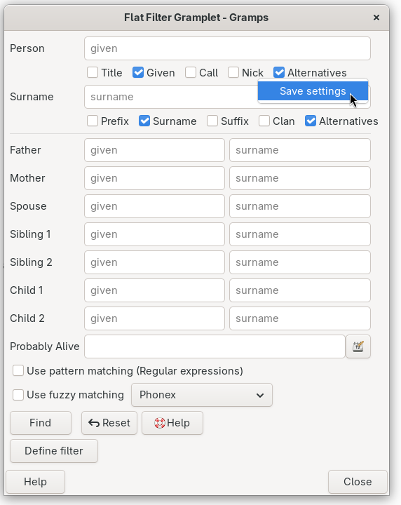
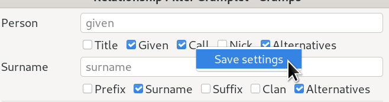

# Flat Filter

[Read Me](README.md) ● [Change Log](CHANGELOG.md)

A Gramps gramplet that adds a sidebar filter to the **People** view. It finds people by the names of their relatives (father, mother, spouse, siblings and children), by their own name, by an optional "probably alive" date, and with several text-matching modes.

Where the standard Person filter offers a single *Name* box, Flat Filter gives each relationship role **two boxes**: one for the given name and one for the surname. This lets you narrow a search precisely, with plain text, regular expressions, or phonetic matching.

## Background
Paul Womack (BugBear) wrote Flat Filter to fill two gaps in the standard Gramps filter sidebar: it cannot search a given name separately from a surname, and it has no quick way to filter by the names of relatives.

[Paul suffered a serious stroke in April 2026 and asked for volunteers to continue the gramplet](https://gramps.discourse.group/t/flat-filter-addon-can-anyone-take-over-help/9725). Doug Blank reworked it as "Relationship Filter" for Gramps 6.0. Version 2.0.0 returns to the original name and adds Gramps 5.2 support, name-part checkboxes, and a choice of phonetic systems. See the [Change Log](CHANGELOG.md) for the full history.

## Requirements
- Gramps 5.2, or Gramps 6.0 and later.
- No third-party Python packages. The gramplet uses only Gramps itself and the GTK bindings that Gramps already needs.
- Optional: the **Fuzzy Matching** addon, for phonetic systems other than Soundex (see Phonetic systems below).
- Optional: the **Markdown Dash** addon, to show this README inside Gramps (see Help button below).

## Installation
1. Install the gramplet with the Addon Manager.
2. Restart Gramps (or use **Help → Reload Plugins**).
3. Open the **People** view.
4. In the sidebar, choose **Gramplets → Add a Gramplet → Flat Filter**, or add it from the gramplet selector of the sidebar. The gramplet also works in the bottombar.

If an older copy named "Relationship Filter" is installed, remove it. Settings saved by that copy are not carried over.

## Compatibility
Works on Gramps 5.2 and Gramps 6.0 and later. Gramps 6.0 renamed the internal `Rule.apply()` method, which every filter rule must implement, to `apply_to_one()`. The rule classes in this addon implement both names (one calls the other), so the same file runs on either version.

## What it does
The gramplet places a set of name-search rows in the sidebar. Most rows have two text boxes, a given-name box and a surname box, which are combined into one filter when you click **Find**. The **Person** row is the exception: its given-name and surname boxes are on separate lines, each followed by its own row of **Include:** checkboxes (see below).



| Row | Matches people who... |
|-------------------------|---------------------------------------------------------------------|
| Person | ...have this given name / surname themselves |
| Father | ...have a father with this given name / surname |
| Mother | ...have a mother with this given name / surname |
| Spouse | ...have a spouse with this given name / surname |
| Sibling 1, Sibling 2 | ...have a sibling with this given name / surname |
| Child 1, Child 2 | ...have a child with this given name / surname |

Any row you leave blank is skipped. Filling in more than one row combines them with an implicit **AND**: a person must match every box that is filled in. For example, a surname in *Person* and a given name in *Father* finds people with that surname whose father has that given name.

The two **Sibling** rows (and the two **Child** rows) work the same way. Each row is tested separately, so filling in both finds people who have a sibling matching the first row **and** a sibling matching the second, for example a brother named `John` and a sister named `Mary`. One sibling who matches both rows also counts.

Press **Enter** in any box, or click **Find**, to apply the filter. Spaces at the start or end of a box are removed first. Click **Reset** to clear the boxes. **Find** with every box blank shows everyone.

### Basic name search examples
- Everyone whose **father** has a surname containing `Mac`: in the **Father** row, leave the given-name box empty and type `Mac` in the surname box.
- Everyone with a **spouse** named `Ann`, `Anne` or `Anna`: check **Use pattern matching (Regular expressions)**, then type `^Ann(e|a)?$` in the given-name box of the **Spouse** row.

The **Probably Alive** field accepts a Gramps date (for example `before 1900`, or `between 1800 and 1900`). It uses the standard Gramps `ProbablyAlive` rule to keep only people who were plausibly alive around that time. Date words follow the language of Gramps, so type them as the Gramps date editor shows them.

## Include: checkboxes (Person row only)
A Gramps name record stores several parts: a title, a call name, a nickname, a surname prefix, a suffix, a family nickname (labeled "Clan" here because it is short), and more, in addition to the given name and surname. By default, matching a name tests **all** of these parts. That can give surprising results: a search for an *empty* given name (`^$`, see below) also matches anyone with an empty *title*, which is nearly everyone.

The two checkbox rows of the **Person** row narrow the search to the parts you mean, for that row only. Every other row (Father, Mother, Spouse, and so on) still searches all parts.

- Below the given-name line: **Title**, **Given**, **Call**, **Nick**, **Alternatives**
- Below the surname line: **Prefix**, **Surname**, **Suffix**, **Clan**, **Alternatives**

Only the checked parts are tested against the text you typed. **Alternatives** (in both rows, set separately) decides whether *alternate* names are searched as well as the primary name. For example, you might search alternate names for a surname but not for a given name.

**Defaults:** Given + Alternatives, and Surname + Alternatives, are checked. Everything else starts unchecked. This is deliberately narrow, so a pattern like `^$` behaves as expected (see the Regular expression examples below) instead of matching almost everyone through a blank title or suffix.

### Saving your own checkbox settings
Right-click **any** checkbox in the gramplet (either Include: row, or the **Use pattern matching (Regular expressions)** / **Use fuzzy matching** checkboxes below), or its label, to open a small context menu with **Save settings**.


**Save settings** writes the state of all twelve checkboxes (five personal, five surname, and the two matching-mode checkboxes) to `FlatFilter.ini`, in the folder of the gramplet. It uses the Gramps configuration system, the same one other Gramps addons use. The gramplet reloads these settings the next time it starts, and the **Reset** button restores them too.

The phonetic system chosen in the **Use fuzzy matching** popup menu does not need **Save settings**. It is remembered as soon as you change it.

## Help button
The **Help** button next to **Find** / **Reset** opens this README. It opens in a Markdown Dash window if that addon is installed and enabled, or in your web browser otherwise. If a translation of this README exists for your Gramps language, that translation opens instead.

## Matching modes
Two checkboxes control how the text you type is interpreted. They are mutually exclusive: checking one unchecks the other.

- **Use pattern matching (Regular expressions)** treats the text as a Python [Regular expression](https://gramps-project.org/wiki/index.php/Gramps_Glossary#regex) instead of a plain substring.
- **Use fuzzy matching** treats the text phonetically, so names that *sound* alike match even when they are spelled differently (for example `Smith` and `Smyth`). The popup menu after the checkbox chooses the phonetic system. Soundex is the default.

If neither box is checked, the text is matched as a plain, case-insensitive substring anywhere in the field (the normal Gramps default).

Like the Include: checkboxes, these two checkboxes are covered by **Save settings** and **Reset** (see above).

## Phonetic systems
The **Use fuzzy matching** popup menu lists the phonetic systems that are available:

- Without the Fuzzy Matching addon, only **Soundex** (built into Gramps) is listed.
- With the Fuzzy Matching addon installed and enabled, every system that addon provides is listed, for example Soundex, NYSIIS, Match Rating Approach and Metaphone. Hover over the menu to see a description of the selected system.

If a remembered system is no longer installed, the menu shows Soundex until you choose another system.

## Regular expression examples
When **Use pattern matching (Regular expressions)** is checked, the text in a given-name or surname box is matched against that field with the Python `re` module. Some practical examples:

| Pattern | Finds people whose... | Typical use |
|---------|-------------------------------|---|
| `^$` | given name (or surname) field is **empty** | A "Null" pattern |
| `.+` | given name (or surname) field is **not empty** | A "not-Null" pattern |
| `^Mc` | surname starts with `Mc` (e.g. `McDonald`, `McKay`) | Prefix search |
| `sen$` | surname ends in `sen` (e.g. `Jensen`, `Andersen`) | Suffix search, useful for Scandinavian patronymics |
| `^(John\|Jon\|Jonathan)$` | given name is exactly `John`, `Jon`, or `Jonathan` | Exact match against a small set of name variants |
| `[aeiou]{3,}` | field contains three or more vowels in a row | Catching unusual spellings or OCR/transcription errors |
| `(?i)^o'` | surname starts with `O'` in any letter case (e.g. `O'Brien`, `o'brien`) | Case-insensitive prefix match |

* **A "Null" pattern** finds records missing that piece of data. For example, put `^$` in the *Person* surname box to find everyone with no surname recorded. On the **Person** row, this only works as expected when the Include: checkboxes are narrowed to the one field you mean (the defaults already do this). With every part checked, `^$` also matches anyone with a blank title, suffix, and so on.
* **A "not-Null" pattern** is the opposite. Put `.+` in the *Father* given-name box to find everyone whose father has a recorded given name.
* **Case-insensitive prefix match**: the substring mode is already case-insensitive, but this shows how to force it inside a pattern.

## Fuzzy matching example
With **Use fuzzy matching** checked and **Soundex** chosen, typing `Smith` in a surname box also matches `Smyth`, `Smithe`, and other names with the same Soundex code. This helps when a family name was spelled differently across historical records.

Each word of a name is encoded separately, so `John` in a given-name box also finds `John Henry`.

**Note:** a phonetic code covers the *whole* word. It is not a prefix search. Typing `Thom` matches `Thom`, but not `Thomas` (the Soundex codes are `T500` and `T520`). Type the full name you expect, not a shortened form.

## Known limitations
- Sibling matching uses only the *main* parent family of a person (`get_main_parents_family_handle()`), not every parent family. A person with more than one parent family (for example, birth parents and adoptive parents) may miss some siblings.
- The rule class hierarchy (`_HasNamedRelation` and its subclasses) mixes composition and inheritance in a way that the original author called "slightly nasty". Refactoring is welcome.
- The rules are used only inside the gramplet. They do not appear in the Gramps Filter Editor.

## Notes for developers
- The rule classes are ordinary Gramps `Rule` subclasses and can be reused or combined in custom filters:

| Class | Matches |
|-------|---------|
| `RegExpPersonal` | The given-name side of a name: title, given name, call name, nickname |
| `RegExpFamily` | The surname side of a name: prefix, surname, suffix, family nickname ("Clan") |
| `HasName` | The person, including the surnames of spouses for a female person (see below) |
| `HasNamedFather` | The father of the person matches a name rule |
| `HasNamedMother` | The mother of the person matches a name rule |
| `HasNamedSpouse` | Any spouse matches a name rule |
| `IsSiblingofNamedSibling` | Any sibling in the main parent family matches a name rule |
| `HasNamedChild` | Any child matches a name rule |

- `RegExpPersonal` and `RegExpFamily` accept optional `personal_fields` / `surname_fields` (a subset of `PERSONAL_FIELDS` / `SURNAME_FIELDS`) and `include_alternates` arguments, which restrict the name parts tested and whether alternate names are tested. Only the "Person" row of the sidebar passes these (from its Include: checkboxes). Every other row omits them and searches everything.
- Phonetic matching is selected with an `encoder` argument: a function that takes one word and returns a `set` of codes, or `None` for no phonetic matching. A field matches when any word in it shares a code with any word of the search text.
- The phonetic systems come from the `phonetic_codes` registry of the Fuzzy Matching addon, reached through its "Fuzzy Match API" GENERAL plugin (`BasePluginManager.get_plugin()` then `import_plugin()`), as described in `FuzzyMatchAPI.md` of that addon. If that plugin is missing or fails to load, only the built-in `gramps.gen.soundex` is offered.
- The sidebar UI is built on the Gramps `SidebarFilter` base class (`gramps.gui.filters.sidebar.SidebarFilter`). The matching-mode checkboxes, the phonetic system popup menu and both Include: rows are attached directly to `self.grid`.
- Matching a `HasName`-derived rule against a `RegExpFamily` field for a female person also searches the surnames of her spouses, since married women in many record-keeping traditions took the surname of their spouse.
- Settings are stored with the Gramps configuration system (`gramps.gen.config.config.register_manager`) as `FlatFilter.ini` in the addon folder: the Include: checkboxes, the two matching-mode checkboxes (`[matching]` `regex`, `fuzzy`) and the phonetic system (`[matching]` `algorithm`). The file also stores the plugin id and a config schema version under `[meta]`. If either does not match what the running code expects, all saved settings are reset to their defaults rather than risk misreading a value from an incompatible revision.
- Every rule class implements both `apply_to_one()` (called by Gramps 6.0) and `apply()` (a one-line alias for Gramps 5.2). See Compatibility above.
- **Do not use `db.get_raw_person_data()` / `db.get_raw_family_data()` for anything beyond a bare lookup.** They look like a good Gramps 6.0 speed-up, but the result depends on backend and version: on the Gramps 5.2 dbapi backend they return a plain pickled tuple with no attribute access, while the Gramps 6.0 JSON-backed database returns a dict-like wrapper that supports attribute access. Code that assumes the latter raises `AttributeError` on the former. This was tried, failed in the field, and was reverted to `get_person_from_handle()` / `get_family_from_handle()`, verified against real `gramps==5.2.4` and `gramps==6.0.8` installs.
- The Help button code is pasted into `FlatFilter.py` from the reference `help_doc_button.py` kept with MarkdownUtils (see `HelpDocButton.md` there), between `BEGIN HELP BUTTON BLOCK` and `END HELP BUTTON BLOCK` markers. No separate module ships with this addon. If the button row cannot be found, the gramplet simply has no Help button.
- `SidebarFilter` wraps each button row in a 12 px border; `Filter._tighten_button_rows()` replaces it with smaller margins. The undocked window size is set by `detached_width` / `detached_height` in `FlatFilter.gpr.py`.

### Files
```
FlatFilter/
├── FlatFilter.py       # Rule classes, sidebar filter, gramplet, Help button
├── FlatFilter.gpr.py   # Gramps plugin registration
├── FlatFilter.ini      # Saved settings (created by Save settings)
├── README.md
├── CHANGELOG.md
└── media/              # Screenshots used by this README
```

## Contributing
Bug reports and patches are welcome. Please follow the [Gramps developer guidelines](https://www.gramps-project.org/wiki/index.php/Howto:_Contribute_to_Gramps), including the [disclosure rules for AI-generated code](https://www.gramps-project.org/wiki/index.php/Howto:_Contribute_to_Gramps#AI_generated_code). New code should be formatted with Black and checked with pylint (target score 9 or higher) and mypy. Tests belong in a `test/` folder, use the `unittest` framework, and are named `*_test.py`:

```bash
GRAMPS_RESOURCES=. python3 -m unittest discover -p "*_test.py"
```

## Taking over maintenance
Paul Womack is looking for someone to maintain Flat Filter. If you are willing to take on that role:
1. Post on the [Gramps Discourse forum](https://gramps.discourse.group/) with the subject *"Flat Filter — volunteering as maintainer"*.
2. Review the Known limitations above, and the TODO comments in the source.
3. Make sure you have a working Gramps development environment.

A maintainer triages bug reports, reviews and merges patches, keeps the gramplet working with new Gramps releases, and publishes new releases for the Addon Manager.

## Credits
- Paul Womack (BugBear): original author and designer.
- Doug Blank: the "Relationship Filter" rework for Gramps 6.0.
- Version 2.0.0: Claude AI (Anthropic), wish coding by Brian McCullough.
- The Gramps development team, for the `SidebarFilter`, `GenericFilter` and `Rule` classes that Flat Filter builds on.

## License
GNU General Public License v2.0 or later, consistent with Gramps itself.
