# Fuzzy Grouping

[README.md](README.md) ● [CHANGELOG.md](CHANGELOG.md)


Fuzzy Grouping is a view for the People category of Gramps. It works like the built-in Grouped People view, but it puts people into groups by how their surnames sound, not by exact spelling. Smith, Smyth and Schmidt can be in one group, so the spelling variants of a family are easy to see side by side, and easy to compare when you look for people to merge.

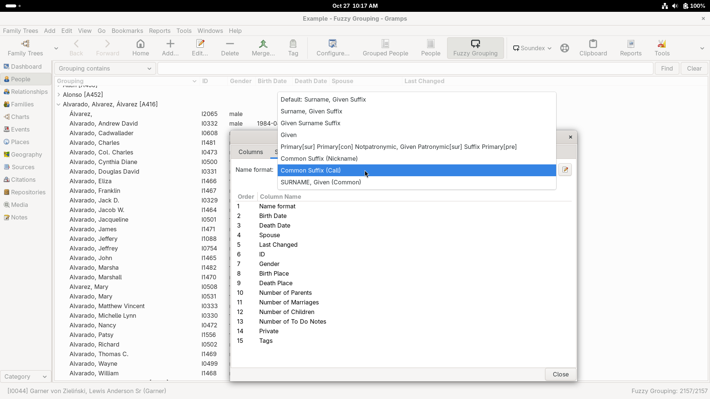

## Contents
- [Requirements](#requirements)
- [Install](#install)
- [Opening the view](#opening-the-view)
- [Reading the groups](#reading-the-groups)
- [Phonetic systems](#phonetic-systems)
- [The toolbar](#the-toolbar)
- [Configure: Columns tab](#configure-columns-tab)
- [Configure: Subsorting tab](#configure-subsorting-tab)
- [When changes take effect](#when-changes-take-effect)
- [Working with Flat Filter and Fuzzy Matching](#working-with-flat-filter-and-fuzzy-matching)
- [Adding and editing people](#adding-and-editing-people)
- [Settings](#settings)
- [Limits](#limits)
- [Turn the view off](#turn-the-view-off)
- [Credits](#credits)
- [AI disclosure](#ai-disclosure)

## Requirements
- Gramps 5.2, 6.0 or 6.1.
- Optional: the [Phonetic Filter Rules](https://github.com/emyoulation/CuratedGrampsPlugins/blob/main/gramps61/source/FuzzyRules/README.md) addon. Without it, the view uses Soundex only. With it, the view can also use NYSIIS, Match Rating Approach, Phonex, Metaphone, Double Metaphone and Daitch-Mokotoff.
- Optional: the Markdown Dash addon, to read this document inside Gramps from the Help icon.
- Optional: the Flat Filter and Fuzzy Matching gramplets, which share the phonetic system with this view (see [Working with Flat Filter and Fuzzy Matching](#working-with-flat-filter-and-fuzzy-matching)).
- Recommended: PyICU, for correct subsorting. Most Gramps installations include it.

## Install
Install the addon with the Gramps Addon Manager, from the [https://github.com/emyoulation/CuratedGrampsPlugins/](Emyoulation addons project). If the Emyoulation addons project is not in your Addon Manager yet, add it as the project page describes. Restart Gramps after you install the addon.
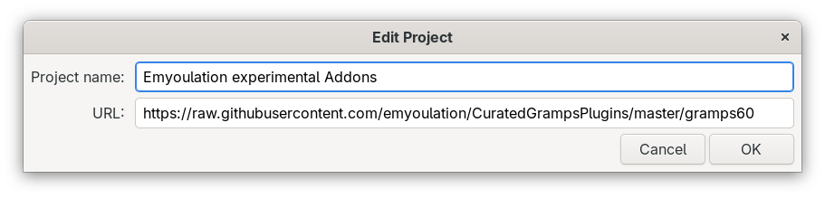

# Important! Change the **Status** filter in the **Addons** tab of the Addon Manager from **Stable** to **All statuses**.
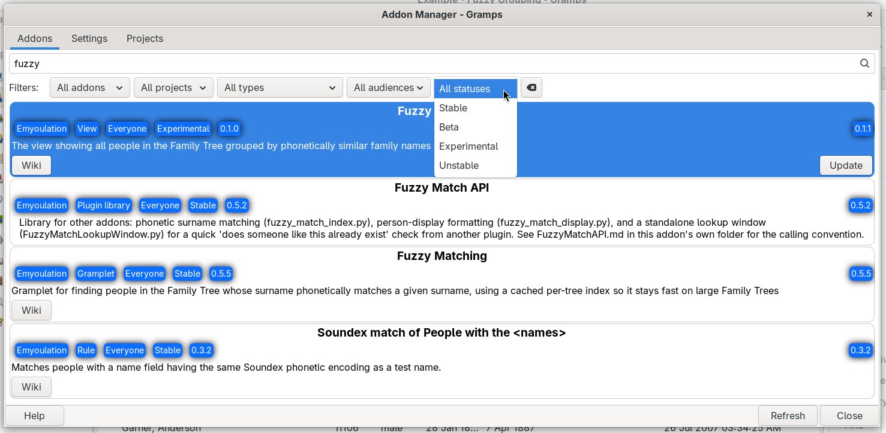


## Opening the view
Choose the **People** category, then click the **Fuzzy Grouping** button on the toolbar, or choose **Fuzzy Grouping** from the **View** menu.

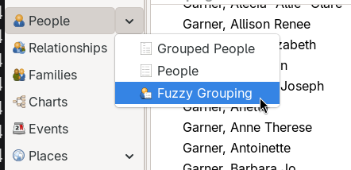

The first time the view opens, the Configure dialog also opens, so that you can choose how the groups and the people in them are sorted. You can close it and keep the defaults. To open it again at any time, click the **Configure...** button on the toolbar.

## Reading the groups
The view shows one row for each group. Click the triangle beside a group row to see the people in the group. To open or close every group at once, right-click in the view and choose **Expand all Nodes** or **Collapse all Nodes**.

Each group row lists the surname spellings in the group, the most used spelling first, followed by the phonetic code in brackets. For example: `Smith, Smyth, Schmidt +2 [S530]`. When a group has more than four spellings, "+N" tells how many more spellings the group has.

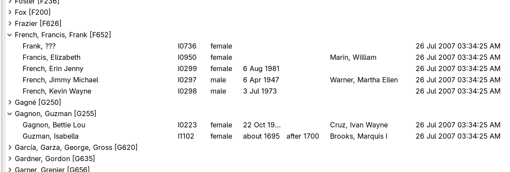

People with no surname are in a group of their own, at the top of the list.

The view starts from the same group name as the Grouped People view. A "Group as" value on a name, and the surname group mapping table of Gramps, still apply. The phonetic code is made from the group name that those settings give. So if you group "MacDonald" as "McDonald" in Gramps, the view uses "McDonald" to make the code.

Each person is in exactly one group, made from the primary name of the person. Alternate names do not make extra groups.

## Phonetic systems
A phonetic system turns a name into a short code from how the name sounds. Names with the same code go into one group. Different systems make different choices, so a pair of names can share a group with one system and not with another.

- **Soundex** is the classic system for English names, and the one that Gramps uses itself. It keeps the first letter and makes a letter and three digits. It is always available, and it is the default.
- **NYSIIS** (New York State Identification and Intelligence System) handles common English spelling patterns better than Soundex.
- **Match Rating Approach** keeps the outline of the name: its first letter, and the consonants that are not doubled.
- **Phonex** is a variant of Soundex that treats more starting letters alike.
- **Metaphone** follows English pronunciation rules, so it can group names that do not start with the same letter, like "Knight" and "Night".
- **Double Metaphone** also knows many spellings from other languages, and can give a second code for a name that can be said two ways.
- **Daitch-Mokotoff** was made for Eastern European and Jewish names, and can give several codes for one name. Its codes are numbers.

To see a short description of the system in use, hold the pointer over the phonetic system menu button.

The systems other than Soundex come from the Phonetic Filter Rules addon. If you hide one of its rules in the Plugin Manager, that system leaves the menu the next time you open the view. If the view was using it, the view goes back to Soundex, but it remembers your choice: when you show the rule again, the view uses it again.

## The toolbar
The view adds two items at the right end of the toolbar.

The **phonetic system menu button** shows the view icon and the name of the current system. Click it and choose another system. The view builds its groups again at once.

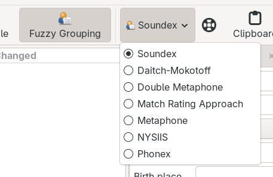

The **Help icon** shows this document. If Markdown Dash is installed and active, the document opens inside Gramps. Otherwise, the Help web page opens in your browser. Hold the pointer over the icon to see which one a click will open.

## Configure: Columns tab
Click the **Configure...** button on the toolbar to open the Configure dialog.

At the top of the Columns tab, **Grouping:** sets the order of the groups:
- **Fuzzy grouping ID** (the default) sorts the groups by their phonetic code. With Soundex, the groups come out nearly in alphabetical order, because a Soundex code starts with the first letter of the name.
- **Sample Surname** sorts the groups alphabetically by the most used spelling in each group. Choose this with Daitch-Mokotoff, whose number codes have no alphabetical order.

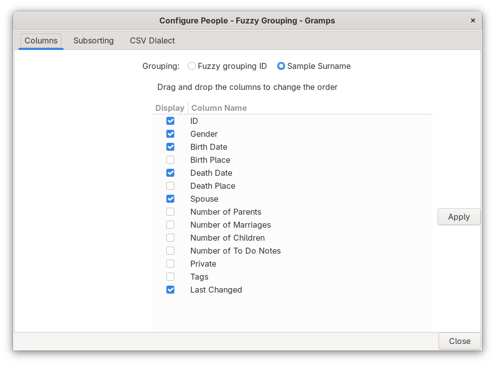

The first column of the view is named **Grouping**. It always stays first. Below the Grouping choice, the list of columns works the same as in the Grouped People view: check a column to show it, drag a column to a new place in the list, then click **Apply**.

## Configure: Subsorting tab
The Subsorting tab sets the order of the people inside each group.

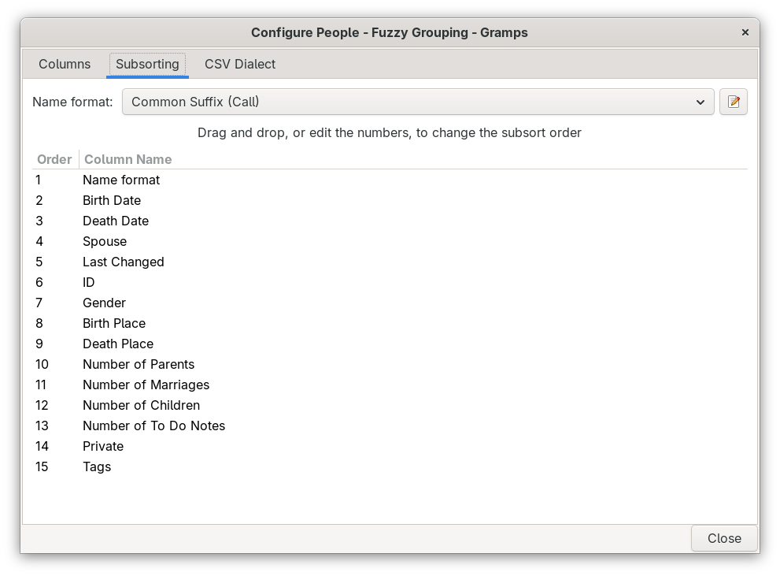

**Name format** chooses how names are compared for sorting. This choice is used only for sorting in this view. It does not change the Name format in the Gramps Preferences, and it does not change how names are shown. The first choice, **Default**, is your current Display name format without the surname parts, because the people in a group already have similar surnames. If you change the Display name format in the Preferences later, Default follows it.

Click the edit icon beside Name format to open the Display Name Editor, the same editor that the Preferences use. There you can add, change and remove name formats. When you close the editor, the format that you last selected in it is chosen here.

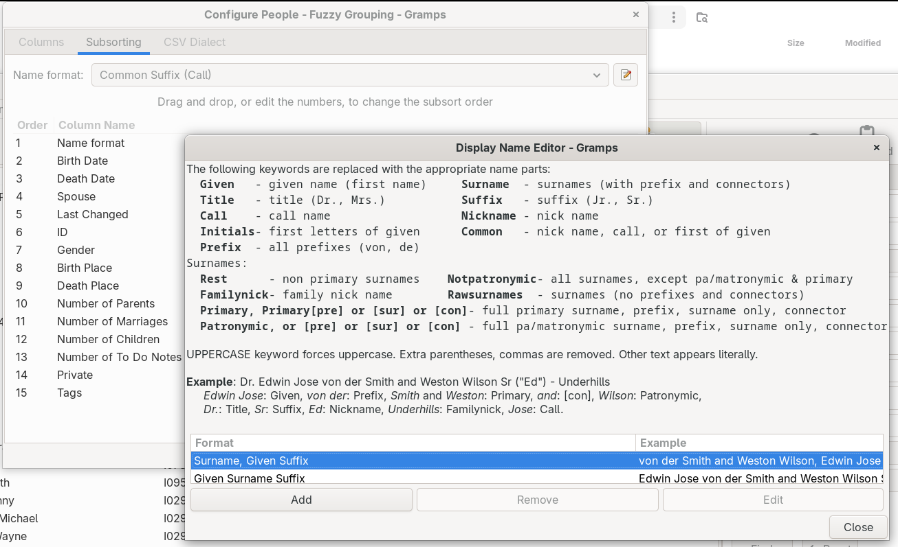

Below Name format is a numbered list of everything that can be used for sorting. The view sorts by number 1 first, then uses number 2 when number 1 is the same, and so on. To change the order, drag a line to a new place, or click its number and type a new number. The other lines move to make room. The first order is:
1. Name format
2. Birth Date
3. Death Date
4. Spouse
5. Last Changed
6. The other columns, in the order of the Columns tab

The subsort is used when the view is sorted by the Grouping column. When you click another column header, the view sorts by that column only, the same as the Grouped People view. Click the Grouping column header to go back to the subsort.

## When changes take effect
Changes in the Configure dialog take effect 5 seconds after your last change, so that several quick changes need only one rebuild. When you close the Configure dialog, a waiting change takes effect at once. The **Apply** button of the Columns tab and the phonetic system menu on the toolbar take effect at once.

When building the groups takes more than 1 second, a progress window shows how far the work has gone. In a large family tree, the subsort can take more time than the grouping, because Spouse and the number columns must look up other records for each person.

## Working with Flat Filter and Fuzzy Matching
The Flat Filter gramplet (in the sidebar) and the Fuzzy Matching gramplet (in the sidebar or the bottom bar) have their own phonetic system menus. When one of them is in this view, it uses the same system as the view, both ways:
- When you choose a system on the toolbar of the view, the gramplets in this view change to it.
- When you choose a system in one of these gramplets, the view and the other gramplet change to it. The view builds its groups again 5 seconds later. If you click **Find** in the Flat Filter before then, that one rebuild does both.

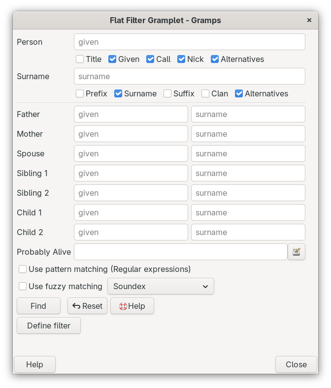

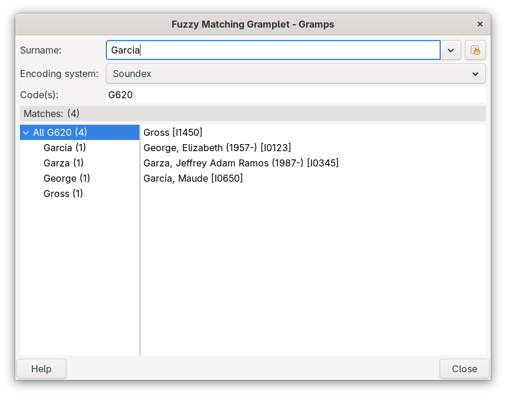

If a gramplet does not offer the system that the view uses, it shows Soundex. In other views, the gramplets keep their own choice. The Fuzzy Match Lookup window is a separate window, so it also keeps its own choice.

A filter in the sidebar changes which people the view shows. The groups are then made only from those people.

## Adding and editing people
Double-click a person to open the Edit Person dialog, as in the other People views. When you click **Add** (the plus button) while a person is selected, the new person starts with the surname of the selected person, as in the Grouped People view.

When you change a name, the person moves to the group of the new name. Group rows stay in their places until the view is built again (for example, the next time you open the view).

## Settings
The settings are saved in the file `FuzzyGrouping.ini` in the addon folder: the phonetic system, the Grouping choice, the sort Name format and the subsort order. The column choices of the Columns tab are saved by Gramps, as for every view.

To start again from the defaults, close Gramps and delete `FuzzyGrouping.ini`. The next time you open the view, the Configure dialog opens again, as on first use.

## Limits
- Systems that can give more than one code for a name (Double Metaphone and Daitch-Mokotoff) use the lowest code, so that each person is in exactly one group. Two spellings that share only a second code can end up in different groups.
- With Sample Surname, the group order is set when the groups are built. A person added later does not move a group, even if that person changes which spelling is used most.
- Subsorting needs PyICU. Without it, the sort fields can run together, and the order of the people in a group can be wrong.
- While the Display Name Editor is open from this view, the **Edit...** button for Name format in the Gramps Preferences shows an error. Close the editor first. This is a problem in Gramps itself.

## Turn the view off
To switch the view off without removing it, open the Help -> Plugin Manager, hide (or Deactivate) the "Fuzzy Grouping", and restart Gramps. To remove it, use the "Uninstall".

## Credits
- The view starts from the Grouped People view of Gramps, by the Gramps project.
- The other phonetic systems come from the Phonetic Filter Rules addon.
- Addon by Brian McCullough.

## AI disclosure
This addon was substantially written with an AI tool, as the Gramps [AI generated code policy](https://www.gramps-project.org/wiki/index.php/Howto:_Contribute_to_Gramps#AI_generated_code) asks contributors to disclose.
```
Generated-by: Claude Opus 5.5 (claude-opus-5-5), Anthropic, via the claude.ai chat interface, 2026
Prompted by: Brian McCullough
```
- **Prompts (summary):** fork the Grouped People view into a view that groups by phonetic code, with Soundex as the default, a toolbar menu for the other systems and a custom icon; a Configure dialog with a Grouping choice and a Subsorting tab (a sort-only name format and a numbered subsort order with drag and drop); a delayed refresh, a progress window and a Help icon; respect for hidden plugins; and a shared phonetic system with the Flat Filter and Fuzzy Matching gramplets.
- **Guidelines:** written in "draft mode", so the Gramps [AGENTS.md](https://github.com/gramps-project/gramps/blob/master/AGENTS.md) style rules (type hints, Black, pylint and others) were not applied.
- **Testing:** the AI checked the code by compiling it and by reading the Gramps 5.2, 6.0 and 6.1 sources. The user interface was tested by Brian McCullough.
