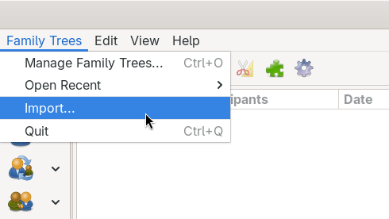
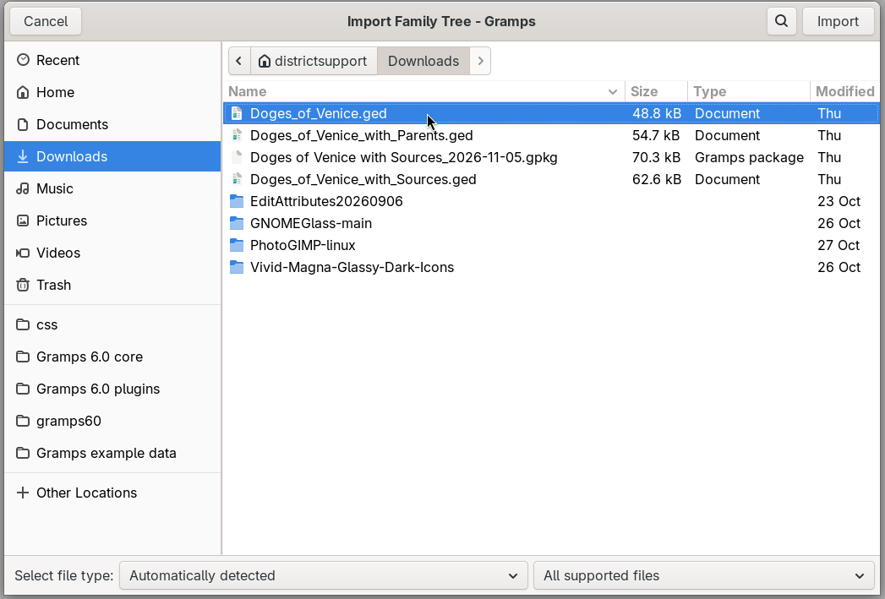
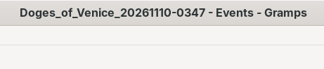
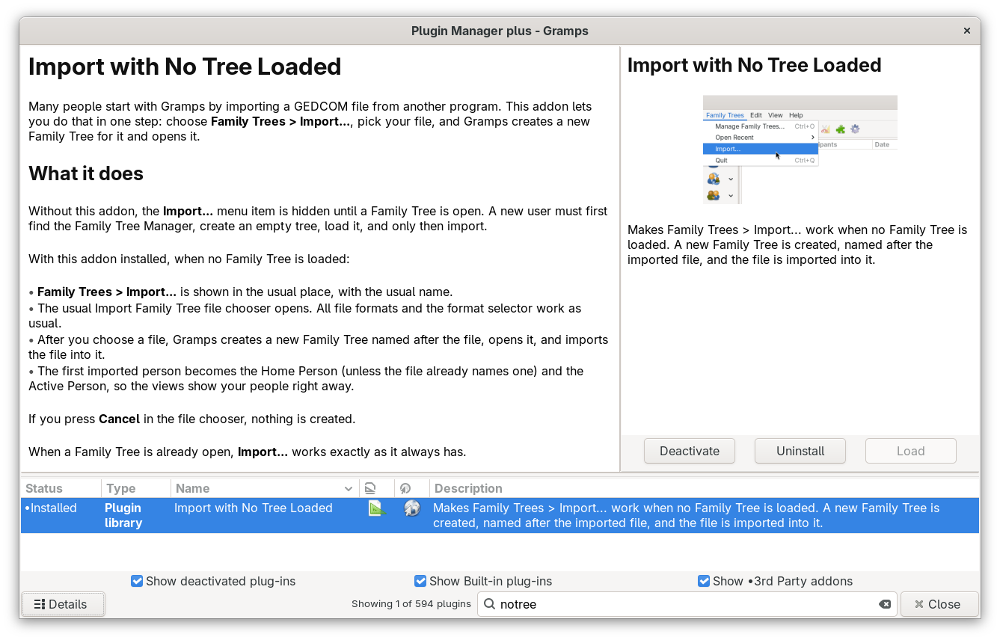

# Import with No Tree Loaded
Many people start with Gramps by importing a GEDCOM file from another program. This addon lets you do that in one step: choose **Family Trees > Import...**, pick your file, and Gramps creates a new Family Tree for it and opens it.

## What it does
Without this addon, the **Import...** menu item is hidden until a Family Tree is open. A new user must first find the Family Tree Manager, create an empty tree, load it, and only then import.

With this addon installed, when no Family Tree is loaded:

- **Family Trees > Import...** is shown in the usual place, with the usual name.
- The usual Import Family Tree file chooser opens. All file formats and the format selector work as usual.
- After you choose a file, Gramps creates a new Family Tree named after the file, opens it, and imports the file into it.
- The first imported person becomes the Home Person (unless the file already names one) and the Active Person, so the views show your people right away.

If you press **Cancel** in the file chooser, nothing is created.

When a Family Tree is already open, **Import...** works exactly as it always has.

## How the new tree is named
The tree gets the name of the file plus the date and time of the import in UTC. For example, importing `Genesis.ged` creates a tree named `Genesis_20261110-0013`. If that name is already taken, `_2`, `_3` and so on are added. You can rename the tree later in the Family Tree Manager.

## How to use it
1. Start Gramps. If the Family Tree Manager opens, close it.
2. Choose **Family Trees > Import...**.
3. Pick your file and press **Import**.

The addon has no window and no settings of its own.

## Uninstalling

## Related links
- [Mantis feature request 0012185](https://gramps-project.org/bugs/view.php?id=12185) asks for Import to work when no tree is loaded. This addon is a way to try that idea before it is part of Gramps.
- [Pull request #2388: Prompt new users to import the Example Family Tree on startup](https://github.com/gramps-project/gramps/pull/2388) is another way to help new users get started.
- [Pull request #2394: First-run onboarding tour](https://github.com/gramps-project/gramps/pull/2394) adds a guided tour for new users.
- [Pull request #1297: Make an easy way to start Gramps for novices](https://github.com/gramps-project/gramps/pull/1297) was an earlier idea that created a starting family in a new tree.
- [Pull request #2179: Backend picker dialog when creating a new family tree](https://github.com/gramps-project/gramps/pull/2179) shows the opposite direction, an extra step when creating a tree.

## Assumptions I made
- The menu item keeps the usual "Import..." label, so translators have nothing new to translate. A separate "Import as New Family Tree..." item would be clearer, but was not chosen.
- The keyboard shortcut Ctrl+I does nothing until a tree is open. Binding it a second time would make Gramps log a duplicate shortcut warning.
- If the new tree cannot be opened, or the import fails, the new empty tree stays in the Family Tree Manager. It is not deleted automatically.
- "First imported person" means the first person stored in the database. That is usually the first person in the file, but it is not always the lowest Gramps ID.
- The Family Tree Manager still opens at startup when no tree is loaded. The user closes it to reach the menu.
