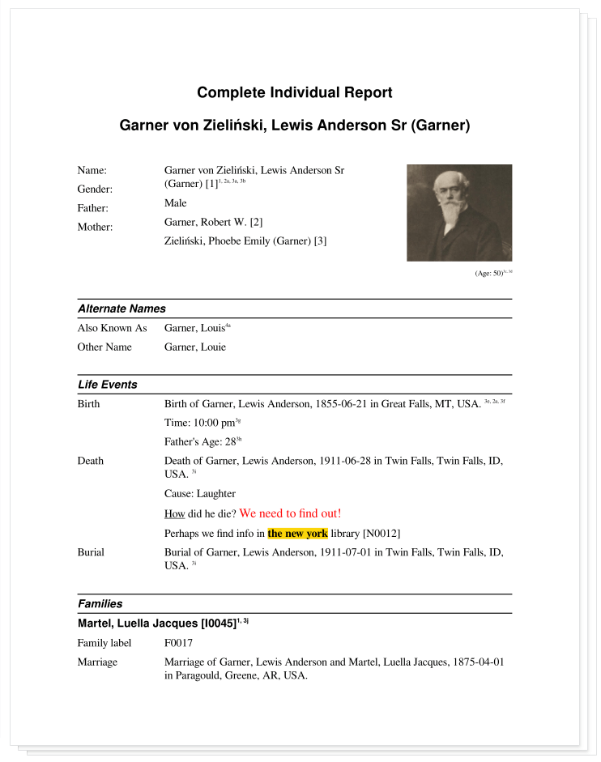
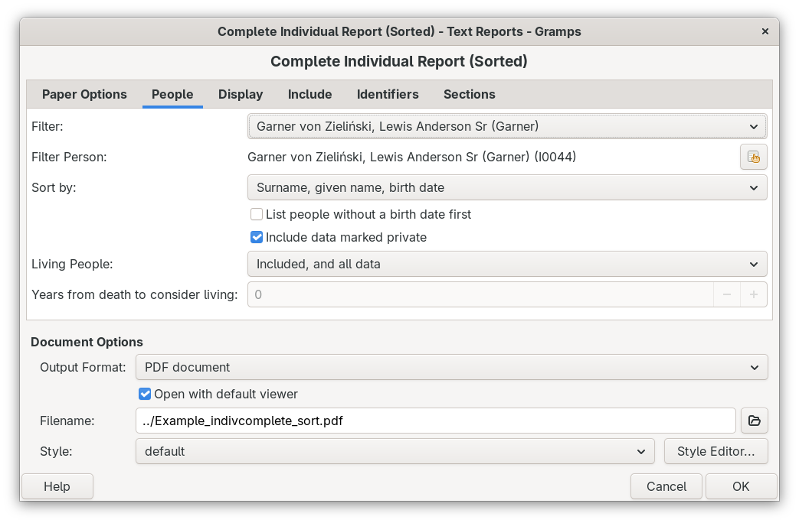
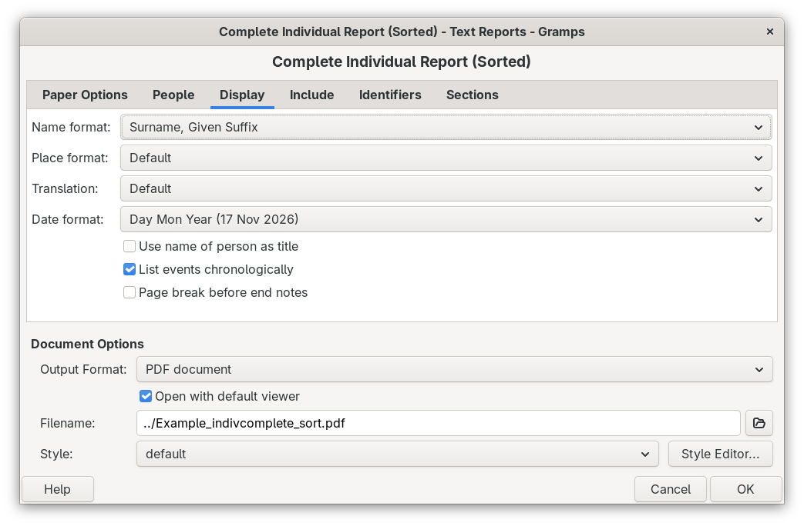
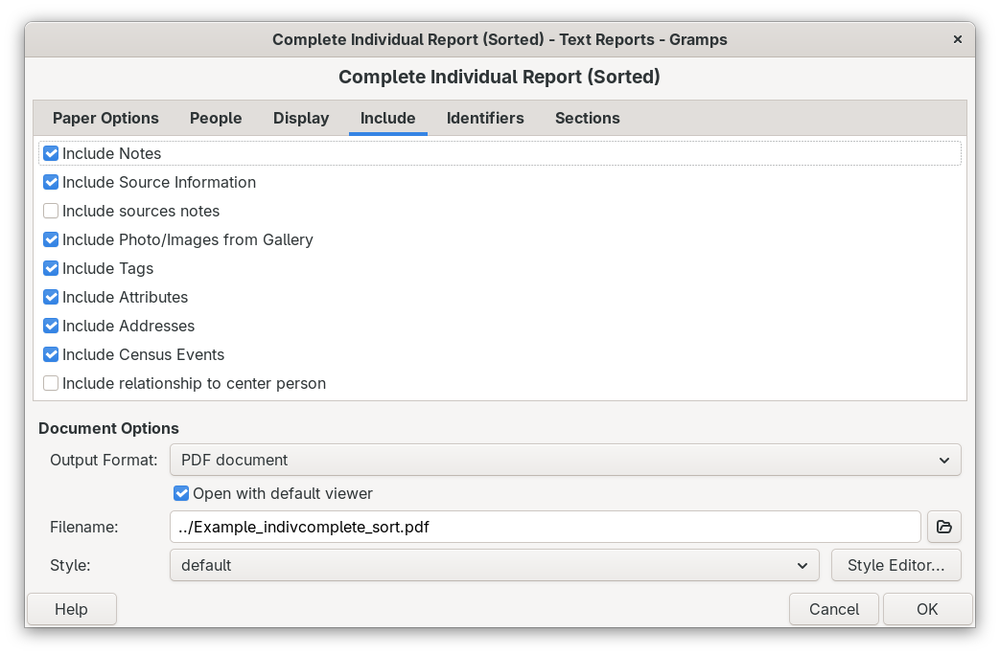
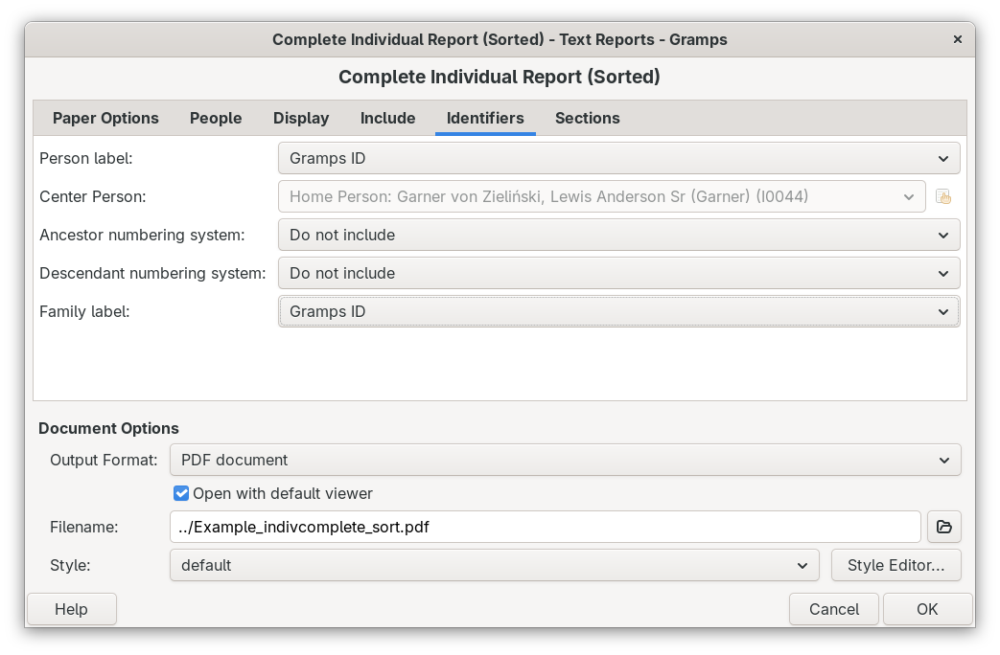
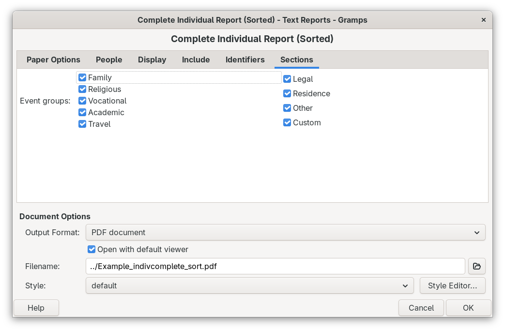
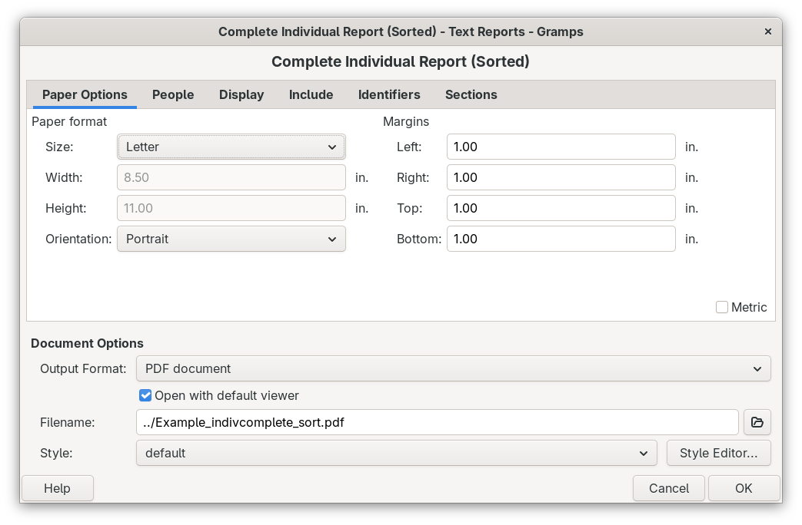

# Complete Individual Report (Sorted)
[README.md](README.md) ● [CHANGELOG.md](CHANGELOG.md) ● [GenealogicalNumberingAPI.md](GenealogicalNumberingAPI.md)

The Complete Individual Report prints everything Gramps knows about each selected person: names, events, families, notes, sources and pictures. This version of the report adds what many users asked for: you choose the order of the people, and you choose how each person and family is identified on the page. You can keep Gramps IDs, show your own reference numbers from an attribute, or number ancestors and descendants with a standard genealogical numbering system such as Sosa-Stradonitz (Kekulé) or Henry.

Find the report in the **Reports** menu, under **Text Reports** › **Complete Individual Report (Sorted)**. It works on its own and in Books.

## What is different from the built-in report
- **People are sorted the way you choose.** The built-in report has no reliable order for the people it lists. This report lists them in the same order every time.
- **Identifiers replace the Gramps ID.** The text in brackets after each name can be a Gramps ID, an attribute value, or an ancestor or descendant number. Families can show a label too.
- **Clearer tabs.** The options are grouped in the People, Display, Include, Identifiers and Sections tabs, instead of "Report Options (2)" and "Include (2)".

Everything else on the page is the same as the built-in Complete Individual Report.

## People tab

**Filter** and **Filter Person** choose who is in the report, as in the built-in report.

**Sort by** chooses the order of the people:

| Choice | Order |
|---|---|
| Surname, given name, birth date | The usual choice. People with the same name are listed oldest first. |
| Surname, given name, Gramps ID | The same order as older versions of Gramps. |
| Birth date, surname, given name | Oldest first. |
| Gramps ID | By ID. |
| Kinship, starting from the Filter Person | Each family together: the parents, then their children by birth date, then the families of the children and of the parents. People who are not related to the Filter Person come last, sorted by name. |
| Numbering system | Numbered ancestors first, then numbered descendants (see the Identifiers tab), then everyone else by name. |

Birth dates also use a baptism or christening date when there is no birth date. Dates such as "about 1850" or "before 1700", dates before the year 1000, and dates in other calendars all sort in their correct place.

**List people without a birth date first** puts people with no known birth date before the others. When it is not checked, they come last.

**Include data marked private** and **Living People** work as in the built-in report.

## Display tab

The name, place and date formats, the report language, the title, the order of events and the page break before the end notes.

## Include tab

Choose which kinds of information appear on each page.

## Identifiers tab

These options decide what appears in brackets after each name, for example "Garner, Robert W. [2]".

**Person label** is used for every person who has no number. Choose "Do not include", "Gramps ID", or "Attribute". The Attribute item opens a list of the attribute types in your tree; the report then shows the value of that attribute. A person with no value for the attribute gets the Gramps ID instead. The attribute you chose last is remembered and shown on the Attribute item, for example "Attribute: Identification Number".

**Center Person** is the person who gets number 1 in the numbering systems. The list offers the Home Person, the active person, and your bookmarked and recently viewed people. Use the button next to the list to choose anyone else.

**Ancestor numbering system** and **Descendant numbering system** number the ancestors and the descendants of the Center Person:

| Ancestor systems | Example |
|---|---|
| Sosa-Stradonitz (also called Kekulé) | 1, 2, 3, 4 |
| Ahnentafel | 1, 2, 3, 4 |

| Descendant systems | Example |
|---|---|
| Simple (the generation) | 1, 2, 2, 3 |
| Henry | 1, 11, 1A |
| Modified Henry | 1, 11, 1(10) |
| d'Aboville | 1, 1.1, 1.2.3 |
| de Villiers/Pama | a1, a1b1, a1b2c3 |
| Meurgey de Tupigny | I, II-1, III-1 |
| Record (Modified Register) | 1, 2, 3, 4 |

In Sosa-Stradonitz and Ahnentafel numbering, the father of person number *n* is 2*n*, and the mother is 2*n*+1. The two names describe the same numbers.

Both lists also have an Attribute item. With it, the same ancestors or descendants are numbered from your own attribute, for example a custom "Ahnentafel" attribute. A person with no value for the attribute gets their Person label.

The bracket after a name shows the ancestor number first. If the person is not an ancestor, it shows the descendant number. If the person is neither, it shows the Person label. Someone who appears in the family tree more than once (for example, after a marriage between cousins) shows every number, such as "[8, 14]".

**Family label** adds a "Family label" line to each family: "Do not include", "Gramps ID", or "Attribute" with a family attribute.

## Sections tab

Choose which groups of events get their own section, as in the built-in report.

## Paper Options tab

Paper size, orientation and margins.

## Books
The report can be added to a Book more than once, with different settings in each copy. For example, one copy can list ancestors by Sosa-Stradonitz number and another copy can list descendants by Henry number. The active person is only known while the report options window is open. In a Book that runs later, the Home Person is used instead.

## Credits
This report is a fork of the Complete Individual Report that is built into Gramps, written by Donald N. Allingham, Brian G. Matherly, Nick Hall, Benny Malengier, Jakim Friant, Tim G L Lyons, Mathieu MD, Paul Franklin and other Gramps developers.

The idea came from the Gramps Discourse discussion [Sorting Complete Individual Report](https://gramps.discourse.group/t/sorting-complete-individual-report/1804), started by les61, with a first sorting patch by SNoiraud. The kinship order is adapted from the KinSorter by Matthias Basler, offered in [MantisBT 0010362](https://gramps-project.org/bugs/view.php?id=10362).

Development and documentation by Claude AI, from wish coding by Brian McCullough.

## More information
- [Genealogical numbering systems](https://gramps-project.org/wiki/index.php/Genealogical_Numbering_Systems) on the Gramps wiki
- [Complete Individual Report](https://gramps-project.org/wiki/index.php/Gramps_6.0_Wiki_Manual_-_Reports_-_part_6#Complete_Individual_Report) in the Gramps manual
- [Books](https://gramps-project.org/wiki/index.php?title=Gramps_6.0_Wiki_Manual_-_Reports_-_part_3#Books) in the Gramps manual
