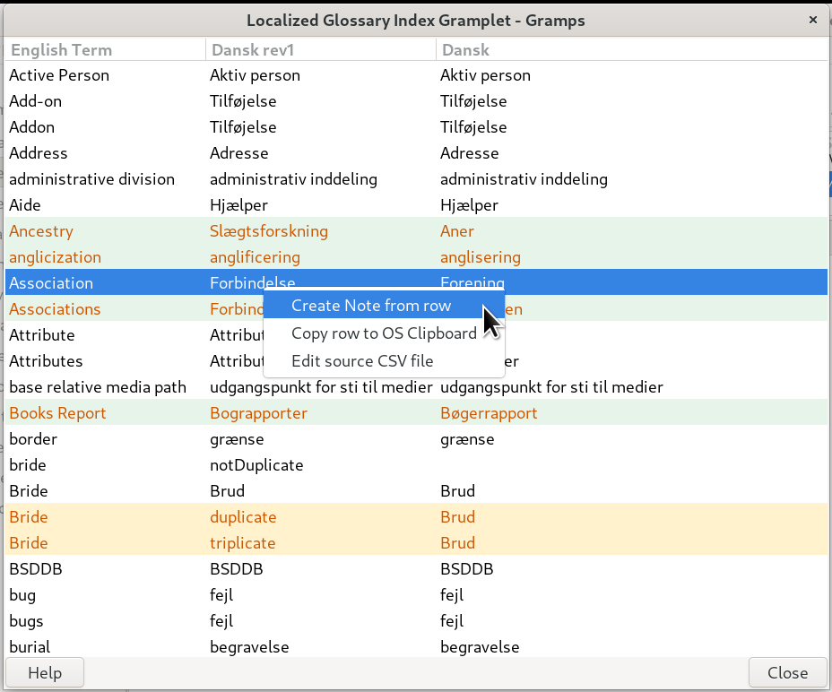
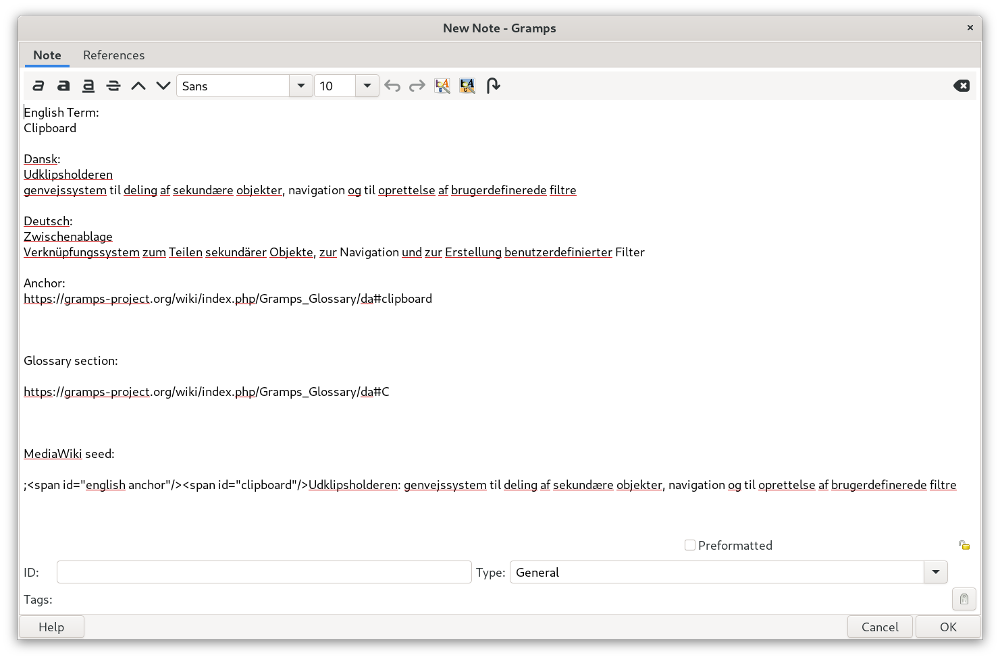
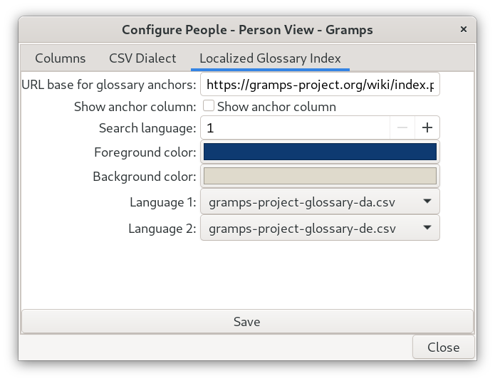

# LocalTerm dashboard gramplet

#  *LocalTerm* gramplet

A localized index to [Gramps Glossary](https://gramps-project.org/wiki/index.php/Gramps_Glossary) terminology.

 **This plugin is in the Beta development stage.**  
*Data schemas are finalized, but tracking updates against custom CSV overrides should be verified regularly before upstream submissions.*

The LocalTerm gramplet (available for the Dashboard, Relationships/People-based, and Notes view categories) displays a side-by-side translation and workspace index for the [Gramps Glossary](https://gramps-project.org/wiki/index.php/Gramps_Glossary#gramps). It renders terms as they appear in the Python source code alongside up to two chosen language locales simultaneously.

The glossary lookups rely on standard CSV spreadsheets exported from the Weblate translation platform. If your files use custom names or variants (e.g., `da.csv` or `danish_rev1.csv`), the engine automatically extracts the proper language environments by reading row key descriptors inside the file metadata.


---

## Split-View Layout Navigation

The interface splits language environment components into two isolated tracking tables to separate configuration variables from structural data:

### 1. Language Environment Metadata (Top Panel)
Embedded within a collapsible accordion drawer (`Gtk.Expander`), this table isolates the internal CSV settings rows (such as `endonym`, `englishexonym`, `language code`, and `translators`). 
* **Interaction:** Double-clicking a metadata attribute row instantly launches your web browser to the live upstream translation components or wiki status indicators matching that language profile.
* **Column Scaling:** This row block explicitly locks horizontal resizing; adjusting columns on the dictionary table underneath automatically synchronizes column geometry above.

### 2. Main Dictionary Tree (Bottom Panel)
Displays the translatable core technical terminology rows. 
* **Interaction:** Double-clicking an English term or translation cell routes your browser to the corresponding wiki anchor target. If an explicit anchor is missing from the file data, it falls back to a section-level index lookup (e.g., `Gramps_Glossary/da#C`).
* **Visual Diff Tracking:** When two different translation files are compared side-by-side, cells automatically highlight green when a mismatch is caught, simplifying peer reviews.

---

## Workspace Context Menus

Right-clicking entries inside the layout displays unique workspace tools tailored to each environment:

### Metadata View Menu
* **Help:** Opens this README documentation inside an external browser session.

### Main Dictionary Menu
Right-clicking a terminology row displays tools designed for copy-pasting code definitions into forums, emails, or wiki formatting fields:

#### `Create Note from row`
Assembles a fully structured Gramps Note containing cross-language properties, reference definitions, and ready-to-use MediaWiki text seeds:

```text
English Term:
Clipboard
English Reference Note: Shortcut system for sharing secondary objects...

Dansk:
Udklipsholderen
Sprognavn på modersmål...

Anchor:
[https://gramps-project.org/wiki/index.php/Gramps_Glossary/da#clipboard](https://gramps-project.org/wiki/index.php/Gramps_Glossary/da#clipboard)

Glossary section:
[https://gramps-project.org/wiki/index.php/Gramps_Glossary/da#C](https://gramps-project.org/wiki/index.php/Gramps_Glossary/da#C)

MediaWiki seed:
;<span id="english anchor"/><span id="clipboard"/>Udklipsholderen: genvejssystem til deling...
```

### Copy row to OS Clipboard
Copies selected translations and the master wiki reference URL as a tab-delimited string, ready for spreadsheet insertion or documentation write-ups:

``` plaintext
Association    Forening    Verknüpfungen    [https://gramps-project.org/wiki/index.php/Gramps_Glossary/da#association](https://gramps-project.org/wiki/index.php/Gramps_Glossary/da#association)
```
### Edit source CSV file

Launches the spreadsheet application or text editor registered by your operating system directly to the underlying `.csv` file populating that column.

---

## Single Language & Inline Weblate Controls

When both language selections are set to the same file, the gramplet shifts into an integrated **Single Language Optimization Mode**. This hides redundant comparison columns and shows four direct Weblate hyperlinked actions:

* **Review:** Jumps straight to the specific term's localization checks on the platform.
* **Search:** Performs a verbatim source string index lookup.
* **Filter:** Displays isolated project matches inside the Weblate string repository.
* **Translated Search:** Queries the platform using the target language's translation instead of the English source.


---

## Configuration & Setup

To manage your layout files and interface preferences, open the standard Gramplet options menu by clicking the configuration cog icon or accessing it via the view settings.


* **URL base for glossary anchors:** Sets the destination wiki endpoint prefix.
* **Show anchor column:** Toggles the visibility of raw mediawiki anchor hashes.
* **Track Changes:** Enables or disables automated cell differential color highlighting.
* **Search language:** Defines whether typing into the table searches the English baseline column (1) or the translated target column (2).
* **Language 1 & 2 Choice Selectors:** Drop-down lists that parse file attributes into clear, standardized headers formatted as: <internal language code> - <endonym> (<English Exonym>).


<!--
# *LocalTerm* gramplet
#  *LocalTerm* gramplet

a Localized index to [Gramps Glossary](https://gramps-project.org/wiki/index.php/Gramps_Glossary) terminology

 **This plugin is still in the Experimental stage.**  
*Not feature complete nor ready for general release. Your work done improving a data file is likely to be lost as the gramplet evolves.*

The LocalTerm gramplet (available for Dashboard, people-based and Notes view categories), will show you a table of glossary terminology (terms) for [Gramps for Desktops](https://gramps-project.org/wiki/index.php/Gramps_Glossary#gramps). 
It will show the term, as it appears in the Python source code's translatable strings, and up to two additional locale (language) translations.
The locale lookups are [provided in separate Weblate-generated CSV file](gramps-project-glossary/README.md). One for each language. (However, our CSVs have been modified with additional terms and corrections.) 

Double-clicking a row will open a browser page with the **Glossary in the *Gramps* wiki**  in the language of the 2nd column. If the term is unanchored, the local language will be scrolled to the top of page. (Which can be taken as a hint that the Glossary page has an opportunity for improvement.) If the anchor exists on the destination page, the browser will be scrolled to the row's term Dictionary for Gramps. 

Clicking one of the language columns and start typing will do a search in that column based upon your typing


## Context menu options

### `Create Note from row` information:
This context menu option copies the selected terms in each language and the Glossary URL for the term (from the 2nd column). Intended for pasting into Gramps Glossary localization page. 

``` text
English Term:
Clipboard

Dansk:
Udklipsholderen
genvejssystem til deling af sekundære objekter, navigation og til oprettelse af brugerdefinerede filtre

Deutsch:
Zwischenablage
Verknüpfungssystem zum Teilen sekundärer Objekte, zur Navigation und zur Erstellung benutzerdefinierter Filter

Anchor:
https://gramps-project.org/wiki/index.php/Gramps_Glossary/da#clipboard


Glossary section:
https://gramps-project.org/wiki/index.php/Gramps_Glossary/da#C


MediaWiki seed:
;<span id="english anchor"/><span id="clipboard"/>Udklipsholderen: genvejssystem til deling af sekundære objekter, navigation og til oprettelse af brugerdefinerede filtre
```



### `Copy row to OS Clipboard` information:

This context menu option copies the selected terms in each language and the Glossary URL for the term (from the 2nd column). Intended for pasting into the various Gramps support forums or eMails. 
``` text
Association	Forening	Verknüpfungen	https://gramps-project.org/wiki/index.php/Gramps_Glossary/da#association
```

### `Edit source CSV file` action:

The CSV files are originally downloaded with the customized download (using the `.csv` 

Opens whatever app your OS has associated with `.csv` type files. And load the CSV associated with populating the 2nd column. If you choose to edit this file, it is better to save it under a different file name. (These files are in the naming style and format of exports from Weblate's "Glossary" component.) Then use the Configure to choose the edit file for Language 1 and the original for Language 2. This will let you view the english term, your updated translation, and the original translation; all side-by-side for direct comparison. 

## Configure options:

Choose the View -> Configure menu items or click the Configure toolbar icon.




-->

