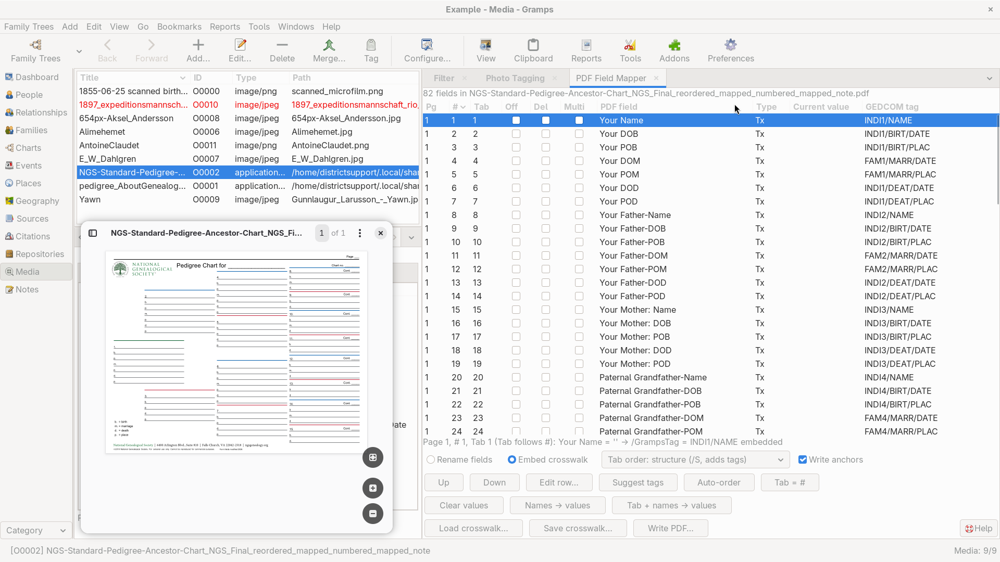

# PDF Field Mapper

[README.md](README.md) ● [CHANGELOG.md](CHANGELOG.md)

# Experimental - exploration for a potential new PDF form Charts view

PDF Field Mapper is a Gramps gramplet for PDF media objects that contain fillable forms. It lists every form field of the selected PDF, lets you attach a GEDCOM-style tag to each field, sets the tab order, hides or deletes unwanted fields, fills or clears values, and writes the result to a new PDF. The original media file is never changed.

## What problem might it solve?
Fillable genealogy forms, such as pedigree charts and family group sheets, often have fields with unhelpful names, fields in an awkward tab order, or fields with swapped labels. Fixing these problems in a PDF editor is slow. PDF Field Mapper shows all fields in one table, so each problem can be fixed in place and the corrected form saved as a new file.

A tag states the meaning of a field, for example INDI4/BIRT/DATE for the birth date of ancestor number 4. The tags are stored in the PDF, so other tools, such as a future importer, can tell which field holds which fact.

## Requirements
- Gramps 5.2 or later. The registration file allows Gramps 5.2 through 6.2. Development and testing used Gramps 6.0.8 on Fedora Linux.
- The Python module **pypdf**, in a place where Gramps can find it (see *Installing pypdf*). The automated checks gave identical results with pypdf 4.2.0 (the version in Fedora 44), 5.9.0, and 6.21.2.
- A PDF viewer to check the results. Okular is recommended (see Tab order and PDF viewers).

## Installation
1. Use the Addon Manager to install from the https://github.com/emyoulation/CuratedGrampsPlugins repo 
2. Make pypdf available to Gramps (see *Installing pypdf*).
3. Restart Gramps.
4. Open the **Media** view and show the sidebar with the View menu.
5. Select a PDF form in the Media list view (add one, if necessary.) 
   - Sample forms are provided in the **`/plugins/PDFfieldmapper/media`** folder. Distribution permission has not yet been established.
6. Right-click a tab of the sidebar, choose Add a gramplet, and select **PDF Field Mapper**.

The gramplet works on Media objects only. It shows a message when the selected media object is not a PDF.

## Where the plugins folder is located
The folder name contains the Gramps version, so Gramps 6.0 uses `gramps60/plugins/PDFfieldmapper` and Gramps 6.1 uses `gramps61/plugins/PDFfieldmapper`.

- Linux with Gramps 6.0 or later: `~/.local/share/gramps/gramps60/plugins`
- Linux with Gramps 5.2: `~/.local/share/gramps/gramps52/plugins`. When an older folder named `~/.gramps` exists, Gramps 5.2 keeps using it, and the plugins folder is then `~/.gramps/gramps52/plugins`.
- Windows with Gramps 6.0: `%APPDATA%\gramps\gramps60\plugins`. This comes from reading the Gramps source code and was not tested.
- macOS and other systems: not tested.

On Linux, this command prints the exact folder: `python3 -c "from gramps.gen.const import USER_PLUGINS; print(USER_PLUGINS)"`

## Installing pypdf
When Gramps starts, it checks the Python modules that each addon needs. When a module is missing, Gramps skips the addon and shows no message, so the gramplet does not appear in the Plugin Manager or in the gramplet menus. A module counts as present only when Gramps can find it.

Fedora starts Gramps with a Python setting that hides the folder used by `pip install --user`. The first line of the Gramps launcher shows the setting: `#! /usr/bin/python3 -sP`. A module installed that way works in a terminal but stays invisible to Gramps. Use one of these methods instead:

- Fedora: install the system package with `sudo dnf install python3-pypdf`.
- Any system, without administrator rights: install pypdf into the lib folder inside the plugins folder, for example `pip3 install --target ~/.local/share/gramps/gramps60/plugins/lib pypdf`. Gramps adds that lib folder to the places where it looks for modules.
- When an addon listing names pypdf as a requirement, select the check box Allow Gramps to install required Python modules in the Addon Manager window. Gramps then runs pip and installs the missing modules into the same lib folder. This needs the pip program on the system.

When pypdf is found in both places, the system copy is used.

## Quick start
1. Select a PDF media object. The table lists every form field. The status line shows the file name and the number of fields.
2. Press Suggest tags. The gramplet reads placeholder values and field names, and fills in tags where it can. The status line shows how many tags came from values, how many came from names, and which fields are still without a tag.
3. Correct any wrong or missing tag. Click a cell in the GEDCOM tag column and type the tag.
4. Press Auto-order. The rows are sorted by ancestor number and fact.
5. Choose how to write the tags (Rename fields or Embed crosswalk) and the tab order mode, then press Write PDF… and choose a file name.
6. Open the new PDF in a viewer to check the result. To see the tab order, press Tab + names → values before writing. Each field then shows its tab position and name, so a field visited out of order is easy to spot. Press Clear values to remove the numbers.

## The table
Each row is one widget. A field can have more than one widget, for example when the same field appears twice on a page.

- Pg: the page number.
- #: the working order of the rows. It starts as the order of the widgets in the PDF.
- Tab: the tab order. It starts from the tab setting of the PDF, or follows # when the PDF has no setting. After Tab is edited, it is independent of #. The Tab = # button makes Tab follow # again.
- Off: hides the widget. The viewer neither draws nor prints it.
- Del: deletes the widget when the PDF is written. When the widget is the only one of its field, the field is deleted too. A deleted row is shown with a line through the text.
- Multi: marks a text field as multi-line. Remove the check mark for fields that should hold one line (see Limits and troubleshooting).
- PDF field: the name of the field in the PDF.
- Type: Tx for text, Btn for buttons and check boxes, Ch for choice lists, Sig for signatures.
- Current value: the value of the field. Changes made with the value buttons appear here before the PDF is written.
- GEDCOM tag: the tag. Click the cell to edit it. A list of common tags is offered, and any text is accepted.

The line below the table describes the selected row: page, #, Tab, name, value, and what will be written. It also names the sort column when reordering is not possible.

## Sorting and reordering
- Click a column header to sort. The page is always the first sort key.
- Editing a tag, a check box, or a value never moves a row. A column that can be edited is sorted again only when its header is clicked again.
- Each newly loaded PDF starts sorted by #.
- Rows can be reordered only while the table is sorted ascending by # or Tab. Reordering changes the numbers in the column used for sorting. When # is the sort column and Tab follows #, Tab changes too.
- Drag a row and drop it on another row of the same page. A line shows where the row will land.
- Up and Down move the selected row one position. They are gray when reordering is not possible, and the tooltip explains why.
- Edit row… opens the Row Editor. A double-click on a row, or Enter on a selected row, opens it too. Type the # position and the Tab position. The row moves there as if dropped on that position. The Row Editor works whatever the table is sorted by.

## Buttons
- Up, Down: move the selected row.
- Edit row…: open the Row Editor.
- Suggest tags: fill empty tags. Placeholder values are tried first, such as `ID08,Birthdate`. Field names are tried next, such as `Your Father-POD` or `Paternal Grandfather-DOB`. Existing tags are never replaced.
- Auto-order: order the rows by tag. The order applies to Tab when the table is sorted by Tab, and to # otherwise.
- Tab = #: make Tab equal to # and keep Tab following #.
- Clear values: empty all text and choice fields. Other field types are left alone.
- Names → values: put the name of each text field into its value. The name is the one that will be written, which is the tag when Rename fields is selected.
- Tab + names → values: put the tab position and the name into each text field, for example `22: INDI4/NAME`. Hidden and deleted widgets are not counted, because a viewer does not stop there. Positions are counted per page, with the page number as a prefix when the PDF has more than one page.
- Load crosswalk…, Save crosswalk…: read or write the sidecar file (see Crosswalk sidecar file).
- Write PDF…: write the new PDF.

Below the table, two options choose how tags are written, a drop-down list chooses the tab order mode, and the check box Write anchors adds a link target to each field (see Anchors).

## Tags
A tag uses the slash as separator, for example INDI1/NAME, INDI4/BIRT/DATE, FAM4/MARR/PLAC, INDI8/CONT, and CHART/NO. A period cannot be part of a PDF field name, because the period separates a field from its parent. A slash is never part of a GEDCOM tag, so a name converts back to the tag exactly by replacing each slash with a period. A tag typed with periods is converted to slashes automatically, so the table always shows exactly what is written.

The parts of a tag:

- INDI plus a number: a person, numbered like an ancestor chart (1 is the main person, 2 the father, 3 the mother, 4 the paternal grandfather, and so on).
- FAM plus a number: the family of that person. Marriage facts use it, so they sort between birth and death.
- CHART: fields of the chart itself, such as CHART/TITLE, CHART/NO, CHART/PAGE, CHART/PREV/PERSON, and CHART/PREV/NO.
- Facts: NAME, BIRT, MARR, and DEAT, with DATE or PLAC. CONT marks the field for a continuation chart number.

How Suggest tags reads relationship names:

- Your, Self, Individual, or Person is ancestor 1. Father is 2 and Mother is 3.
- Each word Paternal or Maternal is one step up the tree, and Father or Mother is the last step. Paternal Grandmother is 5. Maternal-Paternal Great-Grandfather is 12, which is mother, then father, then father.
- The number of steps must fit the generation named. A name that does not fit is left without a tag.
- DOB, POB, DOM, POM, DOD, and POD mean the date and place of birth, marriage, and death. Spelled-out forms such as Birth Date and Place of Death work too.
- Page no, Chart no, Pedigree Chart for, and cont1 to cont8 are recognized as chart fields. The fields cont1 to cont8 become INDI8/CONT to INDI15/CONT, which fits forms where they sit beside ancestors 8 to 15.

Auto-order sorts by page, then chart fields first, then ancestors by number. Inside one ancestor the order is name, birth, marriage, death, and other facts. Continuation fields come after the ancestor. Hidden and deleted rows go last on the page, and rows without a usable tag follow the tagged rows.

## Writing the PDF
Write PDF… proposes the name of the original plus _mapped, in the same folder. It refuses to overwrite the original file.

Two options decide how tags are stored:

- Embed crosswalk (the default): each field keeps its name, and the tag is stored next to it under the key /GrampsTag. Clearing a tag removes the key.
- Rename fields: the tag becomes the field name, and no /GrampsTag is written. The original name is lost. Two fields cannot receive the same name. The write stops with a message when that would happen.

The tab order drop-down list has three modes:

- Structure (/S, adds tags): the default. The tab order is written to the PDF structure tree and the page setting /Tabs is set to S. A PDF without a structure tree receives a new tree. A PDF with a tree that does not list the fields, which is common, receives a Form fields branch at the end of the tree, and the other content of the tree is not touched. Writing a file again updates that branch. When the tree groups the fields in several places, the tree is left alone and the status line says so.
- Annotation order (/A, PDF 2.0): the page setting /Tabs is set to A, which means the order of the page annotation list.
- Leave /Tabs unchanged: no page setting and no tree change.

In every mode the page annotation list and the form field list, including nested groups of fields, are put in the same tab order. After writing, the status line lists the places that carry the order, for example `tab order set in: annotations, field list, tag tree, /Tabs /S`.

Other changes in the written file:

- Off sets the Hidden flag of the widget.
- Del removes the widget, and its field when no widget is left. Matching elements of the structure tree are removed too.
- Multi changes the multi-line flag of text fields.
- Anchors are written unless the check box Write anchors is cleared (see Anchors).
- Changed values are written, and the viewer redraws the fields from the values. Each field keeps its own font size. A viewer that ignores this setting may show empty fields until a field is selected.
- The PDF version of the original is kept, and raised to 1.4 only when a structure tree is added. The document information is kept. The XMP metadata is kept when it can be read.
- The written file is not encrypted. If the original has encryption with owner restrictions, those restrictions are not carried over.
- A PDF with a damaged cross-reference table is read and rewritten with a correct table. The gramplet shows a short note in the status line, not messages on the console.

## Tab order and PDF viewers
A PDF can state a tab order in several places, but each viewer reads only some of them. The gramplet writes all of them in the same order, so a viewer that follows any of them gets the same result.

- Okular follows the order of the page annotation list. This was confirmed in the source code and by testing.
- Firefox sorts the fields by position on the page (rows from top to bottom, left to right inside a row) and ignores every setting of the PDF. This was confirmed in the source code and by testing.
- Xreader also sorts by position and ignores the settings. This was confirmed in the source code and by testing. It still stops at hidden fields, so use Del when a field must not be a tab stop.
- Papers probably behaves like Xreader. This was not verified.
- Acrobat is expected to follow the page setting /Tabs, and the structure tree when the setting is S. This was not tested.
- Chrome was not checked.

A viewer that sorts by position cannot follow another order unless the fields move on the page.

## Anchors
An anchor, also called a named destination, is a name stored in the PDF that points to a place on a page. A link that ends with the name opens the PDF and scrolls to that place. With the check box Write anchors selected, which is the default, every visible field receives an anchor at its upper left corner. The anchor has the name of the tag, such as INDI4/BIRT/DATE, or the name of the field when the field has no tag.

For example, a link to the birth date of ancestor number 4 looks like this: `file:///home/user/pedigree_mapped.pdf#INDI4/BIRT/DATE`

- Hidden (Off) and deleted (Del) fields get no anchor.
- When two fields would receive the same name, only the first field in tab order gets the anchor.
- The gramplet recognizes the anchors that it wrote earlier by their position at a field, and replaces them each time the PDF is written. Renamed or deleted fields therefore leave no old anchors.
- Anchors that came from somewhere else are kept. A name already used by such an anchor is not reused, and the status line reports the number of anchors skipped for this reason.
- The anchors are stored in both places where viewers look for them.

Viewers that follow such links:

- Okular: add the name after a number sign, as in the example. The Okular source code reads the name from the address, and a test with the poppler library that Okular uses found every anchor of a test form. A link was not yet tried in the Okular window.
- Firefox: the same form is expected to work, and so is `#nameddest=INDI4/BIRT/DATE`. This was read in the source code of the PDF reader inside Firefox and was not yet tried in the Firefox window.
- Papers: expected to follow the `#nameddest=` form. This was read in the source code and not tested.
- Xreader, Chrome, and Acrobat: not checked.

## Crosswalk sidecar file
A crosswalk is a JSON file stored next to the PDF, named like the PDF with the ending .crosswalk.json. For example, pedigree.pdf has the sidecar pedigree.crosswalk.json. Save crosswalk… proposes that name in the folder of the PDF. Load crosswalk… selects that file when it exists. When a PDF is selected and a sidecar exists, the status line says so. Nothing is applied automatically.

The file holds the decisions that the PDF cannot hold:

- pdf: the file name of the PDF that the crosswalk was saved from.
- tags: the tag of each field, by field name.
- order: the field names in # order.
- tab: the field names in Tab order, saved only when Tab is independent of #.
- disabled and deleted: the widgets marked Off or Del, written as the field name, a number sign, and the number of the widget among widgets of the same name.

Loading a crosswalk made for a different PDF still works, which is useful for forms with the same field names. The status line then names the PDF that the crosswalk was saved for. Older crosswalk files without some of these entries load too.

## Limits and troubleshooting
- The gramplet does not appear in the Plugin Manager or in the gramplet menus: Gramps skipped it without a message. Check these causes in order. First, pypdf (see Installing pypdf): the command `head -1 "$(command -v gramps)"` prints the launcher line, and when the line ends with `-s` or `-sP`, a pypdf installed with `pip install --user` is hidden from Gramps. Second, the folder (see Where the plugins folder is). Third, the name of the registration file must end with `.gpr.py`.
- Papers prints lines such as `Trying to measure PpsOverlayForm ... it needs at least 34` in the terminal: these are warnings from Papers about form fields that are shorter than its own entry control. They do not come from this gramplet, and the written PDF is not damaged. Okular is the recommended viewer.
- A link with an anchor name does nothing: the viewer does not read named destinations from the address (see Anchors).
- Rows do not move, and Up and Down are gray: the table is sorted by a column other than # or Tab. Click the # or Tab header, and sort ascending.
- A tag change did not re-sort the table: this is intended. Click the column header again to sort.
- Tab stops inside a multi-line field in Okular: Okular inserts a tab character inside multi-line text fields instead of moving on. Remove the check mark in the Multi column for fields that should hold one line.
- The tab order has no effect in Firefox or Xreader: these viewers sort by position (see Tab order and PDF viewers).
- The list of fields is empty: the PDF has no form fields, or the media object is not a PDF.
- The cont fields are matched to ancestors by number only: this fits some forms and may not fit others. Correct the tags by hand when needed.
- Long values may be cut off in a short field, because the viewer draws the text at the font size of the field.
- Damaged PDFs: a PDF that cannot be read at all shows the reason in the status line.
- Only PDFs written by this gramplet carry /GrampsTag keys. No importer reads them yet.

## License
GNU General Public License, version 2 or later.
