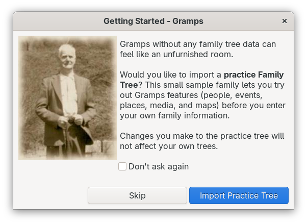
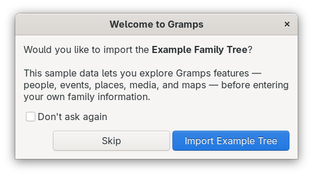
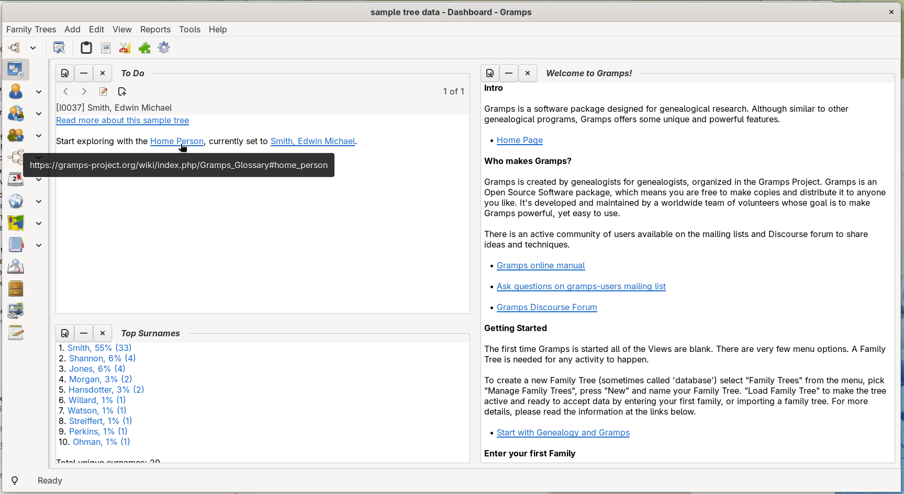

# PR2388 Example Tree Prompt
<!-- undocked=false -->
[README.md](README.md) ● [CHANGELOG.md](CHANGELOG.md)

# This addon is a field-test package of pull request #2388
[Gramps pull request #2388](https://github.com/gramps-project/gramps/pull/2388) by Doug Blank ([@dsblank](https://github.com/dsblank)): "Prompt new users to import the Example Family Tree on startup"

The feature idea, the startup dialog, the import logic and the map tiles come from that pull request. This addon repackages the work so that testers can try it in Gramps 5.2, 6.0 and 6.1 without patching Gramps core files, and adds a few starter helpers of its own (listed below). Please leave feedback about the core feature on [the pull request](https://github.com/gramps-project/gramps/pull/2388).

Welcome! A brand-new Gramps can feel like an empty room. This addon offers to fill it with a small practice family tree, so you can explore people, events, places, media and maps before you enter your own family history.
  

When you start Gramps and no practice tree exists yet, a **Getting Started** dialog asks whether you would like to import one. Choose **Import Practice Tree** and the addon creates the tree, fills it with the sample data that comes with Gramps and opens it, then switches to the Dashboard with a To Do note ready to guide your first steps.

---

## What the Dialog Offers
* **Import Practice Tree** creates a new tree called *sample tree data*, imports the sample records into it and opens it. If you later delete or rename this tree, the dialog appears again at the next startup.
* **Skip** closes the dialog for this launch only. Closing it with the Esc key or the window close button does the same. The dialog appears again at the next startup.
* **Do not ask again** turns the dialog off for good, whichever button you then choose.

The dialog appears after the Family Trees manager closes (if that opens at startup). On a launch where the dialog appears, the Tip of the Day is skipped, so two similar windows never open together. The Tip of the Day returns at the next startup.

The dialog does not appear when a tree is opened at startup: when you choose a tree in the Family Trees manager, when Gramps loads the last tree automatically, when you open a GEDCOM file from your file manager, or when you use the `-O`, `-i` or `-e` command line options. That way it never competes with the tree or file you asked for.

---

## Exploring the New Practice Tree and Dashboard
Once the import finishes, the addon helps with your first steps:
* **Dashboard and To Do gramplet:** Gramps switches to the **Dashboard**. If the Dashboard is empty or still shows only the default gramplets, a **To Do** gramplet is added. A Dashboard that you have arranged yourself is left alone.
* **Starter To Do note:** A To Do note is added and attached to the Home Person. It links to more information about this sample tree, to the [Gramps Glossary entry for Home Person](https://gramps-project.org/wiki/index.php/Gramps_Glossary#home_person), and to the Home Person. (If the sample data already has To Do notes, nothing is added.)



* **Media folder bookmark:** A bookmark named **Gramps example data** is added to the left side of file chooser windows, so the sample pictures are easy to find. The bookmark is a normal GTK bookmark, so it also appears in other programs (such as your file manager). Right-click it and choose **Remove** if you no longer want it.
* **Geography starter tiles:** If the optional map pictures are installed (see below), a set of world map pictures is copied into the map cache, so the Geography view shows the world map right away, even without an internet connection.

---

## Installing
1. Install **PR2388 Example Tree Prompt** from the Emyoulation experimental addons project in the Gramps Addon Manager.
2. Optional: add the starter map pictures. Open a terminal, go to the folder where the addon was installed and run the command below. For Gramps 6.0 the folder is usually `~/.local/share/gramps/gramps60/plugins/PR2388_ExampleTreePrompt` (use `gramps52` or `gramps61` for those versions).

```bash
for z in 0 1 2; do n=$((1<<z)); for x in $(seq 0 $((n-1))); do for y in $(seq 0 $((n-1))); do curl -sf --create-dirs -o maps/openstreetmap/$z/$x/$y.png https://raw.githubusercontent.com/gramps-project/gramps/5bef5c3081616c59559d3c21203ab42b9212421b/data/maps/openstreetmap/$z/$x/$y.png; done; done; done
```

This downloads 21 small map pictures (about 170 KB) from the pull request into a `maps` folder inside the addon folder. Without them, the addon still works, and the Geography view downloads map pictures from the internet as usual.

3. Optional, to test the "default Dashboard" behavior: choose **Family Trees > Close**, quit Gramps, then delete the Dashboard layout file `Gramplets_dashboardview_gramplets.ini`. For Gramps 6.0 on Linux it is usually in `~/.config/gramps/gramps60/` (or in `~/.gramps/gramps60/` on older setups). This resets your Dashboard to the default gramplets, so only do it on a test setup.

---

## Using
1. Start (or restart) Gramps.
2. If the Family Trees manager appears, close it without opening a tree. (If you open a tree, the dialog stays away for that launch.)
3. The **Getting Started** dialog appears. Choose **Import Practice Tree**.

---

## Resetting the Dialog (For Testers)
The dialog only appears when no tree named *sample tree data* exists. Use **Family Trees > Manage Family Trees** to delete the *sample tree data* tree.

The addon keeps its one setting in `PR2388_ExampleTreePrompt.ini` in the addon folder. To bring the dialog back after choosing **Do not ask again**, do one of these while Gramps is closed:
* Delete `PR2388_ExampleTreePrompt.ini`, or
* Open it in a text editor and change `show-example-prompt=0` to `show-example-prompt=1`.

---

## If the Dialog Does Not Appear
* **A *sample tree data* tree already exists.** See "Resetting the Dialog" above.
* **The setting is turned off.** See "Resetting the Dialog" above.
* **A tree was opened at startup.** This includes choosing a tree in the Family Trees manager, the last tree loading automatically, and starting Gramps with a file or tree to open or import. The dialog stays out of the way on those launches.
* **The sample data is not installed.** Some Linux packages and minimal installs leave out the example files. Start Gramps from a terminal and look for a line from PR2388 Example Tree Prompt that says the example data was not found, along with the place it looked.
* **Your Gramps already includes this feature.** If a future Gramps version contains the pull request, this addon steps aside and does nothing, so you never see two dialogs.

---

## Things Testers May Want to Watch For
* Do the pictures in the practice tree show up correctly after the import?
* Does the Geography view show the world map at the widest zoom without a network connection?
* Does the **Getting Started** title show in the window title bar on macOS and Windows?
* Does the To Do gramplet appear on a default or empty Dashboard, and stay away from a Dashboard you have arranged?

Please report what you find about the core feature on [the pull request](https://github.com/gramps-project/gramps/pull/2388).

---

## Credits
* **Doug Blank ([@dsblank](https://github.com/dsblank))** created [Gramps pull request #2388](https://github.com/gramps-project/gramps/pull/2388): the feature, the dialog, the import routine, the map tile logic and the bundled OpenStreetMap tiles. The pull request notes that it was written with Claude Code.
* **Claude AI** (wish coding by Brian McCullough) repackaged the pull request as this addon, added the starter helpers and wrote this documentation, with additions by Google Gemini.
* **Brian McCullough** maintains the addon.
* Map tiles © [OpenStreetMap](https://www.openstreetmap.org/copyright) contributors.

---

## Technical Note for Developers
The pull request adds a call in `Gramps.__init__` right after the Tip of the Day. An addon cannot change that code, so this addon uses `load_on_reg` (which runs while plugins register, inside `ViewManager.__init__`) to wrap `ViewManager.post_init_interface` one time. After the original method returns, the wrapper puts the original back, checks the start-up arguments (`vm.app.argparser`), whether a tree is open (chosen in the Family Trees manager) and whether the last tree is about to load automatically (`behavior.autoload` with a valid `paths.recent-file`). Unless one of those applies, it queues the dialog with `GLib.idle_add`, so it appears once the main loop starts. When the dialog is going to appear, `behavior.use-tips` is switched off just before `Gramps.__init__` checks it and switched back on in the idle callback, so the saved setting never changes.

Other details:
* The `GRAMPS_RESOURCES` key is added to `gramps.gen.const.ENV` at runtime. `gramps.gen.utils.file` imports the same dictionary object, so `{GRAMPS_RESOURCES}` in the sample media path expands correctly.
* `DOC_DIR` is not exported by `const.py` in Gramps 5.2 and 6.0, so the addon derives it from `LICENSE_FILE`, which is built from the same resource path.
* The dialog copies the Tip of the Day layout and uses the same `set_titles()` helper. The `tipofday.glade` file itself is not reused, because in Gramps 6.0 it is a `Gtk.Template` bound to the `TipOfDay` class.
* The bookmark is written to the GTK 3 bookmarks file (`gtk-3.0/bookmarks` in `GLib.get_user_config_dir()`). Application shortcuts (`add_shortcut_folder()`) cannot carry a label and are not saved, so a bookmark is used instead.
* The To Do gramplet is added with the Dashboard `GrampletPane.add_gramplet()`. The default set is read from the pane (`default_gramplets`, filtered to installed gramplets), not hard-coded.
* Without a Home Person, the To Do note uses the person with the lowest Gramps ID (`get_person_gramps_ids()`, which does not read every person record).
* The map tiles live in the addon folder instead of the Gramps data folder.
* The setting `behavior.show-example-prompt` lives in `PR2388_ExampleTreePrompt.ini` (a Gramps `ConfigManager` with a `[meta]` block) instead of `gramps.ini`, so the pull request command line override `--config=behavior.show-example-prompt:True` does not apply to the addon.
* The addon does nothing if `gramps.gui.exampleimport` already exists in Gramps core.

Differences from the pull request: the tree is named *sample tree data* instead of "Example Family Tree" (Gramps also includes the much larger `example.gramps`), only the checkbox turns the dialog off for good, the dialog stays away when a tree or file is opened at startup, the Tip of the Day is skipped on that launch, the labels have no keyboard mnemonics, a warning is logged when the sample data is missing, and type annotations were removed so the code runs on older Python versions. (In the pull request, the `ViewManager` annotation in `exampleimport.py` raises a `NameError` at import time on Python 3.13 and older.)
