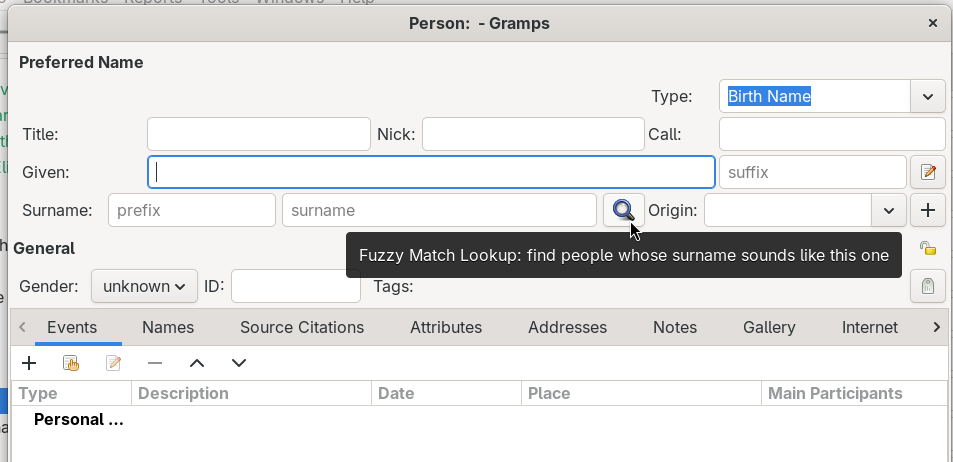

# PR2485 Edit Person Tweaks
<!-- undocked=false -->
[README.md](README.md) ● [CHANGELOG.md](CHANGELOG.md)

PR2485 Edit Person Tweaks makes the New Person and Edit Person dialogs a little quicker to use. Entering several surnames takes fewer clicks, you can check whether a person is already in your tree without leaving the dialog, and the columns in the Multiple Surnames table stay wide enough to read.

It is built around Gramps pull request [#2485](https://github.com/gramps-project/gramps/pull/2485) by Doug Blank, so the improvements can be tried before they become part of Gramps.

There is nothing to set up. Install the addon, restart Gramps, and open any person.

## What changes

### Multiple Surnames is ready for typing
Click **Use Multiple Surnames** (or press Ctrl+A) and the table opens with a new row already added. The cursor waits in the Prefix cell of that row, so you can start typing straight away. If the person has no surname yet, the empty row is used instead of adding a second blank one.

While the Multiple Surnames table is showing, Ctrl+A adds another surname row, the same as the **+** button below the table. Anything you were typing in a cell is kept when the new row opens.

### Fuzzy Match Lookup button
When the Fuzzy Matching addon is installed, a magnifying glass button appears to the right of the Surname field. Click it to open the Fuzzy Match Lookup window with the names you have typed. It lists people whose surnames sound similar, which helps you avoid adding someone who is already in the tree. Double-click a person in that list to open them in their own editor.

The button only appears when Fuzzy Matching is installed and not hidden, and it is hidden while the Multiple Surnames table is showing.

### A "surname" field tip
An empty Surname field now shows a faint "surname" tip, the same way the Prefix and Suffix fields already show theirs.

### Column widths that stay readable
The Multiple Surnames table now remembers the width of all five columns, and the Origin column can be resized like the others. This brings in the changes from Gramps pull request [#2485](https://github.com/gramps-project/gramps/pull/2485) by Doug Blank.

The addon also fixes a wider problem described in [Mantis issue 0014379](https://gramps-project.org/bugs/view.php?id=14379). Gramps could save a width of 2 characters for the columns of any table that was never shown on screen, such as the hidden Multiple Surnames table or an editor tab that was never opened. The next time the table opened, those columns were squeezed almost shut. With this addon, Gramps no longer saves those widths, and columns that were already squeezed go back to their normal width. This repair works in every editor, not only the Person editor.

## Requirements
Gramps 5.2 or newer, up to 6.2.

The Fuzzy Match Lookup button needs the Fuzzy Matching addon from the same addon collection. Everything else works without it.

## How it works
The addon changes the Person editor while Gramps is running. It does not change any Gramps files, so removing the addon and restarting Gramps returns everything to normal.

If a future version of Gramps already includes pull request #2485 or the fix for issue 0014379, the addon notices and leaves that part of Gramps alone.

## Known limits
A surname row that you add but leave empty stays in the list when you save.

The column width repair cannot bring back a width you set by hand before the problem squeezed it. Those columns return to the Gramps default width, and you can drag them wider again.

## Credits
Pull request [#2485](https://github.com/gramps-project/gramps/pull/2485), "Fix broken layout in the Multiple Surnames editor", is the work of Doug Blank.

Addon development and documentation by Claude AI (Anthropic), from wish coding by Brian McCullough.
