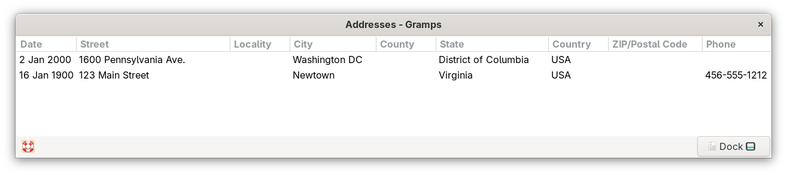

# Personenadressen
Das Gramplet Personenadressen zeigt alle Adressen der aktiven Person in einer Tabelle. Sie können die Tabelle nach jeder Spalte sortieren. So sehen Sie leicht, wo jemand gewohnt hat, in welcher Reihenfolge, und welche Angaben noch fehlen.

## Wo Sie es finden
Das Gramplet arbeitet in der Kategorieansicht **Personen**. Um es hinzuzufügen, klicken Sie auf den Pfeil oben rechts in der Seitenleiste oder Fußleiste, wählen Sie **Ein Gramplet hinzufügen** und dann **Adressen**.

Um die Tabelle in einem größeren Fenster zu sehen, docken Sie das Gramplet ab. Sie können die Fensterränder ziehen, damit alle Spalten Platz haben.

## Die Tabelle benutzen
Wenn Sie in der Ansicht Personen eine Person auswählen, zeigt die Tabelle die Adressen dieser Person. Hat die Person keine Adressen, bleibt die Tabelle leer.

Die Tabelle hat diese Spalten:
- **Datum**: das Datum der Adresse, in Ihrem bevorzugten Datumsformat
- **Straße**
- **Ortschaft**
- **Stadt**
- **Kreis**
- **Bundesland**
- **Land**
- **ZIP/Postleitzahl**
- **Telefon**

### Sortieren
Klicken Sie auf eine Spaltenüberschrift, um die Tabelle nach dieser Spalte zu sortieren. Klicken Sie noch einmal auf dieselbe Überschrift, um die Reihenfolge umzukehren. Beim Sortieren nach **Datum** stehen die Adressen in zeitlicher Reihenfolge. So erhalten Sie eine einfache Zeitleiste der Wohnorte der Person.

Sie können auch eine Spaltenüberschrift ziehen, um die Spalte zu verschieben, und den Rand einer Überschrift ziehen, um die Spalte breiter oder schmaler zu machen.

### Eine Adresse bearbeiten
Doppelklicken Sie auf eine Zeile, um den **Adresseditor** für diese Adresse zu öffnen. Wenn Sie auf **OK** klicken, speichert Gramps die Änderung bei der Person, und die Tabelle wird aktualisiert.

Die Tabelle wird auch von selbst aktualisiert, wenn dieselbe Person an anderer Stelle geändert wird, zum Beispiel im Dialog **Person bearbeiten**.

## Danksagung
Dieses Gramplet entstand als Antwort auf eine Anfrage von J_Hermann im Beitrag [Personenbaumansicht: Ist es möglich, die Felder zu erweitern?](https://discourse.genealogy.net/t/personenbaumansicht-ist-es-moeglich-die-felder-zu-erweitern/834190) auf Genealogy.net ([gramps-l](https://discourse.genealogy.net/c/gramps-l/66)).

Der Programmcode, diese Anleitung und die neuen Übersetzungstexte wurden von Claude AI (Anthropic) geschrieben, nach Wunsch-Programmierung („wish coding“) von Brian McCullough. Der Aufbau folgt dem Gramplet Extended Person Attributes von Nick Hall und Gary Burton.

Diese deutsche Fassung wurde von Claude AI übersetzt und noch nicht von einem Muttersprachler geprüft.

## Annahmen
- Das Gramplet wird nur in der Kategorieansicht Personen angeboten, wie das Gramplet Extended Person Attributes, das als Vorbild diente.
- Ein Doppelklick öffnet den Adresseditor (nicht den Dialog Person bearbeiten), damit Sie direkt zu der angeklickten Adresse gelangen.
- Adressen ohne Datum stehen beim Sortieren nach Datum ganz oben.
- Das Merkmal Privat, die Fundstellen und die Notizen einer Adresse werden in der Tabelle nicht angezeigt.
- In der Gramplet-Liste heißt das Gramplet **Adressen**, der Name des Plugins ist **Personenadressen**.
