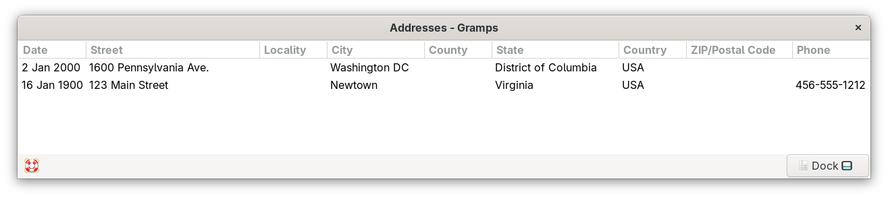

# Person Addresses
The Person Addresses gramplet shows every Address recorded for the active Person in one table. You can sort the table by any column, so it is easy to see where someone lived, in what order, and which details are still missing.

## Where to find it
The gramplet works in the People category view. To add it, click the drop-down arrow at the top right of the Sidebar or Bottombar, choose **Add a gramplet**, and then choose **Addresses**.

To see the table in a larger window, undock the gramplet. You can drag the window edges to make room for all of the columns.

## Using the table
When you select a person in the People view, the table fills with the addresses of that person. If the person has no addresses, the table is empty.

The table has these columns:
- **Date**: the date of the address, shown in your preferred date format
- **Street**
- **Locality**
- **City**
- **County**
- **State**
- **Country**
- **ZIP/Postal Code**
- **Phone**

### Sorting
Click a column heading to sort the table by that column. Click the same heading again to reverse the order. Sorting by **Date** puts the addresses in calendar order, so it gives a simple timeline of where the person lived.

You can also drag a column heading to move the column, and drag the edge of a heading to make the column wider or narrower.

### Editing an address
Double-click a row to open the **Address Editor** for that address. When you click **OK**, Gramps saves the change to the person, and the table updates.

The table also updates by itself when the same person is changed somewhere else, such as in the **Edit Person** dialog.

## Credits
This gramplet was made in answer to a request by J_Hermann in the posting [Personenbaumansicht: Ist es möglich, die Felder zu erweitern?](https://discourse.genealogy.net/t/personenbaumansicht-ist-es-moeglich-die-felder-zu-erweitern/834190) on Genealogy.net ([gramps-l](https://discourse.genealogy.net/c/gramps-l/66)).

The code, this README and the new translation strings were written by Claude AI (Anthropic), from wish coding by Brian McCullough. The design follows the Extended Person Attributes gramplet by Nick Hall and Gary Burton.

## Assumptions I made
- The gramplet is offered only in the People category view, like the Extended Person Attributes gramplet it is modeled on.
- Double-click opens the Address Editor (not the Edit Person dialog), so you go straight to the address you clicked.
- Addresses without a date sort to the top when sorting by Date.
- The Private flag, Citations and Notes of each address are not shown in the table.
- The gramplet title in the gramplet list is **Addresses**, and the plugin name is **Person Addresses**.
