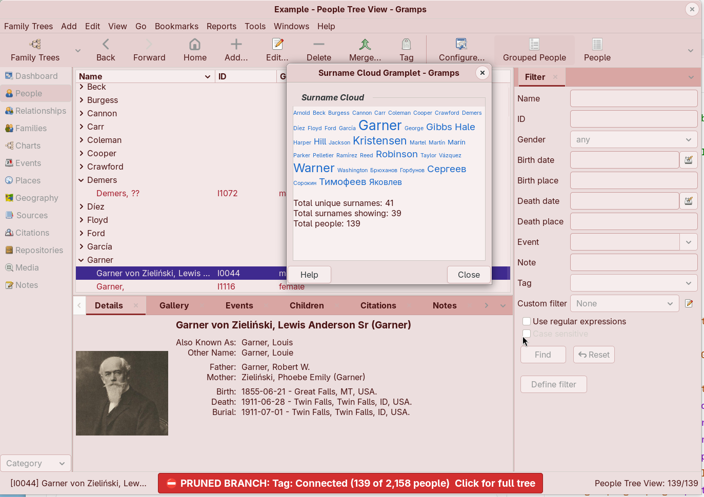
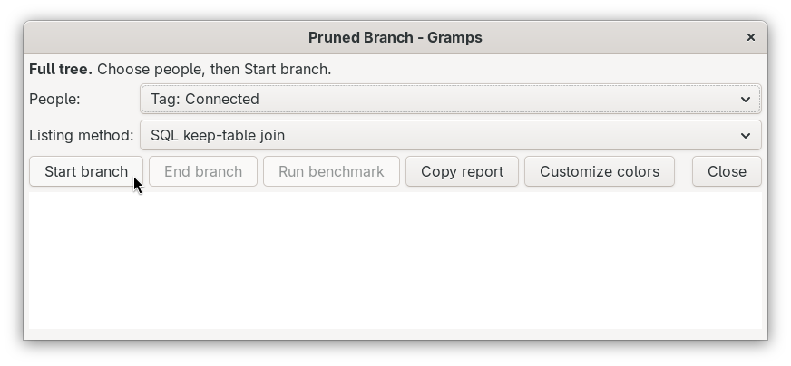

# Pruned Branch — Gramps Addon  ** ⚠ * EXPERIMENTAL PROTOTYPE * ⚠ **
<!-- undocked=false -->
[README.md](README.md) ● [CHANGELOG.md](CHANGELOG.md) ● [DEVELOPER.md](DEVELOPER.md)

## Overview
Pruned Branch lets you work on one branch of a large Family Tree as if it were a small one. You choose the branch, for example the 2,500 people of one family line out of 65,000. Until you end the session, the list views, filters, Dashboard gramplets, reports and most tools of Gramps see only that branch, so work that normally scans the whole tree goes much faster.

Nothing is removed from the Family Tree. Every edit, addition and deletion is saved to the full tree. Pruned Branch only changes which records Gramps *lists*.

## Before you start
Make a backup (Family Trees > Make Backup). A backup always contains the whole tree, even during a session, but it is good practice before you try any experimental addon.

Mark the people of the branch in one of two ways:
- give them a **tag**, or
- write a **Person custom filter** (Edit > Filter editor > Person filters), for example "Descendants of a person".

## Start a session
1. Open **Tools > Utilities > Pruned Branch**.
2. In **People**, choose a tag ("Tag: …") or a custom filter ("Filter: …").
3. Leave **Listing method** at **SQL keep-table join** unless you are comparing speeds.
4. Click **Start branch**.

The tags that you used most recently for this Family Tree are at the top of the **People** list, and the last one is already selected. Each Family Tree keeps its own list.

Gramps selects the people, then adds every record that they use: their families, events, places (including the enclosing places, such as county and country), citations, sources, repositories, media and notes. A family is included only when a parent or a child is in the branch, and an event only when a person or a family of the branch uses it.

The views and the Dashboard then reload with only the branch. The Active Person stays the same.

## How you know a session is active
The session is meant to be impossible to miss:
- The main window changes from shades of grey to a light rose tint: menu bar, menus, toolbar, lists, tabs, gramplets and status bar. Detached gramplet windows change too.
- The window title starts with **⛔ PRUNED BRANCH**, the name of the branch, and the number of people (for example "2,513 of 65,012 people").
- A large red button in the middle of the status bar shows the same text. **Click it to return to the full tree.**

## What the session limits
- All list views (People, Families, Events, Places, Sources, Citations, Repositories, Media, Notes) and the place tree.
- Sidebar filters and custom filters.
- Gramplets that count or list records, such as Surname Cloud, Top Surnames, Statistics, Records and To Do.
- Reports, and tools that list records.

## What always uses the full tree
- Opening, editing and saving any record. A person in the branch keeps all links to parents, spouses and children outside the branch. Saving never removes those links.
- The Relationships view, the charts and the What's Next gramplet, which follow links from one person to the next. They can show relatives outside the branch.
- Undo and redo.
- New Gramps IDs. They are unique in the whole tree.
- Backlinks ("References" tabs). A record is never treated as unused only because the records that use it are outside the branch.
- Family Trees > Make Backup, the automatic backup, the backup on exit, and every export (Family Trees > Export). To export only the branch, use the person filter in the Export Assistant.
- Tags. The tag lists always show every tag.

## Open editors
Starting or ending a session reloads every view, and Gramps closes open editors without saving when that happens. So Pruned Branch will not start or end a session while an editor is open (for example Edit Person or Edit Event). It lists the open editors instead. Save or cancel them, then try again.

## Tools during a session
When you start a tool from the Tools menu, Pruned Branch asks first:
- For the **Family Tree Repair** tools (for example Check and Repair Database), you can only end the session and then run the tool on the full tree, or cancel.
- For other tools, you can run the tool on the branch only, end the session and run on the full tree, or cancel. For example, Find Possible Duplicate People on the branch only is fast and can be useful.

Reports run on the branch without asking.

## Records added during a session
- Every new record (person, family, event, place, and so on) joins the branch automatically.
- When you link an existing person outside the branch to a family in the branch (for example, as a new child), that person joins the branch. The events and other records of that person do not join. That person can be missing from the list views until the next session start.
- Deleted records leave the branch.

## End a session
Use any of these:
- Click the red button in the status bar.
- Click **End branch** in the Pruned Branch tool.
- Choose **End branch, then run** when a tool asks.

Opening another Family Tree or closing the tree also ends the session.

## Customize the colors
Click **Customize colors** in the Pruned Branch tool. This opens the session stylesheet in your default text editor. It is the file `media/pruned_branch.css` in the addon folder:

`~/.local/share/gramps/gramps60/plugins/PrunedBranch/media/pruned_branch.css` (Linux)

Changes apply the next time a session starts. Updating the addon replaces this file, so keep a copy of your changes.

The Pruned Branch colors are stronger than the CSS themes and patches of the Themes addon. A `gramps_user.css` file from the Themes addon is stronger than Pruned Branch.

## Benchmark
Click **Run benchmark** to measure how much faster the branch is. The report compares the full tree with the branch for each record type, sorted lists, the place tree, and the filter chosen in **People**.

You can run the benchmark before you start a session, to find out whether a branch is worth it. Pruned Branch then builds a trial branch from the **People** choice and measures it, but Gramps stays on the full tree and nothing changes on screen. During a session, the benchmark measures the active branch and also reports how long the views took to switch.

Run it twice: the first full-tree pass also loads the tree into the disk cache, so the second report is more accurate. Click **Copy report** to copy the text.

## Requirements and limitations
- Gramps 6.0 or newer, with an SQLite Family Tree (the default). Other database backends work, but more slowly.
- Only the tags that started a session are remembered. The listing method and custom filter choices are not saved.
- Editors and other dialogs keep their normal colors. When the window manager draws the title bar of a window, that title bar keeps its normal colors too.
- The parent family of a branch person stays in the branch, with its family events, even when neither parent is in the branch.
