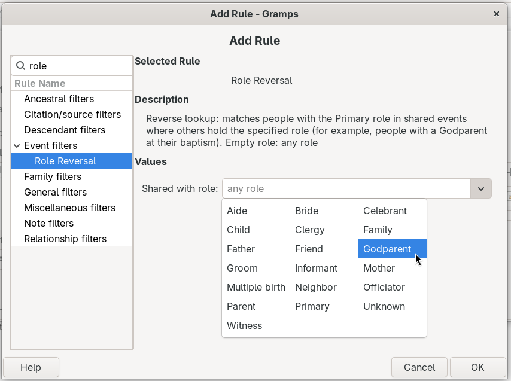

# Role Reversal Rule
<!-- edit=False status=True browse=False undocked=True -->
[README.md](README.md) ● [CHANGELOG.md](CHANGELOG.md)

Role Reversal Rule is a Gramps addon that adds a custom filter rule for a "reverse lookup" of shared events. You choose the role that **other** participants hold in an event, and the rule finds the person or family at the center of that event:
- In the People view, the **Role Reversal** rule finds people with the **Primary** role in an event where someone else holds the chosen role.

- In the Families view, the **Role Reversal** rule finds families with the **Family** role in an event where someone else holds the chosen role.

For example, choose **Godparent** to find the people who have a godparent recorded at their baptism.

The addon was written for a request in a [Gramps user group on Facebook](https://www.facebook.com/groups/370692133138445/?multi_permalinks=3320596891481273): find the people (and families) who have a Godparent in one of their events.

## Contents
- [Install](#install)
- [Example: people with a godparent](#example-people-with-a-godparent)
- [Add the rule to a custom filter](#add-the-rule-to-a-custom-filter)
- [The Shared with role box](#the-shared-with-role-box)
- [More examples](#more-examples)
- [Limits](#limits)
- [Credits](#credits)
- [AI disclosure](#ai-disclosure)

## Install
Install the addon with the Gramps Addon Manager, from the [Emyoulation curated Gramps plug-ins](https://github.com/emyoulation/CuratedGrampsPlugins/) project. If that addons project is not in your Addon Manager yet, add it as the project page describes. Restart Gramps after you install the addon.

Addon Manager projects URLs:
* `https://raw.githubusercontent.com/emyoulation/CuratedGrampsPlugins/master/gramps52`
* `https://raw.githubusercontent.com/emyoulation/CuratedGrampsPlugins/master/gramps60`
* `https://raw.githubusercontent.com/emyoulation/CuratedGrampsPlugins/master/gramps61`

The addon works with Gramps 5.2, 6.0 and 6.1. In the Plugin Manager, it is listed as **Person Role Reversal** and **Family Role Reversal**.

## Example: people with a godparent
In Gramps, a godparent is usually recorded by sharing the Baptism (or Christening) event of the child: the child has the **Primary** role in the event, and each godparent has the **Godparent** role in the same event. The Event Reference Editor sets the role.

To find every person who has a recorded godparent:
1. Go to the People view.
2. Make a custom filter with one rule: **Role Reversal**, with **Shared with role** set to **Godparent**.
3. Save the filter, and choose it in the Custom filter list of the Filter sidebar.
4. Click **Find**.

The view then shows the children who have a godparent. The godparents themselves are not in the list, because their role in the event is Godparent, not Primary. This is the "reversal": you search by the role of the godparent, and you get the child.

To find families, make the same filter in the Families view. For example, choose **Witness** to find the families with a witness recorded for their marriage, or **Godparent** if you record baptisms as family events.

## Add the rule to a custom filter
1. Go to the People view (or the Families view).
2. Open the filter editor with **Edit > Person Filter Editor** (or Family Filter Editor), and click **+** to define a new filter.
3. In the Define filter dialog, click **+** to add a rule.
4. In the rule list, open **Event filters** and select **Role Reversal**.
5. Set the **Shared with role** box, or leave it empty.
6. Click **OK**, give the filter a name, and save it.

## The Shared with role box
The box lists the standard Gramps event roles and the custom roles that are already used in your family tree. You can also type a role.
- **A role**: only events where another person or family holds that role are a match.
- **Empty** (the box shows "any role"): every event that another person or family also references is a match.

The rule saves a standard role by its English name, so a filter keeps working when you change the language of Gramps. A custom role is saved as you typed it, and it must match the custom role in your events exactly, uppercase and lowercase letters included.

## More examples
| To find | View | Shared with role |
|---|---|---|
| People with a recorded godparent | People | Godparent |
| Families with witnesses to an event | Families | Witness |
| People with an informant for an event (for example, a death) | People | Informant |
| People who share an event as Primary with another person (for example, one census record for a whole household) | People | Primary |
| People with any shared event | People | (empty) |

## Limits
- The rule finds the person or family with the **Primary** or **Family** role. It does not find the other participants (the godparents or the witnesses).
- Only people and families are counted as other participants.
- The rule does not look at the event type. To find only baptisms with a godparent, add a second rule for the event type to the same filter.

## Credits
- Requested in a [Gramps user group on Facebook](https://www.facebook.com/groups/370692133138445/?multi_permalinks=3320596891481273).
- Addon by Brian McCullough.

## AI disclosure
This addon was substantially written with an AI tool, as the Gramps [AI generated code policy](https://www.gramps-project.org/wiki/index.php/Howto:_Contribute_to_Gramps#AI_generated_code) asks contributors to disclose.
```
Generated-by: Claude Opus 5.5 (claude-opus-5-5), Anthropic, via the claude.ai chat interface, 2026
Prompted by: Brian McCullough
```
- **Prompts (summary):** a Person rule and a Family rule that find people with the Primary role (and families with the Family role) in an event that is shared with someone else, with a text combo box to select the role of the other participant; the original request was for the Godparent role. Then the "Role Reversal" naming of the addon and its rules.
- **Guidelines:** written in "draft mode", so the Gramps [AGENTS.md](https://github.com/gramps-project/gramps/blob/master/AGENTS.md) style rules (type hints, docstrings for every method, pylint and others) were not applied. The code is formatted with Black.
- **Testing:** the rule logic was checked by the AI on a small SQLite family tree with Gramps 6.0, and the role box was checked with GTK 3 on a virtual display.
