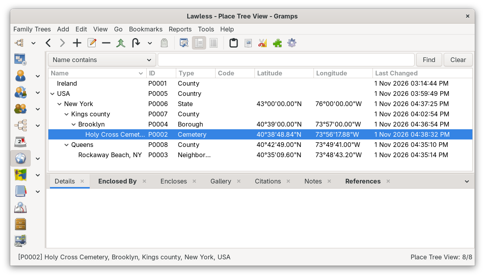
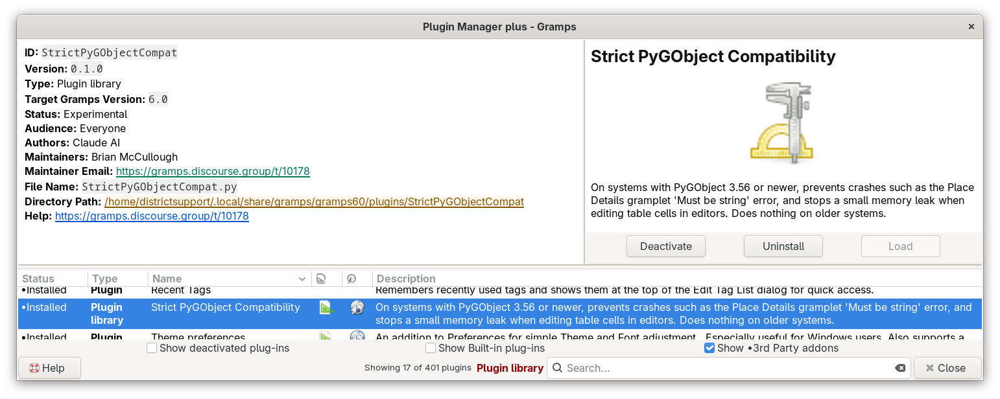
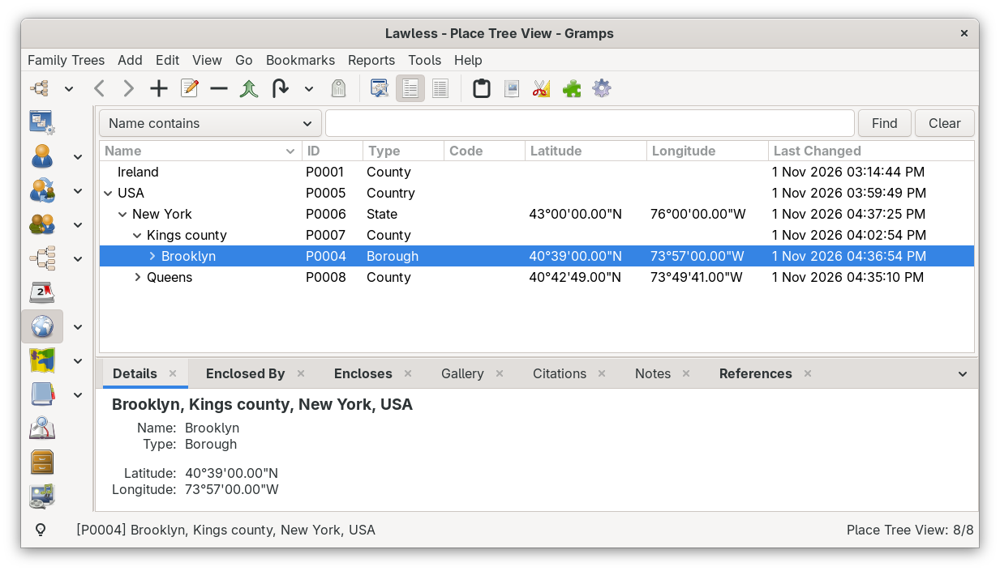
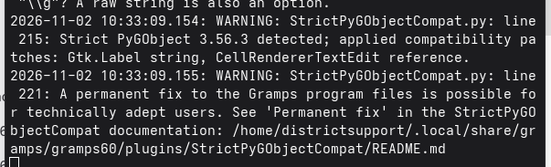

# Strict PyGObject Compatibility
Welcome! This small helper keeps Gramps running smoothly on newer computers. It works quietly in the background, and most of the time you will never notice it is there. On systems that need it, it prevents some parts of Gramps from stopping with an error.

## Do you need this?
You probably need this helper if any of these things happen to you:

- The Details tab at the bottom of the Places views stays empty when you select a place.
- Gramps shows a "Gramps has experienced an unexpected error" message when you switch to the Places view.
- After that error, other views (such as Relationships) stop updating until you restart Gramps.
- You start Gramps from a terminal window and see a message that ends with the words "Must be string, not" followed by a name such as PlaceType.
- You see a terminal message that begins with `RuntimeWarning: Adding extra reference for <Gtk.Entry` after you edit a cell in a table inside an editor, such as the list of multiple surnames in Edit Person.



*Before: a place is selected, but the Details tab stays empty.*

This is what the terminal window shows at the same moment:

```
Warning: History: Exception occurred in callback function.
Traceback (most recent call last):
  File "/usr/lib/python3.14/site-packages/gramps/gen/utils/callback.py", line 424, in emit
    fn(*args)
    ~~^^^^^^^
  File "/usr/lib/python3.14/site-packages/gramps/gen/plug/_gramplet.py", line 316, in update
    self._generator = self.main()
                      ~~~~~~~~~^^
  File "/usr/lib/python3.14/site-packages/gramps/plugins/gramplet/placedetails.py", line 111, in main
    self.display_place(place)
    ~~~~~~~~~~~~~~~~~~^^^^^^^
  File "/usr/lib/python3.14/site-packages/gramps/plugins/gramplet/placedetails.py", line 131, in display_place
    self.add_row(_("Type"), place.get_type())
    ~~~~~~~~~~~~^^^^^^^^^^^^^^^^^^^^^^^^^^^^^
  File "/usr/lib/python3.14/site-packages/gramps/plugins/gramplet/placedetails.py", line 80, in add_row
    value = Gtk.Label(label=value, halign=Gtk.Align.START)
  File "/usr/lib64/python3.14/site-packages/gi/overrides/__init__.py", line 357, in new_init
    return super_init_func(self, **new_kwargs)
TypeError: Must be string, not PlaceType
```

These problems appear after updating to a newer version of your operating system, or a newer Gramps installer. Your family tree data is safe. The problem is only in how Gramps shows some information on the screen.

If you are not sure, it is fine to install it anyway. On computers that do not need it, the helper checks once when Gramps starts and then does nothing at all.

## Why does this happen?
Gramps uses a supporting piece of software called PyGObject to draw its windows, buttons and labels. A recent update to PyGObject made it more strict about the kind of information it accepts. Some older parts of Gramps, and some addons, were written when PyGObject was more forgiving. When those parts meet the strict version, they stop with an error.

This helper teaches the strict version to be forgiving again in the place where most of these errors happen: the text labels that Gramps shows on the screen. It also repairs the table cells in editors, so that each edit no longer leaves a small piece of memory behind until Gramps closes.

## Installing
1. Open the Addon Manager in Gramps.
2. Find "Strict PyGObject Compatibility" in the Emyoulation addons collection and install it.
3. Close Gramps and start it again. The helper only does its work when Gramps starts.



*After installing, the helper appears in the list of installed plugins.*

## How do you know it is working?
There is nothing new to see in Gramps. The best sign is that the errors described above stop happening.



*After: the Details tab shows the selected place again, including its Type.*

If you start Gramps from a terminal window, you can see a short message when the helper is active:

`Strict PyGObject 3.56.0 detected; applied compatibility patches: Gtk.Label string, CellRendererTextEdit reference.`

If the Gramps program files themselves still contain the two problems, a second message follows. It says that a permanent fix is possible for technically adept users and shows where to find this document. See "Permanent fix" below.



*Messages from the helper in the terminal window.*

You may also see messages that begin with "Converted". Each one points to a spot in Gramps or an addon that needs a small repair by its authors. These messages are helpful to include if you report a problem on the Gramps forum, but you do not need to do anything about them yourself.

If you see no message at all, your computer does not need the helper, and it is resting.

## Removing it
When future versions of Gramps and your addons have been repaired, you may not need this helper anymore. You can uninstall it in the Addon Manager at any time and restart Gramps. Nothing in your family tree changes when you add or remove it.

## What it cannot fix
This helper covers text labels, which is where these errors are most common. If a different kind of screen element has the same problem, you may still see an error. Please report it on the Gramps forum and include the message from the terminal window, so it can be added.

## Permanent fix (for technically adept users)
The helper repairs the problems each time Gramps starts. If you are comfortable with a terminal window and administrator access, you can instead repair the two Gramps program files that cause them. This section applies to Gramps 5.2 and 6.0. Keeping the helper installed afterwards is still a good idea, because it also protects you from the same label problem in addons.

The helper folder includes two repaired files, `placedetails.py` and `cellrenderertextedit.py`. Each one is a copy of the Gramps 6.0.8 file with one line changed. The program code in these two files is the same in Gramps 5.2.4 and 6.0.8, so the copies fit both. The steps below are written for Linux. On Windows and macOS, the same two files are inside the Gramps installation folder, and replacing them needs administrator rights.

1. Find the Gramps program folder. This command prints it (on Fedora 44 it prints `/usr/lib/python3.14/site-packages/gramps`):
   ```bash
   /usr/bin/python3 -sP -c "import gramps, os; print(os.path.dirname(gramps.__file__))"
   ```
2. Store that folder, and the helper folder, in two shortcuts for the next steps. Use `gramps52` instead of `gramps60` for Gramps 5.2:
   ```bash
   G=/usr/lib/python3.14/site-packages/gramps
   A=~/.local/share/gramps/gramps60/plugins/StrictPyGObjectCompat
   ```
3. Compare each Gramps file with its repaired copy. The only differences should be the license wording at the top and the one repaired line. If you see other differences, your Gramps release does not match, so stop and do not copy that file.
   ```bash
   diff "$G/plugins/gramplet/placedetails.py" "$A/placedetails.py"
   diff "$G/gui/widgets/cellrenderertextedit.py" "$A/cellrenderertextedit.py"
   ```
4. Keep a backup of each original file:
   ```bash
   sudo cp "$G/plugins/gramplet/placedetails.py" "$G/plugins/gramplet/placedetails.py.orig"
   sudo cp "$G/gui/widgets/cellrenderertextedit.py" "$G/gui/widgets/cellrenderertextedit.py.orig"
   ```
5. Copy the repaired files into place:
   ```bash
   sudo cp "$A/placedetails.py" "$G/plugins/gramplet/"
   sudo cp "$A/cellrenderertextedit.py" "$G/gui/widgets/"
   ```
6. Start Gramps from a terminal window. The message about a permanent fix no longer appears.

To undo the repair, copy the `.orig` files back over the repaired ones, or reinstall Gramps (on Fedora: `sudo dnf reinstall gramps`). A Gramps update also replaces these files. If the permanent fix message comes back after an update, the new files still need the repair, and you can repeat the steps above.

## Technical note for developers
PyGObject 3.55.0 (first stable release 3.56.0, February 2026) merged MR !469, "Unify properties handling". Constructor keyword arguments for properties that have introspection data now go through `pygi_set_gvalue_for_pspec` and strict typed conversion. Previously they went through `pyg_param_gvalue_from_pyobject`, which fell back to `PyObject_Str()` for string properties. As a result, `Gtk.Label(label=obj)` where `obj` is a `GrampsType`, `int` or similar now raises `TypeError: Must be string, not <type>`. Properties without introspection data, such as properties defined in Python, keep the lenient path.

At registration (`load_on_reg`, GUI sessions only), the addon probes with `Gio.SimpleAction(name=1)`, which needs no display. If the probe raises `TypeError`, the addon wraps `Gtk.Label.__init__` so that a non-string first positional argument or `label` keyword is passed through `str()`. `None`, `str` and `bytes` are left untouched. The wrapper is marked, so a plugin reload does not wrap it twice. The first conversion from each calling line is logged with its file and line number, which makes each log entry a ready-made upstream bug report.

The same PyGObject release changed how a Python vfunc may return a new object that nothing else references. Version 3.54 added a reference and handed ownership back to GTK silently. Version 3.56 adds the reference, warns (`RuntimeWarning: Adding extra reference … bugzilla.gnome.org/show_bug.cgi?id=687522`) and never releases it. The PyGObject source notes that its reference-count check does not hold on Python 3.14. Gramps `CellRendererTextEdit.do_start_editing` (`gramps/gui/widgets/cellrenderertextedit.py`) returns a new `Gtk.Entry` with no Python reference, so every cell edit in an `EmbeddedList` leaks one entry. Because PyGObject binds a vfunc to the function present when the class is created, reassigning `do_start_editing` on the existing class has no effect. The addon instead defines a subclass whose `do_start_editing` calls the original and keeps the returned entry on the renderer until the next edit, then rebinds `CellRendererTextEdit` in the `embeddedlist` module globals, which is the only place Gramps 5.2 and 6.0 create the renderer. Tested on Python 3.14 with PyGObject 3.56.0: without the patch, none of six edited entries were finalized and six warnings appeared; with it, there were no warnings and every entry except the one still held was finalized. Each patch is applied independently, so a failure in one does not block the other.

After patching, the addon checks whether the installed core files still contain the bugs: a regular expression on the source of `placedetails.py`, and `inspect.getsource` on `CellRendererTextEdit.do_start_editing` looking for `self.<name> = entry`. Only if one of them is unfixed does it log the second message that points to the "Permanent fix" section. The bundled repaired copies keep the CRLF line endings of the original `cellrenderertextedit.py`.

Only `Gtk.Label` is wrapped for the string conversion, on purpose. A global shim for all string properties would hide new bugs and depend on PyGObject internals. Other widgets (for example `Gtk.Entry(text=...)` or `Gtk.Button(label=...)`) can be added with the same pattern if field reports show a need.

The proper fixes in your own code are an explicit `str()` at the call site, and keeping a Python reference to any new widget that a vfunc returns. For the Place Details gramplet, upstream fixed this in commit [5608b78](https://github.com/gramps-project/gramps/commit/5608b7885130e45c78d05a4a9432180b841fa577) on the `maintenance/gramps60` branch, resolving [Mantis 0014183](https://gramps-project.org/bugs/view.php?id=14183). The fix is not in Gramps 6.0.8 or the `maintenance/gramps52` branch.

To test whether a system is strict:

`python3 -c "from gi.repository import Gio; print(Gio.SimpleAction(name=1).get_name())"`

This prints `1` on a lenient PyGObject and raises `TypeError: Must be string, not int` on a strict one.
