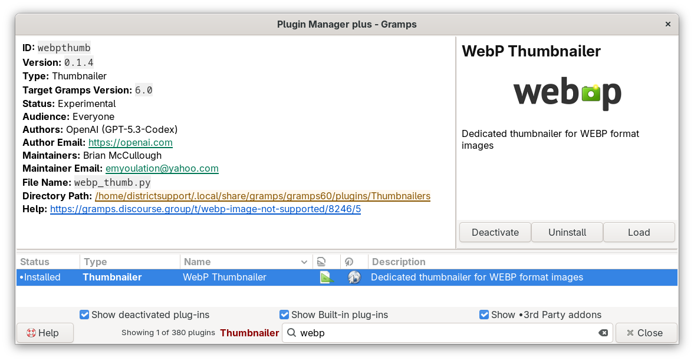

# WebP Thumbnailer for Gramps
<!-- -->
[README.md](README.md) • [CHANGELOG.md](CHANGELOG.md) • [DEVELOPER.md](DEVELOPER.md) • [.webp and .avif format (native) support in the primary OSes](webp_and_avif.md)
 
- **Plug-in type:** Thumbnailer
- **Gramps versions:** 5.2 and later
- **Status:** Experimental
- **Maintainer:** Brian McCullough
- **Package:** `Thumbnailers` in the Emyoulation collection of curated addons

## What this addon does
WebP Thumbnailer makes the small preview pictures (thumbnails) that Gramps shows in Previews and Gallery tabs for media files in the WebP format (`.webp` files, media type `image/webp`). 

Thumbnail images are cached in "normal" (up to 96x96 pixels) and "large" (up to 180x180 pixels) sizes so that previews of multi-megabyte images do not have to be made again each time they are shown.

The WebP thumbnailer tries three decoders, one after the other, until one of them works:
1. **GdkPixbuf**, the image library that Gramps uses for all other pictures.
2. **Pillow**, the Python imaging library, when it is installed.
3. **FFmpeg**, the media conversion program, when it is installed.

Because of this, WebP thumbnails appear even on a computer where GdkPixbuf cannot read WebP files. The addon also writes clear messages to the Gramps log when a `.webp` file is damaged or contains a different image format (for example AVIF data with a `.webp` name).

## WebP images in Gramps
WebP is a modern image format that makes smaller files than JPEG or PNG. Many web sites, online archives and social networks deliver their pictures as WebP files, so pictures that are downloaded for family history research are often WebP files.

Gramps can store a WebP file as a Media object, like any other file. Whether Gramps can show the picture depends on the image decoders that are installed on the computer:
- **Thumbnails:** the built-in Image Thumbnailer of Gramps uses GdkPixbuf. GdkPixbuf reads WebP only when its WebP loader is installed. Without the loader, Gramps shows a generic document icon instead of the picture. This addon solves that problem for thumbnails.
- **The full picture:** other parts of Gramps open the whole picture, for example the region selector in the Media Reference Editor and reports that include pictures. They also use GdkPixbuf, and this addon does not change them.

For complete WebP support in Gramps, install the WebP loader for GdkPixbuf:
- Fedora: `sudo dnf install webp-pixbuf-loader`
- Debian, Ubuntu and Linux Mint: `sudo apt install webp-pixbuf-loader`
- Arch Linux: `sudo pacman -S webp-pixbuf-loader`
- Windows and macOS: the Gramps installers include their own copy of GTK and GdkPixbuf, so WebP support depends on the installer version. See [.webp and .avif format (native) support in the primary OSes](webp_and_avif.md).

**Tips:**
- Gramps decides the media type from the file name extension. The Media Editor shows it in the **Type** field; it must be `image/webp` for this addon to make the thumbnail.
- When a picture must work everywhere (for example in a report, or in a file for another genealogy program), keep a JPEG or PNG copy of the WebP picture.

## Installation
### With the Addon Manager (recommended)
WebP Thumbnailer is part of the Emyoulation collection of curated addons, [CuratedGrampsPlugins](https://github.com/emyoulation/CuratedGrampsPlugins/). Add the collection to the Addon Manager once; after that, the Addon Manager also shows updates.
1. Open **Edit → Addon Manager…**
2. Open the **Projects** tab and click the **+** button (**Insert a project**).
3. Type a **Project name**, for example `Emyoulation`, and the **URL** for your version of Gramps:
    - Gramps 5.2: `https://raw.githubusercontent.com/emyoulation/CuratedGrampsPlugins/master/gramps52`
    - Gramps 6.0: `https://raw.githubusercontent.com/emyoulation/CuratedGrampsPlugins/master/gramps60`
    - Gramps 6.1: `https://raw.githubusercontent.com/emyoulation/CuratedGrampsPlugins/master/gramps61`
4. Make sure that the check box of the new project is selected.
5. Open the **Addons** tab and click **Refresh**.
6. Set the **Status** filter to **All statuses**. WebP Thumbnailer is *Experimental*, and the default filter hides Experimental addons.
7. Find **WebP Thumbnailer** and click **Install**.
8. Restart Gramps.

### Optional helpers
GdkPixbuf is always installed with Gramps. Pillow and FFmpeg are optional; they are used only when GdkPixbuf cannot read a WebP file.
- **Pillow:** install the system package, for example `python3-pillow` on Fedora or `python3-pil` on Debian and Ubuntu. Some Gramps installations do not see Python modules that were installed with `pip install --user`, so the system package is the safer choice.
- **FFmpeg:** install the `ffmpeg` package of your system.

## Using the addon
There is nothing to set up. After the restart, Gramps uses WebP Thumbnailer automatically for every WebP file.

Gramps does not keep a failed thumbnail, so WebP files that showed a generic icon before get their real thumbnail the next time Gramps shows them.

To check that the addon is active, open **Help → Plugin Manager** and look for **WebP Thumbnailer**, with the type Thumbnailer.

## Thumbnails in Gramps
A thumbnail is a small PNG copy of a picture. Gramps shows thumbnails in the Media view, in the Gallery tabs of the editors, in the Media Reference Editor and in several gramplets.

**Thumbnailers** are the plugins that make thumbnails. For each media file, Gramps tries the thumbnailers that accept the media type of the file, one after the other, until one of them succeeds. If none succeeds, Gramps shows a generic icon.

| Thumbnailer | Comes with | Media types |
|---|---|---|
| WebP Thumbnailer | This addon | `image/webp` only; Gramps tries it first for WebP files |
| Image Thumbnailer | Gramps | All `image/*` types that GdkPixbuf can read |
| Gnome Thumbnailer | Gramps | Other types (for example PDF or video files) for which the operating system has a thumbnailer program registered; mainly on Linux |

**Sizes:** Gramps makes thumbnails in two sizes, normal (96 pixels on the long side) and large (180 pixels on the long side).

**Regions:** when a Media reference selects a region of a picture (for example one face in a group photo), Gramps makes a separate thumbnail of that region. One picture can therefore have several thumbnails.

**The thumbnail cache:** Gramps saves the thumbnails in its cache folder, `~/.cache/gramps/thumb/normal` and `~/.cache/gramps/thumb/large` on Linux (on other systems, in a `gramps/thumb` folder inside the user cache folder). Gramps makes a new thumbnail when the original file is newer than the saved thumbnail. It is safe to delete the files in the cache folder; Gramps makes them again when it needs them.

## Troubleshooting
WebP Thumbnailer writes its messages to the Gramps log under the name `.thumbnail`. Warnings appear in the terminal window from which Gramps was started. To also see the information and debug messages, start Gramps with `gramps --debug=.thumbnail`.

| Message | Meaning and solution |
|---|---|
| No WEBP thumbnail for … ffmpeg fallback unavailable | No decoder could read the file. Install the GdkPixbuf WebP loader, Pillow or FFmpeg (see above). |
| MIME/content mismatch for thumbnail decode | The content of the file does not match its media type, for example AVIF data in a file named `.webp`. Rename the file with the correct extension. |
| File appears to be AVIF data mislabeled as WEBP | The file contains an AVIF picture. Rename it to `.avif`. |
| Pillow WEBP fallback failed, followed by a header diagnostic | The file is probably damaged or incomplete. Download it again or replace it. |
| GdkPixbuf decoded WEBP but writing the thumbnail failed | The picture was read, but the thumbnail could not be saved. Check that the thumbnail cache folder can be written and that the disk is not full. |

## Credits
- **Addon:** first designed and written with the help of OpenAI GPT-5.3-Codex (April 2026); fixes in October 2026 by Claude (Anthropic, Claude Opus 5.5), wish coding by Brian McCullough. Maintainer: Brian McCullough.
- **Development plan:** see [DEVELOPER.md](DEVELOPER.md).

### Credits for the WebP format
The WebP image format was created by **Google**, which announced it on September 30, 2010. Official site: [WebP — An image format for the Web](https://developers.google.com/speed/webp).
- **Lossy compression** uses the key frame (intra-frame) coding of the **VP8** video codec ([RFC 6386](https://datatracker.ietf.org/doc/rfc6386/)). VP8 was created by **On2 Technologies**. Google bought On2 in 2010 and released VP8 as an open, royalty-free format.
- **Lossless compression** is a newer method, not related to VP8, designed by Google engineer **Jyrki Alakuijala**.
- **The file container** is based on the Resource Interchange File Format (RIFF) from Microsoft and IBM.
- **The specification** is [RFC 9649, "WebP Image Format"](https://datatracker.ietf.org/doc/rfc9649/) (IETF, November 2024), by **James Zern**, **Pascal Massimino** and **Jyrki Alakuijala**. It also registers the `image/webp` media type, which is the type this thumbnailer handles.
- **The reference implementation** is the `libwebp` library from Google and the [WebM Project](https://www.webmproject.org/code/#libwebp-webp-image-library), released under a BSD license.

## See also
- Discourse forum: [.webp and .avif format (native) support in the primary OSes](https://gramps.discourse.group/t/webp-and-avif-formats/9841)
- Discourse forum: [WebP image not supported](https://gramps.discourse.group/t/webp-image-not-supported/8246/5)
- [.webp and .avif format (native) support in the primary OSes](webp_and_avif.md) (in this addon)
