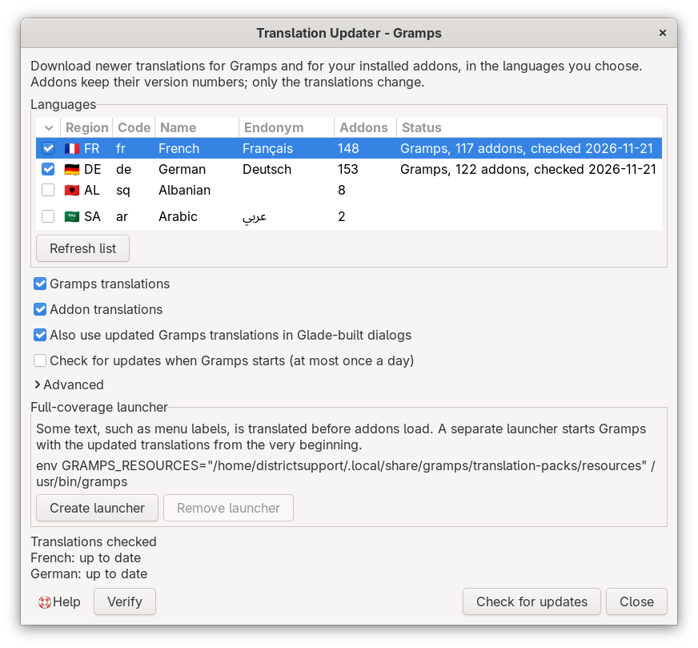
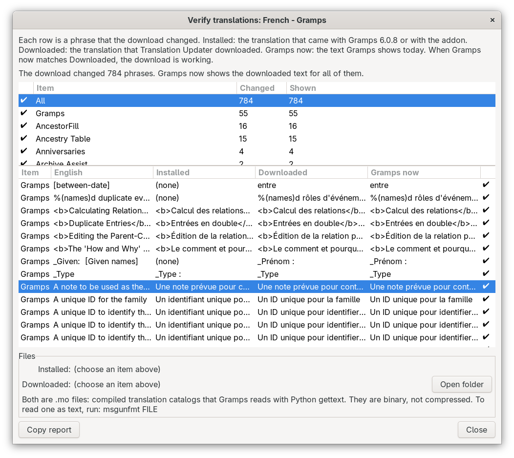

# Translation Updater
<!-- edit=True status=True browse=True undocked=True -->

Translators improve the Gramps translations every day, but those improvements usually reach you only when Gramps or an addon gets a new release. Translation Updater brings them to you sooner. Choose the languages you use, press one button, and Gramps and your installed addons pick up the newest translations. The addons themselves stay exactly as they are, with the same version numbers.



## What it does
Volunteer translators work on the Gramps and addon translations in Weblate. Every day, those translations are collected and published as small language packs. Translation Updater downloads the packs for the languages you choose, and only for the addons you have installed.

Translators usually work on the newest Gramps version. When a phrase in your Gramps is word for word the same as in the newest version, the packs use the newest translation of it. So you also get the work that translators did for the next Gramps release.

The downloaded translations are layered on top of the ones that came with Gramps and with each addon. When a downloaded pack has a translation for a phrase, that translation is used. When it does not, the original translation is used, just as before. An addon that came with no translation for your language can still use a downloaded one. Nothing inside Gramps or inside your addon folders is changed.

## Getting started
1. Open a family tree, then choose **Tools > Utilities > Translation Updater**.
2. Press **Refresh list** to see which languages are published.
3. Put a check mark next to each language you want. The language you use in Gramps is already checked the first time. Checked languages move to the top of the list.
4. Press **Check for updates**. A progress bar shows the download, and the text under the list then names what was downloaded for each language. You can keep working in Gramps while it runs.
5. Restart Gramps so that every window uses the new translations.

After the first time, you only need to repeat step 4. Only translations that changed are downloaded again.

## The Translation Updater window
**Languages** lists every published language, with the same columns as the language table in Environment Inspector: Region (with a flag), Code, Name and Endonym (the name of the language in that language). The **Addons** column shows how many addons have a published translation in that language. The **Status** column shows what was downloaded and when the language was last checked. Your checked languages stay at the top of the list. Point at a language to see what its last update brought.

**Gramps translations** downloads updated translations for Gramps itself.

**Addon translations** downloads updated translations for the addons you have installed.

**Also use updated Gramps translations in Glade-built dialogs** applies the updated Gramps translations to the dialogs that Gramps builds from Glade design files, such as many editors. This takes effect when Gramps restarts.

**Check for updates when Gramps starts** checks quietly in the background, at most once a day. When something new arrives, a message appears in the status bar.

**Advanced** shows the address the packs are downloaded from, the Gramps branch the packs are chosen for, and the folder where they are kept on your computer.

**Help** opens this document. **Verify** shows whether Gramps really uses the downloaded translations (see below). **Check for updates** downloads anything new for your chosen languages. **Close** closes the window and remembers its size.

## Checking that it works
You do not need to read a language to check that its downloaded translations reach Gramps. Click a language in the list and press **Verify**.



Each row of the lower table is a phrase that the download changed. The columns show the phrase in English, the **Installed** translation (the one that came with Gramps or with the addon), the **Downloaded** translation, and **Gramps now**: the text that Gramps shows today. When Gramps now matches Downloaded, the download is working, and the row gets a check mark. Rows that do not match are listed first.

The upper table lists Gramps and each addon, with how many phrases the download changed and how many Gramps now shows. Choose a row to see only its phrases. The **Files** area then shows where the installed and the downloaded translation files are, and **Open folder** opens the folder of the downloaded file.

Translation files are `.mo` files: compiled catalogs that Gramps reads with Python gettext. They are not plain text, so the window shows their contents for you. To read one yourself, run `msgunfmt` with the file name in a terminal.

**Copy report** copies a short text report to the clipboard, ready to paste into a forum post or an email. It names your Gramps version, where the packs came from, the totals, and a few examples.

## The full-coverage launcher
A few words in Gramps, such as some menu labels, are translated while Gramps is starting, before any addon has a chance to run. Translation Updater cannot change those words in a session that has already started.

On Linux, the **Full-coverage launcher** section can create a second menu entry called **Gramps (updated translations)**. Starting Gramps from that entry uses the updated translations from the very first moment, so every word is covered. The window also shows the matching command line, if you prefer to start Gramps from a terminal.

Press **Remove launcher** to remove the menu entry again. Your normal Gramps menu entry is never changed.

## When an update is paused
A downloaded translation is only used together with the exact files it was downloaded for. If your system installs a newer Gramps translation, or an addon update brings its own newer translation, the matching download is paused. This makes sure that an older download never hides newer work by the translators.

A paused download shows "paused" in the Status column. Press **Check for updates** to bring it up to date, and it is used again.

## Works well with Addon Locale Fix
Addon Locale Fix is a separate, small addon that corrects two old problems in how Gramps finds addon translations. With it installed, an addon that has no translation for your language still loads, and the translation that comes with an addon is used before the Gramps translation of the same phrase. Translation Updater already does this for every addon that has a downloaded translation. Addon Locale Fix does it for all addons. The two can be installed in any order.

## Where the files are kept
Downloaded packs are kept outside Gramps and outside your addon folders, in the `translation-packs` folder inside your Gramps user data folder. On Linux, that is usually `~/.local/share/gramps/translation-packs/`. Reinstalling or updating an addon does not touch them.

When you remove the check mark from a language and check for updates, the packs for that language are deleted.

Your settings are kept in `TranslationUpdater.ini`, in the same folder as the addon.

## Limitations
- Gramps needs to restart before every window shows the new translations. Text that Gramps translates each time it is shown, such as most dialogs, messages and reports, changes right away.
- Addons that start together with Gramps, and that happen to start before Translation Updater, keep their original translations until the next restart.
- A language can only be updated if Gramps itself has a translation for it installed.
- On Windows, the Glade-built dialogs and the full-coverage launcher are not available. On macOS, the full-coverage launcher is not available.
- The packs follow the Gramps branch you are running (for example, the packs for Gramps 6.0). Phrases that only exist in a newer Gramps are simply ignored.
- The Verify window leaves out phrases with plural forms, because which form a test number picks is different in each language. Those translations are still used.

## For maintainers: publishing the packs
The `server` folder holds the tools that build and publish the packs. They are not part of the installed addon.

`build_translation_packs.py` reads the Weblate translations from a copy of the gramps and addons-source repositories, compiles them, and writes one manifest per language. It also puts all the files of a language into one `pack.zip`, so that a language is one download instead of one download per addon. It needs the GNU gettext tools (`msgfmt`, `msgmerge`, `msgcat` and `msgattrib`).

```
python3 build_translation_packs.py --branch gramps60 --gramps ../gramps60 --addons ../addons60 --donor-gramps ../gramps61 --donor-addons ../addons61 --out ../site
```

The `--donor-gramps` and `--donor-addons` options let a newer branch lend its finished translations to an older one. Weblate follows one branch at a time, so without a donor an older branch stops getting translations, even for phrases that are word for word the same. A donor translation is only used for a phrase that the older branch has. If a donor translation keeps a language from compiling, that language is built from its own branch alone.

`classify_releases.py` reads the full history of an addons-source branch and writes `releases.json`, which labels every addon release as a code change, a translation update, a documentation change, a version change only, or a new addon. It needs a copy with full history, not a shallow clone.

```
python3 classify_releases.py --addons ../addons60 --branch gramps60 --out ../site/gramps60/releases.json --summary
```

`translation-packs.yml` is a GitHub Actions workflow. Copy it to `.github/workflows/` in the repository. It runs every day, builds packs and `releases.json` for each supported Gramps branch, lets the newest branch lend to the older ones, and publishes the result to the `translation-packs` branch. You can also start it by hand from the Actions tab with **Run workflow**.

To test without publishing, run the builder on your own computer and enter the output folder as the source address under **Advanced**, for example `file:///home/you/site`.

## Assumptions I made
- The addon is called Translation Updater, with a startup part and a tool under Tools > Utilities.
- The packs are published every day by GitHub Actions to the `translation-packs` branch of CuratedGrampsPlugins.
- The packs are built from the newest translations on the Gramps maintenance branches (5.2, 6.0 and 6.1), not fetched directly from Weblate, and the newest branch lends its translations to the older ones.
- Packs are downloaded only for addons that are installed in the user plugin folder.
- Checking at startup is turned off until the user turns it on.
- The full-coverage launcher is an extra menu entry, not a replacement for the normal one.
- The tool can only be opened while a family tree is open, like other tools.
- Addon Locale Fix stays a separate, optional addon rather than being built into Translation Updater.
- Two screenshots are enough: the main window shows nearly everything a user touches, and the Verify window is the proof that people will want to see.
