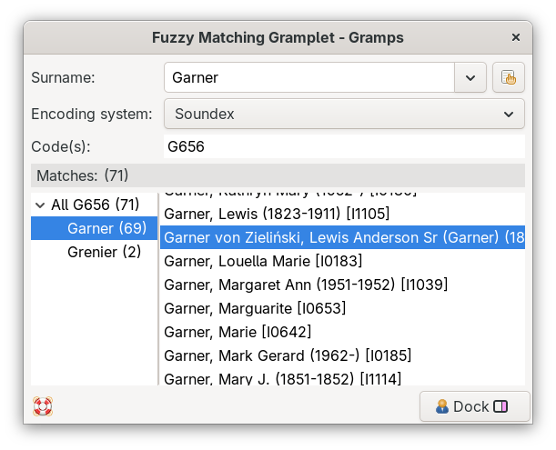
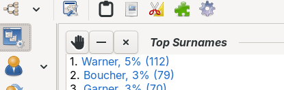

# Undocked Gramplets
<!--  -->
[README.md](README.md) ● [CHANGELOG.md](CHANGELOG.md)

Welcome. Any gramplet in a sidebar, a bottombar, or the Dashboard of Gramps can be pulled out into its own floating window. That floating window has a plain **Close** button, which does not say that closing it puts the gramplet back where it came from. Undocked Gramplets makes undocking easier to discover, makes the window clearer, and on the Dashboard it also gives the gramplet more room.

## What you get
**A Dock button instead of Close.** The button shows the icon of the view the gramplet came from and the word **Dock**. For a sidebar or bottombar gramplet, an icon after the word shows the destination. Hover over the button for a longer description. Clicking it returns the gramplet to its place, exactly as Close did before.

**A close button that really closes.** The **x** in the title bar of the floating window now closes the gramplet instead of docking it. Only the Dock button puts the gramplet back. To get a closed gramplet back, right-click the sidebar, bottombar, or Dashboard and add or restore it from the menu.

**A shorter window title.** The title bar shows only the name of the gramplet, for example **Filter - Gramps** instead of **Filter Gramplet - Gramps**. The **Windows** menu still lists it as a gramplet, so it is easy to tell apart from other open windows.

**A smarter Help button, when available.** If the Markdown Utils addon is installed and active, the standard Help button is replaced by the small unlabeled Help button from that addon. It stays in the lower left corner of the window. If Markdown Utils is not installed, is hidden in the Plugin Manager, or is too old to offer this button, the standard Help button is left exactly as it is.

## Undocking is easier to find
**A hand shows what can be dragged.** Hold the pointer over a gramplet tab in a sidebar or bottombar, or over the drag button of a Dashboard gramplet, and the pointer turns into an open hand. On the Dashboard, the drag button itself now shows a hand instead of a wrench.

**A clear sign while dragging.** While you drag, a small square follows at the lower right corner of the pointer. A green square with a white check mark means the gramplet can be dropped there. A red square with a white x means dropping there does nothing.

**No more accidental undocking.** A sidebar or bottombar tab dropped on the main panel of the view, on a sidebar or bottombar, or close to them, stays where it was. Drop it on the tabs to change their order. To undock it, drop it on the toolbar or anywhere outside the view, for example outside the Gramps window.

**A right-click menu.** Right-click a gramplet tab in a sidebar or bottombar, or the name of a Dashboard gramplet, for two choices:

- **Move** undocks the gramplet into its own window, without any dragging.
- **Help** opens the help for the gramplet, the same help the Help button of the floating window opens.

## More room for Dashboard gramplets
A gramplet undocked from the Dashboard used to keep its Dashboard decorations inside the floating window.

- **No repeated name.** The row with the gramplet name is hidden, because the title bar of the window already shows the same name.
- **No extra border.** The wide border and frame around the gramplet are removed, so the content fills the window.

Both come back as soon as the gramplet is docked. To rename (relabel) a Dashboard gramplet, dock it first, then click its name in the Dashboard.

Some addons add more views to the Dashboard category, each with its own set of gramplets. The Dock button shows the icon of the view the gramplet came from, and the tooltip names that view.

## Which gramplets are affected
Every gramplet that can be undocked, for example Filters, Fan Chart, Statistics, What's Next, or the Collections Clipboard. The addon is not tied to any one gramplet.

## Installing
1. Install the addon with the Gramps Addon Manager, or copy the **Undocked** folder into your Gramps user plugins folder.
2. Close Gramps completely and start it again. The addon takes effect at startup.

Nothing in Gramps is overwritten. The addon adjusts the floating windows while Gramps starts.

## Removing
Delete the **Undocked** folder, or hide the addon in the Plugin Manager, then restart Gramps. The original Close and Help buttons return.

## Good to know
- Your family tree data is never changed.
- Quitting Gramps does not close your floating gramplets. They open again, still floating, the next time you start Gramps, as before.
- Some custom views have no icon of their own in the current icon theme. In that case the icon of the view category is shown instead, and if neither is available the button shows only the word and the destination icon.
- The sidebar and bottombar tabs make Gramps repeat the terminal message `Gtk-WARNING: Drawing a gadget with negative dimensions`. The message is harmless, and this addon hides that one message. All other messages still appear.
- Works with Gramps 5.2 and newer.
- Runs alongside the Clipboard Ref Menu addon. The two are independent and each works without the other.

- While dragging, the pointer is the normal drag pointer of your desktop, not a hand. Outside the Gramps window it may show a small no-entry sign even where the green check mark says the gramplet will undock. Go by the green check mark or the red x.

## Troubleshooting
- **Still see the Close button:** restart Gramps completely, then check that the addon is listed and not hidden in the Plugin Manager.
- **Still see the standard Help button:** this is expected unless Markdown Utils is installed, active, and new enough to provide the smart Help button.
- **A dragged tab will not undock:** drop it on the toolbar or outside the view, where the green check mark shows, or right-click the tab and choose **Move**.
- **A gramplet disappeared:** it was probably closed with the **x** in the title bar. Right-click the place it came from and add or restore it from the menu.
